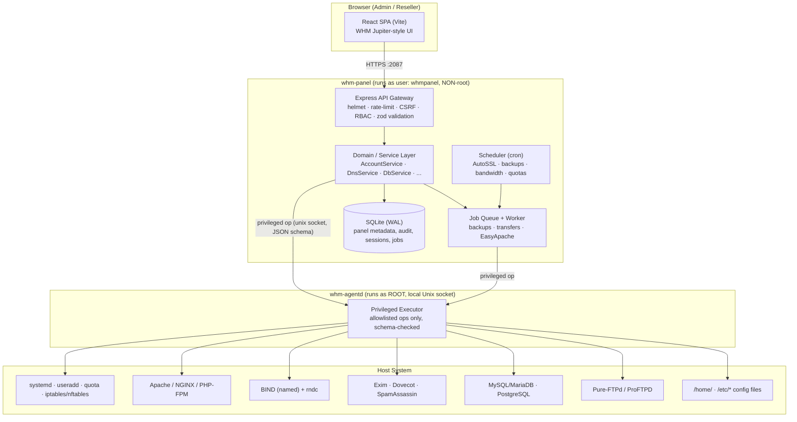
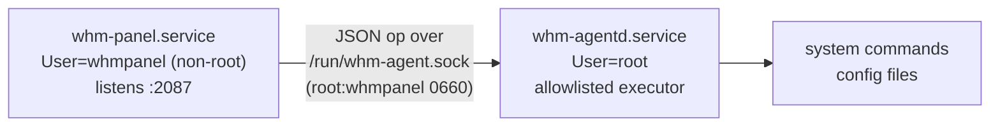

# WHM Control Panel — Full Blueprint (Architecture & Functionality)

> A production-oriented, self-hostable **Web Host Manager** clone that administers a
> real Linux server (Apache/NGINX, BIND, Exim/Dovecot, MySQL/MariaDB, FTP, systemd,
> Linux users, SSL) through a modern **Node.js + React + SQLite** stack.
>
> This document is the single source of truth for *what we are building* and *how it
> is put together*. It mirrors the WHM interface at `trywhm.net` — **all 30 sidebar
> categories and 180+ functions** — and specifies, for each function, the backend
> operation, the real system integration (commands/files touched), what is persisted,
> and the UI.

- **Status:** Design / blueprint
- **Target OS:** Ubuntu 22.04/24.04 LTS & RHEL/AlmaLinux 8/9 (systemd-based)
- **Panel ports:** `2087` (HTTPS admin, WHM-equivalent), `2083` (HTTPS cPanel user side — phase 2)
- **License model:** self-hosted, single binary/service tree

---

## Table of Contents

1. [Goals & Non-Goals](#1-goals--non-goals)
2. [High-Level Architecture](#2-high-level-architecture)
3. [Technology Stack](#3-technology-stack)
4. [Deployment Topology & Privilege Separation](#4-deployment-topology--privilege-separation)
5. [Repository Layout](#5-repository-layout)
6. [Data Model (SQLite Schema)](#6-data-model-sqlite-schema)
7. [Backend Architecture](#7-backend-architecture)
8. [System-Integration Layer (SIL)](#8-system-integration-layer-sil)
9. [Frontend Architecture](#9-frontend-architecture)
10. [Security Model](#10-security-model)
11. [Background Jobs & Scheduler](#11-background-jobs--scheduler)
12. [API Design & Conventions](#12-api-design--conventions)
13. [Complete Functionality Specification (all 30 categories)](#13-complete-functionality-specification)
14. [Build Roadmap / Phases](#14-build-roadmap--phases)
15. [Testing & Quality](#15-testing--quality)

---

## 1. Goals & Non-Goals

### Goals
- Reproduce the **entire WHM administrative surface**: every category and function in the
  sidebar, with the same information architecture and workflows.
- Perform **real server operations** on the host it runs on: create Linux users, write
  Apache/NGINX vhosts, manage BIND zones, provision MySQL databases, issue SSL certs,
  control systemd services, etc.
- Be **secure by construction** — it runs with root-level authority, so privilege
  separation, input validation, allowlisted commands, auditing, RBAC, and 2FA are
  first-class.
- Be **deployable**: install script + systemd units; one command to run.
- **Multi-tenant**: root admin, resellers (scoped sub-admins), and end-user accounts.

### Non-Goals (v1)
- Windows hosting.
- The full end-user cPanel file manager / webmail clients (planned phase 2; the WHM
  admin side is v1).
- Replacing a real hosting business's billing (WHMCS-style) — out of scope, but an
  API + hooks surface is provided so billing can integrate.

---

## 2. High-Level Architecture



**Request lifecycle (mutation example — "Create a New Account"):**

1. SPA submits a validated form to `POST /api/accounts`.
2. API gateway: authn (session cookie) → CSRF check → RBAC (`root` or reseller with
   quota) → `zod` schema validation → rate-limit.
3. `AccountService.create()` opens a DB transaction, reserves the username, resolves the
   package into concrete limits.
4. Service dispatches privileged steps to **whm-agentd** over the local socket, each a
   discrete allowlisted op: `user.create`, `quota.set`, `web.vhost.write`,
   `dns.zone.create`, `mail.domain.add`, `db.grant.bootstrap`.
5. Agent executes each op with `execFile` (argument arrays, **no shell**), returns
   structured results; service records them and writes an **audit-log** row.
6. On any failure the service runs compensating ops (rollback) and aborts the DB
   transaction. On success, commits and returns the new account.

---

## 3. Technology Stack

| Layer | Choice | Why |
|---|---|---|
| Runtime | **Node.js 22 LTS** | async I/O, one language across stack |
| API | **Express 4** + helmet, express-rate-limit, cookie sessions, csrf | mature, minimal |
| Validation | **zod** | schema-first request + config validation |
| DB | **SQLite via better-sqlite3** (WAL) | zero-admin, synchronous, fast, single file |
| Auth | session cookie + **bcrypt** + **TOTP (otplib)** | standard, 2FA built-in |
| Frontend | **React 18 + Vite + React Router 6** | fast dev, SPA routing for 180+ pages |
| UI | custom component kit + **lucide-react** icons | match WHM Jupiter look exactly |
| Privileged exec | **whm-agentd** (Node, root) over Unix domain socket | privilege separation |
| Jobs | in-process queue + worker (DB-backed) | backups/transfers/builds with progress |
| Process mgmt | **systemd** units | production service lifecycle |
| Tests | **vitest** (unit) + **supertest** (API) + **playwright** (e2e) | full pyramid |

**Why SQLite (not MySQL) for the panel's own data:** the panel must keep working even
when the managed MySQL is being restarted/repaired. SQLite has no separate daemon,
survives those operations, and is trivial to back up (copy one file).

---

## 4. Deployment Topology & Privilege Separation

A hosting panel inherently needs root (to create users, bind ports, write
`/etc/*`). Rather than running the web process as root, we split privilege:



- **whm-panel** (non-root `whmpanel` user): serves the API + static SPA, holds the DB,
  runs jobs/scheduler. A compromise of the web tier cannot directly run arbitrary root
  commands — it can only ask the agent to run **named, schema-validated operations**.
- **whm-agentd** (root): a tiny daemon exposing a fixed catalog of operations
  (`user.create`, `web.vhost.write`, `svc.restart`, …). It **never** receives a shell
  string; it receives `{op, args}`, validates `args` against that op's schema, maps to an
  `execFile(bin, [argv])` or a file write with a fixed template, and returns structured
  output. Unknown ops are rejected.
- Socket perms `0660 root:whmpanel`; every call carries the authenticated principal +
  request id for the audit log.

**Alternative (simpler) mode:** `--monolithic` runs everything as root in one process for
small/single-tenant servers. The agent interface is identical, so code paths don't change.

Install locations:
```
/opt/whm/                 app (server + built client)
/etc/whm/whm.conf         main config (yaml)
/var/lib/whm/whm.db       SQLite database
/var/log/whm/             logs (app, audit, access)
/run/whm-agent.sock       privileged socket
/usr/lib/systemd/system/  whm-panel.service, whm-agentd.service
```

---

## 5. Repository Layout

```
whm/
├── BLUEPRINT.md                 ← this document
├── README.md                    install / run / deploy
├── package.json                 workspaces + root scripts (dev, build, start)
├── .env.example
│
├── server/                      Express API + domain + agent client
│   ├── src/
│   │   ├── index.js             bootstrap (panel)
│   │   ├── app.js               express app assembly
│   │   ├── config.js            load /etc/whm/whm.conf + env
│   │   ├── db/
│   │   │   ├── index.js         better-sqlite3 handle (WAL)
│   │   │   ├── schema.sql       full schema
│   │   │   ├── migrate.js       migration runner
│   │   │   └── seed.js          first-run seed (admin user, default package)
│   │   ├── middleware/          auth, rbac, csrf, validate, error, audit, ratelimit
│   │   ├── lib/
│   │   │   ├── agent-client.js  talks to whm-agentd
│   │   │   ├── capabilities.js  detects which services exist on host
│   │   │   ├── jobs.js          job queue + worker
│   │   │   ├── scheduler.js     cron
│   │   │   └── crypto.js        secret encryption, token hashing, TOTP
│   │   ├── services/            business logic (one per domain)
│   │   │   ├── accounts.js  packages.js  resellers.js  dns.js  databases.js
│   │   │   ├── mail.js      ssl.js       ip.js         security.js  software.js
│   │   │   ├── backup.js    transfers.js services.js   system.js    locales.js
│   │   │   └── ...
│   │   └── routes/              thin HTTP layer (one router per category) → services
│   │       ├── server-config.js  security.js  resellers.js  accounts.js  dns.js
│   │       └── ... (30 routers)
│   └── package.json
│
├── agent/                       whm-agentd (root privileged executor)
│   └── src/
│       ├── index.js             unix socket server
│       ├── ops/                 one module per op family (user, web, dns, mail, db, svc, net, ssl, fs)
│       └── schemas.js           per-op arg schemas (allowlist)
│
├── client/                      React SPA
│   ├── index.html
│   ├── vite.config.js
│   └── src/
│       ├── main.jsx  App.jsx  router.jsx
│       ├── nav.js               ← full nav tree: 30 categories → 180+ functions
│       ├── api/client.js        fetch wrapper (CSRF, errors, auth)
│       ├── components/          Layout, Sidebar, TopBar, DataTable, Form*, Toast, Modal, StatusPill, StatPanel, ToolGrid
│       ├── pages/               one folder per category, one component per function
│       │   ├── Home.jsx  Login.jsx
│       │   ├── server-config/  security/  accounts/  dns/  databases/ ... (30 folders)
│       └── theme/               WHM Jupiter-style CSS tokens
│
├── scripts/
│   ├── install.sh               creates users, installs systemd units, builds
│   └── whm-cli.js               admin CLI (create user, reset password, etc.)
└── deploy/
    ├── whm-panel.service
    └── whm-agentd.service
```

---

## 6. Data Model (SQLite Schema)

The panel DB stores **metadata and panel state**; the authoritative state for services
lives in their config files on disk (the panel keeps both in sync). Core tables:

```sql
-- Identity & access ---------------------------------------------------------
users(id, username UNIQUE, email, password_hash, role,           -- role: root|reseller|user
      totp_secret_enc, totp_enabled, suspended, created_at, last_login_at)
sessions(sid PRIMARY KEY, user_id, data, expires_at)
api_tokens(id, user_id, name, token_hash, scopes, expires_at, last_used_at, created_at)
reseller_acls(reseller_id, acl_key, value)                        -- privileges
reseller_limits(reseller_id, max_accounts, max_disk_mb, owns_nameservers, shared_ip)

-- Hosting accounts ----------------------------------------------------------
accounts(id, username UNIQUE, domain UNIQUE, owner_id, reseller_id, package_id,
         ip, contact_email, plan_snapshot_json, shell, suspended, suspend_reason,
         demo_mode, disk_used_mb, bandwidth_used_mb, created_at)
account_domains(id, account_id, domain, type, docroot)           -- type: main|addon|sub|parked|alias
account_bandwidth(account_id, period, bytes)                     -- monthly accounting

-- Packages / features -------------------------------------------------------
packages(id, name UNIQUE, disk_mb, bandwidth_mb, max_domains, max_subdomains,
         max_addons, max_parked, max_db, max_email, max_ftp, quota_inodes,
         php_version, feature_list_id, has_shell, has_dedicated_ip, cgi, digest_auth)
feature_lists(id, name, features_json)                            -- which cPanel features enabled

-- DNS -----------------------------------------------------------------------
dns_zones(id, domain UNIQUE, account_id, serial, ttl, type, dnssec_enabled, updated_at)
dns_records(id, zone_id, name, type, ttl, priority, value)        -- A,AAAA,CNAME,MX,TXT,SRV,NS,CAA,PTR
zone_templates(id, name, body)
dns_clusters(id, name, remote_host, api_token_enc, role)          -- role: write-only|sync|standalone

-- Databases -----------------------------------------------------------------
db_instances(id, engine, host, port, is_local, profile_name)     -- engine: mysql|postgres
databases(id, account_id, name, instance_id)
db_users(id, account_id, name, instance_id)
db_grants(id, db_user_id, database_id, privileges)
db_access_hosts(id, account_id, host)

-- Mail ----------------------------------------------------------------------
mail_domains(id, account_id, domain, routing)                    -- routing: local|remote|backup|auto
mail_accounts(id, domain_id, local_part, quota_mb, password_hash)
mail_filters(id, scope, rule_json)                               -- country/domain filters, greylist
dkim_keys(domain, selector, private_key_enc, public_key)

-- SSL -----------------------------------------------------------------------
ssl_certs(id, account_id, domain, cert_pem, key_enc, chain_pem, issuer, not_after, autossl)
ssl_service_certs(service, cert_pem, key_enc, not_after)         -- exim/dovecot/apache/ftp

-- Network -------------------------------------------------------------------
ip_addresses(id, address, family, netmask, reserved, reserved_reason, dedicated_to)
ip_pool(address, status)

-- Security ------------------------------------------------------------------
cphulk_blocks(id, ip, reason, created_at, expires_at)
login_attempts(id, ip, username, ok, created_at)
host_access_rules(id, service, source, action)                   -- hosts.allow/deny model
modsec_vendors(id, name, url, enabled)
modsec_rules(id, vendor_id, rule_id, disabled)

-- Ops / platform ------------------------------------------------------------
services(name, display_name, unit, monitored, enabled)           -- service manager registry
jobs(id, type, status, progress, params_json, result_json, created_at, finished_at)
backups(id, account_id, type, destination_id, path, size, status, created_at)
backup_destinations(id, name, kind, config_enc)                  -- local|ftp|sftp|s3|b2|gdrive
backup_config(key, value)
settings(key, value)                                             -- Tweak Settings, etc.
contacts(id, channel, address, events_json)                      -- Contact Manager
hooks(id, event, stage, action, enabled)                         -- Manage Hooks
locales(code, name, strings_json, enabled)
audit_log(id, ts, principal, role, ip, action, target, args_redacted, result)
```

(Every category in §13 maps onto these tables; additional small tables are noted inline.)

---

## 7. Backend Architecture

Four layers, strict downward dependencies:

1. **Routes (`routes/*.js`)** — one Express router per sidebar category. Thin: parse →
   validate (`zod`) → call a service method → shape the JSON response. No business logic.
2. **Services (`services/*.js`)** — all business logic and transactions. Compose DB
   access + agent operations. The only layer that writes the DB and the only layer that
   calls the agent. Emits audit events and hook events.
3. **Agent client (`lib/agent-client.js`)** — typed wrapper that sends `{op,args}` to
   `whm-agentd` and returns structured results; handles timeouts, retries, and the
   monolithic fallback (call the op in-process when running as root).
4. **System-Integration providers (in `agent/ops/*`)** — the actual `execFile` calls and
   templated file writes, grouped by subsystem (§8).

Cross-cutting middleware (in order): request-id → access-log → helmet → rate-limit →
body-parse → session → CSRF → auth → RBAC → route → **audit** → error handler.

**Capability detection (`lib/capabilities.js`):** at boot and on demand, the panel probes
which subsystems exist (`systemctl list-unit-files`, `command -v named`, socket checks).
Each service method checks the capability and, when a subsystem is absent (e.g. a dev box
without BIND), returns a clear, structured "service not installed" result and offers the
install action, instead of failing opaquely. This is what lets the exact same code run on
a bare dev container and a fully provisioned production host.

---

## 8. System-Integration Layer (SIL)

Each subsystem is an **op family** in the agent with a provider per implementation. All
ops: allowlisted name, `zod` arg schema, `execFile`/template only (**never** a shell
string), structured result, audit entry.

| Family | Representative ops | Real tools / files |
|---|---|---|
| `user` | create, modify, delete, setShell, setQuota, setPassword | `useradd/usermod/userdel`, `chpasswd`, `setquota`, `/etc/passwd`, `/home/<u>` |
| `web` | vhost.write, vhost.remove, reload, phpfpm.pool, docroot.init | Apache `sites-available`/`conf.d`, NGINX `conf.d`, PHP-FPM pools, `apachectl -t`, reload |
| `dns` | zone.create, zone.edit, record.set, reload, dnssec.sign, zonewalk | `/var/named` or `/etc/bind`, `named.conf`, `rndc reload`, `dnssec-keygen`, `dnssec-signzone` |
| `mail` | domain.add, account.add, routing.set, dkim.gen, queue.list, queue.flush | `/etc/exim*`, Dovecot config, `exim -bp`, `exiqgrep`, `exim -Mrm`, SpamAssassin |
| `db` | db.create, user.create, grant, repair, processes, rootpw | MySQL/MariaDB admin SQL, `mysqlcheck`, `SHOW PROCESSLIST`, PostgreSQL `psql` |
| `ftp` | account.sync, reload | Pure-FTPd/ProFTPD virtual users, restart |
| `svc` | start, stop, restart, status, enable, disable, list | `systemctl …`, `systemctl is-active`, journald |
| `net` | ip.add, ip.remove, ip.list, iptables.rule, nft.rule | `ip addr`, `ip -6`, `iptables`/`nftables`, routing |
| `ssl` | csr.gen, key.gen, cert.install, acme.issue, acme.renew | `openssl`, ACME (Let's Encrypt), service cert install |
| `sec` | hosts.allow.set, modsec.write, fail.block, fail.unblock, ssh.key | `/etc/hosts.allow`, ModSecurity conf, `iptables`, `~/.ssh/authorized_keys`, `/etc/security/limits.conf` |
| `sys` | disk.usage, processes, meminfo, loadavg, reboot, update | `df`, `du`, `ps`, `/proc`, `apt`/`dnf`, `shutdown -r` |
| `fs` | backup.create, backup.restore, file.restore | `tar`, `rsync`, DB dumps, destination drivers (S3/FTP/SFTP/B2) |

---

## 9. Frontend Architecture

- **Single React SPA** served by the panel; React Router drives one route per function,
  all declared from a single `nav.js` tree so **the menu and the routes can never drift**.
- **Layout** mirrors WHM Jupiter: fixed top bar (logo, global search, account menu,
  notifications), a **collapsible, searchable left sidebar** listing all 30 categories →
  functions, a main content region, and a footer status strip.
- **Home dashboard**: the **Statistics panel** (hostname, main IP, load averages, CPU/mem,
  disk, OS, kernel, Apache/PHP/MySQL versions, server uptime, running-service dots) +
  **Tools grid** (searchable card grid of every function) + **Favorites**.
- **Shared components** (built once, reused across ~180 pages):
  - `DataTable` — server-side sort/filter/paginate, row actions, bulk select.
  - `Form` + typed fields (text, number, select, toggle, radio group, password w/ strength
    meter, IP, domain, key/cert textarea, file upload).
  - `ConfigPage` — renders a settings schema as grouped toggles/inputs (used by Tweak
    Settings, Exim/Apache config, Security policies, …).
  - `ActionPage` — a described action + confirm + live result log (restarts, rebuilds).
  - `WizardPage` — multi-step flows (Create Account, Transfer Tool, IP Migration).
  - `Toast`, `Modal`/`ConfirmDialog`, `StatusPill`, `ProgressLog` (for jobs via SSE).
- **State**: lightweight — React Query-style fetching in a small custom hook over the
  `api/client.js` wrapper; auth/user context; toast context.
- **Theme**: CSS custom properties for the WHM palette (light main area, teal accent,
  dark sidebar accents) with a dark-mode variant.

Three page archetypes cover most functions, with bespoke components for the complex ones
(Account creation, DNS Zone Manager, Feature Manager, Reseller Center, Transfer Tool,
EasyApache, Backup Config): **list/table**, **config form**, **action**.

---

## 10. Security Model

Because the panel wields root authority, security is a primary feature, not an add-on:

- **Privilege separation** — web tier is non-root; only `whm-agentd` touches the system,
  and only through a fixed op catalog (§4, §8).
- **No shell injection ever** — every system call is `execFile(bin, argvArray)` or a
  templated file write with escaped values. No `exec`, no string interpolation into shells.
- **Input validation** — `zod` schemas on every endpoint and every agent op. Usernames,
  domains, IPs, paths validated against strict patterns; path-traversal blocked.
- **RBAC** — `root` (everything), `reseller` (only owned accounts + delegated ACLs + their
  own limits), `user` (own account, phase 2). Enforced in middleware and re-checked in
  services.
- **Auth** — bcrypt password hashing, session cookies (`httpOnly`, `secure`, `sameSite`),
  **TOTP 2FA**, forced-password-change flow, API tokens (hashed, scoped, expirable).
- **Brute-force protection (cPHulk analog)** — track `login_attempts`, lock
  accounts/IPs, optional firewall block via agent, allow/deny lists.
- **CSRF** tokens on all mutations; strict CORS (same-origin SPA).
- **Secrets at rest** — DB passwords, ACME keys, destination creds encrypted
  (`crypto.js`, AES-256-GCM with a key in `/etc/whm/secret.key`, `0600 whmpanel`).
- **Audit log** — every privileged action records principal, role, source IP, action,
  redacted args, and result. Surfaced in the UI.
- **Rate limiting** on auth and expensive endpoints.
- **Panel TLS** — self-signed on install, replaceable; HSTS; served on `:2087`.
- **Security Advisor** — active scanner that inspects the host for weak settings and
  reports graded findings (maps to the WHM feature of the same name).

---

## 11. Background Jobs & Scheduler

- **Job queue** (`jobs` table + in-process worker): long operations run as jobs with
  `status` (`queued|running|done|failed`), `progress` (0–100) and a streamed
  `ProgressLog`. Used by: account backups/restore, account transfers, EasyApache builds,
  bulk account operations, DNS zone sync, system updates.
- **Progress** streamed to the UI via **Server-Sent Events** (`GET /api/jobs/:id/stream`).
- **Scheduler** (cron): nightly/weekly **backups**, **AutoSSL** issuance+renewal,
  **bandwidth accounting** rollups, **quota** recomputation, **cPHulk** block expiry,
  log rotation, update checks. Schedules are configurable (Configure cPanel Cron Jobs).

---

## 12. API Design & Conventions

- REST under `/api`, resource-oriented, JSON in/out. Mutations require CSRF + proper role.
- Standard envelope: `{ data, meta }` on success; `{ error: {code, message, fields?} }` on
  failure (field-level errors drive inline form validation).
- Pagination: `?page=&pageSize=&sort=&dir=&q=` → `meta: {page,pageSize,total}`.
- Long ops return `202 { job: {id} }`; poll `GET /api/jobs/:id` or stream.
- Representative endpoints:

| Method & path | Function |
|---|---|
| `POST /api/auth/login` · `/logout` · `/2fa/verify` | login, 2FA |
| `GET/POST /api/accounts` · `PATCH/DELETE /api/accounts/:user` | list/create/modify/terminate |
| `POST /api/accounts/:user/suspend` · `/unsuspend` · `/password` · `/quota` | account functions |
| `GET/POST /api/packages` · `PUT/DELETE /api/packages/:name` | packages |
| `GET/POST /api/dns/zones` · `PUT /api/dns/zones/:domain` · `/records` | DNS |
| `GET/POST /api/databases` · `/users` · `/grants` · `POST /api/databases/:name/repair` | DB |
| `GET /api/ssl/certs` · `POST /api/ssl/csr` · `/install` · `/autossl/run` | SSL/TLS |
| `GET /api/services` · `POST /api/services/:name/{start,stop,restart}` | services |
| `GET /api/system/status` · `/processes` · `/disk` | server status/health |
| `POST /api/backups` · `/restore` · `GET /api/backups` | backup |
| `GET/PUT /api/settings/tweak` · `/security/*` · `/exim` · `/apache` | config pages |
| `GET /api/audit` · `GET/POST /api/tokens` · `/hooks` | development/audit |

---

## 13. Complete Functionality Specification

Legend for each function: **what it does** · *system integration* · `persistence`.
This section enumerates **all 30 categories** from the WHM sidebar — nothing omitted.

### 1. Server Configuration
- **Basic WebHost Manager Setup** — primary contact, main/shared IP, nameservers,
  resolvers, licensing basics. *writes `/etc/whm/whm.conf`, resolv, hostname* · `settings`.
- **Change Root Password** — rotate the server root password. *`chpasswd` via agent* · audit only.
- **Configure cPanel Analytics** — opt-in/out of usage analytics. `settings`.
- **Configure cPanel Cron Jobs** — manage the panel's scheduled jobs. *root crontab* · `settings`.
- **Initial Quota Setup** — enable/repair filesystem quotas. *`quotacheck`,`quotaon`*.
- **Link Server Nodes** — register linked servers (multi-server). `dns_clusters`/nodes.
- **Server Profile** — declare server role (standard/DNS-only/mail node). `settings`.
- **Server Time** — timezone + NTP sync. *`timedatectl`*.
- **Statistics Software Configuration** — AWStats/Webalizer/Analog toggles & schedule. `settings`.
- **Terminal** — in-browser root shell. *PTY over WebSocket through agent (RBAC: root only)*.
- **Tweak Settings** — the big grouped settings page (hundreds of toggles). `settings` + `ConfigPage`.
- **Update Preferences** — release tier (stable/release/edge) & auto-update policy. `settings`.
- **WHM Marketplace** — provider/add-on catalog. `settings`.

### 2. Support
- **Create Support Ticket** — ticket form (captures system snapshot). `jobs`/outbound.
- **Grant cPanel Support Access** — time-boxed support SSH access + token. *creates temp key* · audit.
- **Support Center** — links/resources hub.

### 3. Networking Setup
- **Change Hostname** — set FQDN. *`hostnamectl`, `/etc/hosts`, update vhosts/certs refs*.
- **Resolver Configuration** — set DNS resolvers. *`/etc/resolv.conf`*.

### 4. Security Center
- **Apache mod_userdir Tweak** — enable/disable `~user` URLs, per-domain exceptions. *Apache conf*.
- **SMTP Restrictions** — block non-mail users from direct port 25. *iptables/nftables owner rules*.
- **Compiler Access** — allow/deny gcc to unprivileged users. *chmod on compilers*.
- **Configure Security Policies** — login security policies (2FA requirement, IP checks). `settings`.
- **cPHulk Brute Force Protection** — enable, thresholds, allow/deny lists, one-day blocks. `cphulk_blocks`,`login_attempts`.
- **Host Access Control** — per-service allow/deny by source. *`/etc/hosts.allow`* · `host_access_rules`.
- **Manage External Authentications** — OpenID/OAuth providers for login. `settings`.
- **Manage root's SSH Keys** — generate/import/authorize keys. *`~/.ssh`, `authorized_keys`*.
- **Manage Wheel Group Users** — who may `su` to root. *`/etc/group` wheel*.
- **ModSecurity Configuration / Tools / Vendors** — WAF: enable, edit rules, hit log, vendor rule sets. *ModSecurity conf* · `modsec_vendors`,`modsec_rules`.
- **Password Strength Configuration** — minimum strength per context. `settings`.
- **Security Advisor** — scan host & grade findings with remediation links. *read-only probes*.
- **Security Questions** — recovery questions policy. `settings`.
- **Shell Fork Bomb Protection** — per-user process/mem limits. *`/etc/security/limits.conf`*.
- **SSH Password Authorization Tweak** — toggle SSH password auth. *`sshd_config`, reload sshd*.
- **Traceroute Enable/Disable** — toggle traceroute availability. *chmod*.
- **Two-Factor Authentication** — server-wide 2FA enable + per-user enrollment (TOTP). `users.totp_*`.

### 5. Server Contacts
- **Contact Manager** — notification channels (email, SMS, Slack, Pushover, ICQ-style) per event. `contacts`.
- **Edit System Mail Preferences** — root mail forwarding & which events notify. `settings`/`contacts`.

### 6. Resellers
- **Change Ownership of an Account / Multiple Accounts** — reassign account owner. `accounts.reseller_id`.
- **Edit Reseller Nameservers and Privileges** — ACLs + nameservers per reseller. `reseller_acls`.
- **Email All Resellers** — broadcast. outbound mail.
- **Manage Reseller's IP Delegation** — assign IPs a reseller may use. `ip_addresses`.
- **Manage Reseller's Shared IP** — set a reseller's shared IP. `reseller_limits.shared_ip`.
- **Reseller Center** — create/edit resellers, limits, ACLs, package access (bespoke page). `users`,`reseller_*`.
- **Reset Resellers** — strip reseller privileges. `users.role`.
- **Show Reseller Accounts** — accounts owned by a reseller. query `accounts`.
- **View Reseller Usage and Manage Account Status** — usage dashboard + suspend/unsuspend. query + actions.

### 7. Service Configuration
- **Apache Configuration** — global directives, include editor, MPM, directory indexes, PHP handler, memory/timeout. *`apache2.conf`/`httpd.conf`, `apachectl -t`, reload*.
- **cPanel Log Rotation Configuration** — logrotate policy. *`/etc/logrotate.d`*.
- **cPanel Web Disk Configuration** — WebDAV settings. `settings`.
- **cPanel Web Services Configuration** — API/web-services tuning. `settings`.
- **Exim Configuration Manager** — the big mail-server config (ACLs, RBLs, SPF, rate limits, dictionary attack protections, mailbox format). *Exim config* · `settings`.
- **FTP Server Selection** — choose Pure-FTPd/ProFTPD/disabled. *install/switch + restart*.
- **Mailserver Configuration** — Dovecot IMAP/POP settings, protocols, SSL. *Dovecot conf*.
- **Manage Service SSL Certificates** — install certs for exim/dovecot/apache/ftp/panel. `ssl_service_certs`.
- **Nameserver Selection** — BIND/PowerDNS/disabled + role. *install/switch*.
- **Service Manager** — enable/monitor services; auto-restart on failure (chkservd analog). `services`.

### 8. Locales
- **Configure Application Locales** — default + available locales. `locales`.
- **Copy / Delete / Edit a Locale** — manage translation sets. `locales`.
- **Locale XML Download / Upload** — import/export translations. file I/O.
- **View Available Locales** — list.

### 9. Backup
- **Backup Configuration** — enable, schedule, retention, what to back up, destinations. `backup_config`.
- **Backup Restoration** — restore a full account backup. *job: untar + DB import + reprovision*.
- **Backup User Selection** — per-account include/exclude. `backup_config`.
- **File and Directory Restoration** — restore specific files from a backup. *job: selective extract*.
- **Additional Destinations** — local/FTP/SFTP/S3/B2/Google Drive. `backup_destinations` (encrypted creds).

### 10. Clusters
- **Configuration Cluster** — share config to peer servers. `dns_clusters`/nodes.
- **DNS Cluster** — replicate zones to other nameservers; roles (write-only/sync/standalone). `dns_clusters`.

### 11. System Reboot
- **Graceful Server Reboot** — service-aware shutdown + reboot. *`shutdown -r` after service drain*.
- **Forceful Server Reboot** — immediate reboot. *`reboot`* (confirm + audit).

### 12. Server Status
- **Apache Status** — mod_status worker table, requests/sec. *`apachectl status`/`server-status`*.
- **Daily Process Log** — top processes over time. *sampled `ps` + stored*.
- **Server Information** — CPU, memory, disk, network, PCI, uptime. *`/proc`, `lscpu`, `df`*.
- **Service Status** — up/down + resource use per monitored service. *`systemctl is-active`*.
- **Task Queue Monitor** — the panel's job queue state. `jobs`.

### 13. Account Information
- **List Accounts** — searchable table w/ inline actions (suspend/modify/terminate/login-as). `accounts` + `DataTable`.
- **List Parked / Subdomains** — domain lists. `account_domains`.
- **List Suspended Accounts** — filtered list. `accounts`.
- **Manage Account Enhancements** — add-on features/tiers per account. `settings`.
- **Show Accounts Over Quota** — disk-over-limit list. *quota report*.
- **View Bandwidth Usage** — per-account bandwidth graphs. `account_bandwidth`.

### 14. Account Functions
- **Create a New Account** — full provisioning wizard: user + domain + package + DNS zone + mail + DB bootstrap + vhost + SSL. *orchestrated agent ops* · `accounts`,`account_domains`,`dns_zones`. (bespoke wizard)
- **Change Site's IP Address** — move a site to another IP. *vhost + DNS A record* · `accounts.ip`.
- **Email All Users** — broadcast to account contacts. outbound.
- **Force Password Change** — flag accounts to change password next login. `accounts`.
- **Limit Bandwidth Usage** — per-account cap. `accounts`/`packages`.
- **Manage Account Suspension / Suspend / Unsuspend** — disable/enable account (web+mail+ftp+login). *vhost toggle, shell lock* · `accounts.suspended`.
- **Manage Demo Mode** — restrict account to read-only demo. `accounts.demo_mode`.
- **Manage Shell Access** — normal/jailed/none per account. *`usermod -s`* · `accounts.shell`.
- **Modify an Account** — change domain, owner, package, limits, IP. `accounts`.
- **Password Modification** — set account password (+ sync mail/ftp/db optionally). *`chpasswd`*.
- **Quota Modification** — change disk quota. *`setquota`*.
- **Raw Apache / NGINX Log Download** — download raw access logs. *read log files*.
- **Rearrange an Account** — move account's home to another partition. *job: rsync + relink*.
- **Reset Account Bandwidth Limit** — clear counters. `account_bandwidth`.
- **Terminate Accounts** — remove account entirely (user, files, DNS, mail, DBs, vhost). *destructive orchestration* (confirm + backup option).
- **Unsuspend Bandwidth Exceeders** — bulk unsuspend. bulk action.
- **Upgrade/Downgrade an Account** — change package & apply new limits. `accounts.package_id`.
- **Web Log Retention** — retention policy per account. `settings`.
- **Web Template Editor** — edit default site/error page templates. file templates.

### 15. Multi Account Functions
- **Change Multiple Sites' IP Addresses** — bulk IP move. bulk job.
- **Modify/Upgrade Multiple Accounts** — bulk package/limit change. bulk job.

### 16. Transfers
- **Transfer or Restore a cPanel Account** — import an account from a backup/remote. *job*.
- **Transfer Tool** — multi-account server-to-server migration over SSH. *job: enumerate + rsync + DB* (bespoke).
- **Review Transfers and Restores** — history & logs of transfer jobs. `jobs`.
- **Convert Addon Domain to Account** — promote an addon domain to its own account. *orchestration*.

### 17. Themes
- **Theme Manager** — default UI theme/branding for cPanel/WHM. `settings`.

### 18. Packages
- **Add / Edit / Delete a Package** — hosting plans (limits + features + PHP). `packages`.
- **Feature Manager** — define feature lists toggled per package (bespoke matrix). `feature_lists`.

### 19. DNS Functions
- **Add / Delete a DNS Zone** — create/remove zones. *zone file + `named.conf` + reload* · `dns_zones`.
- **Add an A Entry for Your Hostname** — hostname A record helper. `dns_records`.
- **DNS Zone Manager** — full record editor (A/AAAA/CNAME/MX/TXT/SRV/CAA/NS) (bespoke). `dns_records`.
- **Edit Zone Templates** — templates for new zones. `zone_templates`.
- **Email DNS Record Manager** — SPF/DKIM/DMARC/MX helper. `dns_records`,`dkim_keys`.
- **Email Routing Configuration** — local/backup/remote MX routing per domain. `mail_domains.routing`.
- **Enable DKIM/SPF Globally** — bulk-apply to all domains. *bulk* · `dkim_keys`.
- **Nameserver Record Report** — verify NS/glue health. *resolver checks*.
- **Park a Domain** — parked/alias domain. `account_domains`.
- **Perform a DNS Cleanup** — remove orphan zones. *reconcile*.
- **Set Zone TTL** — default TTL. `dns_zones.ttl`.
- **Setup/Edit Domain Forwarding** — HTTP redirects. *vhost redirect*.
- **Synchronize DNS Records** — push zones to cluster peers. *cluster sync job*.

### 20. Database Services
- **Change Database Root / User Password** — rotate credentials. *admin SQL*.
- **Database Map Tool** — map DBs/users to accounts. `databases`,`db_users`.
- **Edit Database Configuration** — my.cnf-style tuning. *config + restart*.
- **Manage Database Access Hosts** — remote access allowlist. `db_access_hosts`.
- **Manage Database Profiles** — local/remote DB server profiles. `db_instances`.
- **Manage Database Users** — create/drop users + grants. `db_users`,`db_grants`.
- **Manage Databases** — create/drop DBs, assign users. `databases`.
- **phpMyAdmin** — embedded/linked DB admin. proxy/link.
- **Repair Databases** — check/repair tables. *`mysqlcheck --repair`*.
- **Show Database Processes** — live process list + kill. *`SHOW PROCESSLIST`/`KILL`*.
- **Upgrade Database Version** — MySQL↔MariaDB / version upgrade. *job*.

### 21. IP Functions
- **Add a New IP Address** — bind a secondary IP. *`ip addr add`* · `ip_addresses`.
- **Assign IPv6 Address / IPv6 Ranges** — IPv6 management. *`ip -6`* · `ip_addresses`.
- **Configure Remote Service IPs** — IPs for remote MySQL/DNS. `settings`.
- **IP Migration Wizard** — renumber server IPs with vhost/DNS updates (bespoke). *job*.
- **Rebuild the IP Address Pool** — resync free/used pool. `ip_pool`.
- **Show IP Address Usage** — which account uses which IP. join query.
- **Show or Delete Current IP Addresses** — list/remove bound IPs. *`ip addr`*.
- **Show/Edit Reserved IPs** — reserve IPs from allocation. `ip_addresses.reserved`.

### 22. Software
- **Install a Perl Module** — CPAN installs. *`cpan`/`cpanm`*.
- **Install Distro Packages** — apt/dnf package install. *`apt`/`dnf`*.
- **Module Installers** — PHP PECL/PEAR, Ruby gems, etc. *installers*.
- **MultiPHP INI Editor** — per-version/per-domain php.ini (basic+editor). *php.ini/.user.ini*.
- **MultiPHP Manager** — assign PHP version per domain; system default. *PHP-FPM pools, handler* · `accounts`.
- **NGINX Manager** — enable NGINX reverse-proxy/caching. *NGINX conf*.
- **Rebuild RPM Database** — RHEL rpmdb repair. *`rpm --rebuilddb`*.
- **System Update** — OS package updates. *`apt upgrade`/`dnf update`* (job).
- **Update Server Software** — update the panel itself. *job*.
- **EasyApache 4** — build Apache + PHP profiles with modules/extensions (bespoke profile builder). *package sets* (job).

### 23. Email
- **Email Deliverability** — per-domain SPF/DKIM/PTR status + fixes. `dkim_keys`,`dns_records`.
- **Filter Incoming Emails by Country / Domain** — geo/domain mail filtering. `mail_filters`.
- **Greylisting** — enable + tune greylisting. `mail_filters`.
- **Mail Delivery Reports** — delivery success/failure reporting. *exim logs*.
- **Mail Queue Manager** — view/deliver/delete/hold queued mail. *`exim -bp`,`exiqgrep`,`exim -M*`*.
- **Mail Troubleshooter** — trace delivery for an address. *`exim -bt`/log trace*.
- **Mailbox Conversion** — mbox↔maildir conversion. *job*.
- **Repair Mailbox Permissions** — fix ownership/perms. *chown/chmod*.
- **Spamd Startup Configuration** — SpamAssassin daemon options. *config + restart*.
- **View Mail Statistics Summary / Sent Summary / Relayers** — mail analytics. *exim logs*.

### 24. System Health
- **Background Process Killer** — kill disallowed background procs. *`kill`* policy.
- **Process Manager** — live process list, kill/renice. *`ps`,`kill`,`renice`*.
- **Show Current Disk Usage** — per-mount + per-account usage. *`df`,`du`*.
- **Show Current Running Processes** — snapshot. *`ps`*.

### 25. cPanel
- **Change Log** — panel/cPanel changelog. static/feed.
- **Customization** — branding (logos, colors, help links, favicon). `settings`.
- **Manage Plugins** — install/enable WHM/cPanel plugins. `settings`/filesystem.
- **Modify cPanel & WHM News** — news banner for users. `settings`.
- **Reset a Mailman Password** — mailing list admin reset. *mailman tool*.
- **Upgrade to Latest Version** — upgrade the panel. *job*.

### 26. SSL/TLS
- **Generate an SSL Certificate and Signing Request** — key + CSR. *`openssl`* · `ssl_certs`.
- **Install an SSL Certificate on a Domain** — deploy cert to a vhost. *vhost SSL, reload* · `ssl_certs`.
- **Manage AutoSSL** — provider + coverage + run-now + renewals (ACME/Let's Encrypt). *ACME* · job/scheduler.
- **Manage SSL Hosts** — all installed certs + expiry. `ssl_certs`.
- **Purchase and Install an SSL Certificate** — market purchase flow. provider API.
- **SSL Storage Manager** — stored keys/CSRs/certs. `ssl_certs`.
- **SSL/TLS Configuration** — protocols/ciphers/HSTS defaults. *config*.

### 27. Market
- **Market Provider Manager** — enable SSL/add-on providers in the marketplace. `settings`.

### 28. Restart Services
Each is an **ActionPage** that restarts the unit via `svc.restart` and streams output:
- **Database Server** (`mysql`/`mariadb`) · **DNS Server** (`named`) · **HTTP Server**
  (`apache2`/`httpd`) · **IMAP Server** (`dovecot`) · **Mail Server** (`exim`) ·
  **Mailing List Manager** (`mailman`) · **PHP-FPM service for Apache** · **SSH Server**
  (`sshd`). *all via `systemctl restart`* · audit.

### 29. Development
- **OpenAPI Documentation for cPanel / WHM** — rendered API reference (our own OpenAPI spec).
- **Apps Managed by AppConfig** — registered integration apps. `settings`.
- **cPanel Development Forum / Developer Documentation** — links.
- **cPanel Plugin File Generator** — scaffold a plugin. generator.
- **Manage API Tokens** — create/revoke scoped tokens. `api_tokens`.
- **Manage Hooks** — register event hooks (pre/post account create, etc.). `hooks`.

### 30. Plugins
- **ImunifyAV** — malware scanner plugin panel. plugin module.
- **Server Monitoring** — metrics/alerts plugin. plugin module.
- **WP Toolkit** — WordPress management plugin. plugin module.

> Every function above has: a sidebar entry (from `nav.js`), a React page, a route, an
> API endpoint, a service method, and — where it changes the system — an allowlisted
> agent op. The capability layer makes each one behave correctly whether the underlying
> daemon is installed or not.

---

## 14. Build Roadmap / Phases

| Phase | Deliverable |
|---|---|
| **P0 Foundation** | Monorepo, build/run scripts, config loader, SQLite schema+seed, auth+session+2FA, RBAC, CSRF, audit, agent client + agent skeleton, capability detection. |
| **P1 Shell** | React layout (top bar + searchable sidebar with all 30 categories), home dashboard (Statistics + Tools grid + Favorites), login/2FA pages, shared components (DataTable/Form/ConfigPage/ActionPage/Wizard/Toast/Modal/ProgressLog), full `nav.js` + routing to every function (stubbed pages wired). |
| **P2 Core hosting** | Accounts (create/modify/suspend/terminate + lists), Packages + Feature Manager, DNS Functions + Zone Manager, Database Services, Service Config + Service Manager + Restart Services, Server Status/Health. Real agent ops for `user/web/dns/db/svc/sys`. |
| **P3 Security & mail** | Security Center (cPHulk, Host Access, ModSecurity, SSH keys, 2FA, Advisor), Email + Exim/Dovecot config, SSL/TLS + AutoSSL (ACME). |
| **P4 Resellers, IP, backup, transfers** | Reseller Center + delegation, IP Functions, Backup (config/restore/destinations) + scheduler, Transfers + Transfer Tool, Multi-account ops. |
| **P5 Software & platform** | Software (MultiPHP, EasyApache, updates, modules), Locales, Clusters, Server Contacts, Themes, Market, cPanel section, Development (API tokens/hooks/OpenAPI), Plugins. |
| **P6 Hardening & deploy** | install.sh, systemd units, panel TLS, Security Advisor rules, docs, e2e tests, perf. |

Each phase is committed and pushed to `claude/trusting-cori-ifp7wy` so progress is visible.

---

## 15. Testing & Quality

- **Unit** (vitest): services, validators, agent op schemas, crypto.
- **API** (supertest): every route — authz matrix (root/reseller/user), validation errors,
  happy paths against a temp SQLite DB with a **mock agent**.
- **Agent op tests**: each op's arg schema rejects injection/traversal; commands assembled
  as argv arrays (asserted, never a shell string).
- **E2E** (playwright): login+2FA, create→list→suspend→terminate account, add DNS zone +
  record, create DB+user+grant, restart a service, issue AutoSSL — against a disposable VM.
- **CI**: lint + typecheck + unit + API on every push; e2e nightly.
- **Security checks**: dependency audit, a lint rule banning `child_process.exec`/shell
  strings in the agent, and a path-traversal test suite.

---

*End of blueprint. The next step is Phase 0 — scaffolding the monorepo and backend
foundation — unless you want changes to this design first.*
