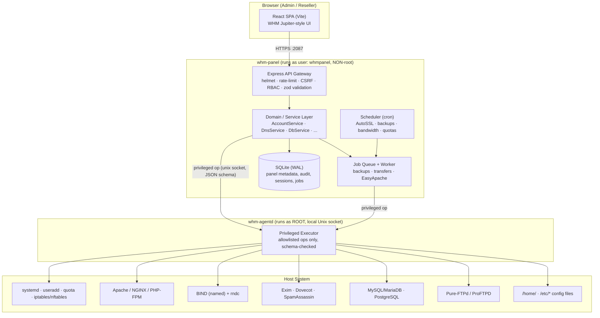
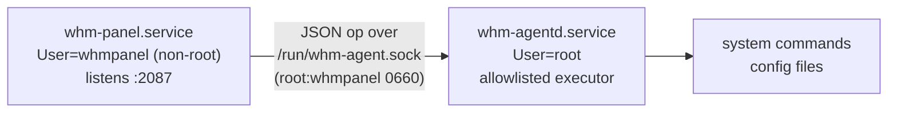
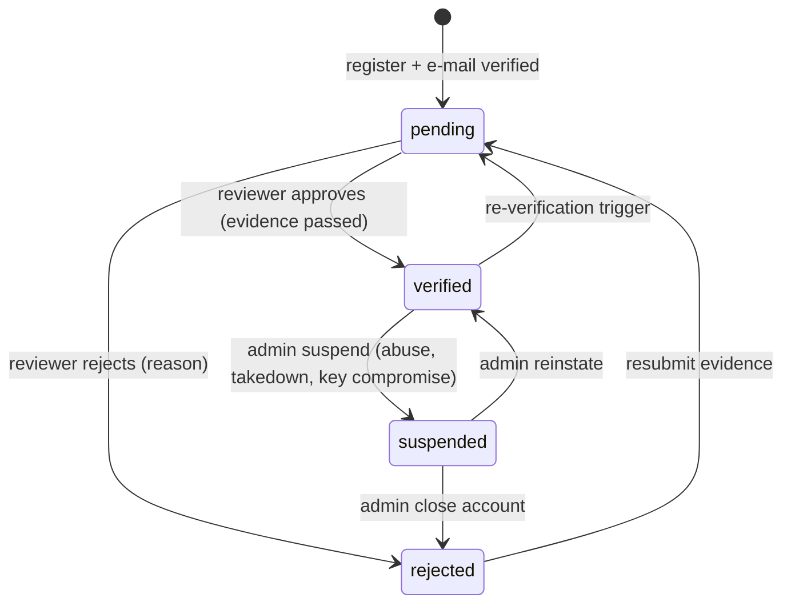
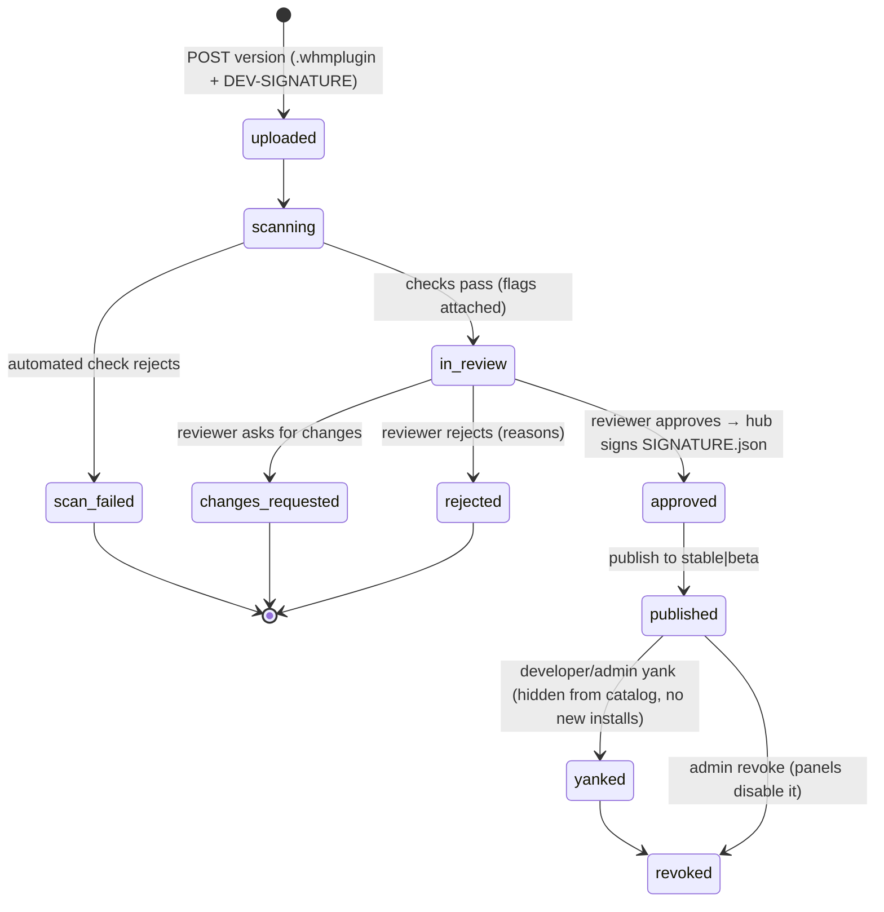

# WHM Control Panel — Full Blueprint (Architecture & Functionality)

> A production-oriented, self-hostable **Web Host Manager** clone that administers a
> real Linux server (Apache/NGINX, BIND, Exim/Dovecot, MySQL/MariaDB, FTP, systemd,
> Linux users, SSL) through a modern **Node.js + React + SQLite** stack.
>
> This document is the single source of truth for *what we are building* and *how it
> is put together*. It mirrors the WHM interface at `trywhm.net` — **all 30 sidebar
> categories and 212 functions** — and specifies, for each function, the backend
> operation, the real system integration (commands/files touched), what is persisted,
> and the UI.
>
> **As built (2026-10-27):** every section of this document is implemented — the 212 functions
> (`CHECKLIST.md`), the privilege-separated agent (316 ops), the plugin host and SDK (§17), the
> license server and marketplace hub (§16, §18; `hub/`), the installer and systemd units, the
> installation guide (`docs/INSTALL.md`) and the user manual (`docs/MANUAL.md`, `docs/MANUAL-partB.md`).
> Deviations from the saved designs are recorded in `docs/design/phase5-build-plan.md` (§16 errata)
> and `docs/design/integration-contracts.md`. Current state and what remains: `HANDOFF.md`.

- **Status:** Design / blueprint
- **Target OS:** Ubuntu 22.04/24.04 LTS & RHEL/AlmaLinux 8/9 (systemd-based)
- **Panel ports:** `2087` (HTTPS admin, WHM-equivalent), `2083` (HTTPS cPanel user side — phase 2)
- **Hub ports:** `7443` (HTTPS: license API, marketplace, portals), `7440` (loopback `/healthz`, `/metrics`) — §16, §18
- **License model:** self-hosted, single binary/service tree; resold through the vendor hub (§16) with a plugin marketplace (§18)

---

## Table of Contents

1. [Goals & Non-Goals](#1-goals--non-goals)
2. [High-Level Architecture](#2-high-level-architecture)
3. [Technology Stack](#3-technology-stack)
4. [Deployment Topology & Privilege Separation](#4-deployment-topology--privilege-separation)
5. [Repository Layout](#5-repository-layout)
6. [Data Model (SQLite Schema)](#6-data-model-sqlite-schema)
7. [Backend Architecture](#7-backend-architecture)
8. [System-Integration Layer (SIL)](#8-system-integration-layer-sil)
9. [Frontend Architecture](#9-frontend-architecture)
10. [Security Model](#10-security-model)
11. [Background Jobs & Scheduler](#11-background-jobs--scheduler)
12. [API Design & Conventions](#12-api-design--conventions)
13. [Complete Functionality Specification (all 30 categories)](#13-complete-functionality-specification)
14. [Build Roadmap / Phases](#14-build-roadmap--phases)
15. [Testing & Quality](#15-testing--quality)
16. [License Server (reselling the panel)](#16-license-server-reselling-the-panel)
17. [Plugin System & SDK](#17-plugin-system--sdk)
18. [Plugin Marketplace](#18-plugin-marketplace)

---

## 1. Goals & Non-Goals

### Goals
- Reproduce the **entire WHM administrative surface**: every category and function in the
  sidebar, with the same information architecture and workflows.
- Perform **real server operations** on the host it runs on: create Linux users, write
  Apache/NGINX vhosts, manage BIND zones, provision MySQL databases, issue SSL certs,
  control systemd services, etc.
- Be **secure by construction** — it runs with root-level authority, so privilege
  separation, input validation, allowlisted commands, auditing, RBAC, and 2FA are
  first-class.
- Be **deployable**: install script + systemd units; one command to run.
- **Multi-tenant**: root admin, resellers (scoped sub-admins), and end-user accounts.

### Non-Goals (v1)
- Windows hosting.
- The full end-user cPanel file manager / webmail clients (planned phase 2; the WHM
  admin side is v1).
- Replacing a real hosting business's billing (WHMCS-style) — out of scope, but an
  API + hooks surface is provided so billing can integrate.

---

## 2. High-Level Architecture



**Request lifecycle (mutation example — "Create a New Account"):**

1. SPA submits a validated form to `POST /api/accounts`.
2. API gateway: authn (session cookie) → CSRF check → RBAC (`root` or reseller with
   quota) → `zod` schema validation → rate-limit.
3. `AccountService.create()` opens a DB transaction, reserves the username, resolves the
   package into concrete limits.
4. Service dispatches privileged steps to **whm-agentd** over the local socket, each a
   discrete allowlisted op: `user.create`, `quota.set`, `web.vhost.write`,
   `dns.zone.create`, `mail.domain.add`, `db.grant.bootstrap`.
5. Agent executes each op with `execFile` (argument arrays, **no shell**), returns
   structured results; service records them and writes an **audit-log** row.
6. On any failure the service runs compensating ops (rollback) and aborts the DB
   transaction. On success, commits and returns the new account.

---

## 3. Technology Stack

| Layer | Choice | Why |
|---|---|---|
| Runtime | **Node.js 22 LTS** | async I/O, one language across stack |
| API | **Express 4** + helmet, express-rate-limit, cookie sessions, csrf | mature, minimal |
| Validation | **zod** | schema-first request + config validation |
| DB | **SQLite via better-sqlite3** (WAL) | zero-admin, synchronous, fast, single file |
| Auth | session cookie + **bcrypt** + **TOTP (otplib)** | standard, 2FA built-in |
| Frontend | **React 18 + Vite + React Router 6** | fast dev, SPA routing for 180+ pages |
| UI | custom component kit + **lucide-react** icons | match WHM Jupiter look exactly |
| Privileged exec | **whm-agentd** (Node, root) over Unix domain socket | privilege separation |
| Jobs | in-process queue + worker (DB-backed) | backups/transfers/builds with progress |
| Process mgmt | **systemd** units | production service lifecycle |
| Tests | **vitest** (unit) + **supertest** (API) + **playwright** (e2e) | full pyramid |

**Why SQLite (not MySQL) for the panel's own data:** the panel must keep working even
when the managed MySQL is being restarted/repaired. SQLite has no separate daemon,
survives those operations, and is trivial to back up (copy one file).

---

## 4. Deployment Topology & Privilege Separation

A hosting panel inherently needs root (to create users, bind ports, write
`/etc/*`). Rather than running the web process as root, we split privilege:



- **whm-panel** (non-root `whmpanel` user): serves the API + static SPA, holds the DB,
  runs jobs/scheduler. A compromise of the web tier cannot directly run arbitrary root
  commands — it can only ask the agent to run **named, schema-validated operations**.
- **whm-agentd** (root): a tiny daemon exposing a fixed catalog of operations
  (`user.create`, `web.vhost.write`, `svc.restart`, …). It **never** receives a shell
  string; it receives `{op, args}`, validates `args` against that op's schema, maps to an
  `execFile(bin, [argv])` or a file write with a fixed template, and returns structured
  output. Unknown ops are rejected.
- Socket perms `0660 root:whmpanel`; every call carries the authenticated principal +
  request id for the audit log.

**Alternative (simpler) mode:** `--monolithic` runs everything as root in one process for
small/single-tenant servers. The agent interface is identical, so code paths don't change.

Install locations:
```
/opt/whm/                 app (server + built client)
/etc/whm/whm.conf         main config (yaml)
/var/lib/whm/whm.db       SQLite database
/var/log/whm/             logs (app, audit, access)
/run/whm-agent.sock       privileged socket
/usr/lib/systemd/system/  whm-panel.service, whm-agentd.service
```

---

## 5. Repository Layout

```
whm/
├── BLUEPRINT.md                 ← this document
├── README.md                    install / run / deploy
├── package.json                 workspaces + root scripts (dev, build, start)
├── .env.example
│
├── server/                      Express API + domain + agent client
│   ├── src/
│   │   ├── index.js             bootstrap (panel)
│   │   ├── app.js               express app assembly
│   │   ├── config.js            load /etc/whm/whm.conf + env
│   │   ├── db/
│   │   │   ├── index.js         better-sqlite3 handle (WAL)
│   │   │   ├── schema.sql       full schema
│   │   │   ├── migrate.js       migration runner
│   │   │   └── seed.js          first-run seed (admin user, default package)
│   │   ├── middleware/          auth, rbac, csrf, validate, error, audit, ratelimit
│   │   ├── lib/
│   │   │   ├── agent-client.js  talks to whm-agentd
│   │   │   ├── capabilities.js  detects which services exist on host
│   │   │   ├── jobs.js          job queue + worker
│   │   │   ├── scheduler.js     cron
│   │   │   └── crypto.js        secret encryption, token hashing, TOTP
│   │   ├── services/            business logic (one per domain)
│   │   │   ├── accounts.js  packages.js  resellers.js  dns.js  databases.js
│   │   │   ├── mail.js      ssl.js       ip.js         security.js  software.js
│   │   │   ├── backup.js    transfers.js services.js   system.js    locales.js
│   │   │   └── ...
│   │   └── routes/              thin HTTP layer (one router per category) → services
│   │       ├── server-config.js  security.js  resellers.js  accounts.js  dns.js
│   │       └── ... (30 routers)
│   └── package.json
│
├── agent/                       whm-agentd (root privileged executor)
│   └── src/
│       ├── index.js             unix socket server
│       ├── ops/                 one module per op family (user, web, dns, mail, db, svc, net, ssl, fs)
│       └── schemas.js           per-op arg schemas (allowlist)
│
├── client/                      React SPA
│   ├── index.html
│   ├── vite.config.js
│   └── src/
│       ├── main.jsx  App.jsx  router.jsx
│       ├── nav.js               ← full nav tree: 30 categories → 180+ functions
│       ├── api/client.js        fetch wrapper (CSRF, errors, auth)
│       ├── components/          Layout, Sidebar, TopBar, DataTable, Form*, Toast, Modal, StatusPill, StatPanel, ToolGrid
│       ├── pages/               one folder per category, one component per function
│       │   ├── Home.jsx  Login.jsx
│       │   ├── server-config/  security/  accounts/  dns/  databases/ ... (30 folders)
│       └── theme/               WHM Jupiter-style CSS tokens
│
├── hub/                         whm-hub: license server + plugin marketplace, ONE process (§16, §18)
│   ├── package.json             @whm/hub (express, express-session, better-sqlite3, zod, helmet, express-rate-limit, bcryptjs, otplib, pino)
│   ├── src/                     index.js (bootstrap, HTTPS :7443, loopback :7440 /healthz /metrics, --check-config)
│   │                            app.js (helmet, rate limits, api-key/portal auth, envelopes)  config.js (/etc/whm-hub/hub.conf JSON + WHM_HUB_*)
│   ├── shared/                  db, crypto, canonical (JCS), keys (Ed25519 + purpose), keyfmt, auth, audit, mailer, webhooks,
│   │                            scheduler, nonce, fingerprint, safe-fetch (SSRF policy), psl (+ psl.dat), validate, errors
│   ├── license/                 migrations/  services/  routes/{public,reseller,admin,portal}.js        (§16)
│   ├── marketplace/             migrations/  services/  routes/{public,developer,reseller,admin}.js  lib/  jobs.js  (§18)
│   ├── scripts/                 gen-key.js (--master | --hmac | --license | --plugin)  hub-cli.js (create-admin, issue, revoke, status, activate-key)
│   ├── test/                    node:test suite + fixtures (key pairs per purpose, canonical vectors)
│   └── ui/                      React (Vite) vendor admin / reseller / developer portal — components COPIED from client/, never imported
│
├── plugins/
│   ├── SDK.md                   plugin developer reference (§17)
│   ├── sdk/                     validate-manifest.js  mock-host.js  errors.js  semver.js  cron.js  pack.js  index.js  test/
│   ├── sample-plugin/           net.whm.sample-notes — one of every extension point; signed marketplace fixture
│   └── bundled/                 net.whm.imunifyav  net.whm.server-monitoring  net.whm.wp-toolkit  net.whm.automated-backup
│
├── scripts/
│   ├── install.sh               creates users, installs systemd units, builds; --with-hub adds whm-hub
│   ├── whm-cli.js               admin CLI (create user, reset password, etc.)
│   └── build-plugin.js          pack + sign a .whmplugin (DEV-SIGNATURE.json with --dev, SIGNATURE.json for local trust)
└── deploy/
    ├── whm-panel.service  whm-agentd.service  whm-hub.service
    └── whm.conf.example  agent.conf.example  panel.env.example  hub.conf.example
```

---

## 6. Data Model (SQLite Schema)

The panel DB stores **metadata and panel state**; the authoritative state for services
lives in their config files on disk (the panel keeps both in sync). Core tables:

```sql
-- Identity & access ---------------------------------------------------------
users(id, username UNIQUE, email, password_hash, role,           -- role: root|reseller|user
      totp_secret_enc, totp_enabled, suspended, created_at, last_login_at)
sessions(sid PRIMARY KEY, user_id, data, expires_at)
api_tokens(id, user_id, name, token_hash, scopes, expires_at, last_used_at, created_at)
reseller_acls(reseller_id, acl_key, value)                        -- privileges
reseller_limits(reseller_id, max_accounts, max_disk_mb, owns_nameservers, shared_ip)

-- Hosting accounts ----------------------------------------------------------
accounts(id, username UNIQUE, domain UNIQUE, owner_id, reseller_id, package_id,
         ip, contact_email, plan_snapshot_json, shell, suspended, suspend_reason,
         demo_mode, disk_used_mb, bandwidth_used_mb, created_at)
account_domains(id, account_id, domain, type, docroot)           -- type: main|addon|sub|parked|alias
account_bandwidth(account_id, period, bytes)                     -- monthly accounting

-- Packages / features -------------------------------------------------------
packages(id, name UNIQUE, disk_mb, bandwidth_mb, max_domains, max_subdomains,
         max_addons, max_parked, max_db, max_email, max_ftp, quota_inodes,
         php_version, feature_list_id, has_shell, has_dedicated_ip, cgi, digest_auth)
feature_lists(id, name, features_json)                            -- which cPanel features enabled

-- DNS -----------------------------------------------------------------------
dns_zones(id, domain UNIQUE, account_id, serial, ttl, type, dnssec_enabled, updated_at)
dns_records(id, zone_id, name, type, ttl, priority, value)        -- A,AAAA,CNAME,MX,TXT,SRV,NS,CAA,PTR
zone_templates(id, name, body)
dns_clusters(id, name, remote_host, api_token_enc, role)          -- role: write-only|sync|standalone

-- Databases -----------------------------------------------------------------
db_instances(id, engine, host, port, is_local, profile_name)     -- engine: mysql|postgres
databases(id, account_id, name, instance_id)
db_users(id, account_id, name, instance_id)
db_grants(id, db_user_id, database_id, privileges)
db_access_hosts(id, account_id, host)

-- Mail ----------------------------------------------------------------------
mail_domains(id, account_id, domain, routing)                    -- routing: local|remote|backup|auto
mail_accounts(id, domain_id, local_part, quota_mb, password_hash)
mail_filters(id, scope, rule_json)                               -- country/domain filters, greylist
dkim_keys(domain, selector, private_key_enc, public_key)

-- SSL -----------------------------------------------------------------------
ssl_certs(id, account_id, domain, cert_pem, key_enc, chain_pem, issuer, not_after, autossl)
ssl_service_certs(service, cert_pem, key_enc, not_after)         -- exim/dovecot/apache/ftp

-- Network -------------------------------------------------------------------
ip_addresses(id, address, family, netmask, reserved, reserved_reason, dedicated_to)
ip_pool(address, status)

-- Security ------------------------------------------------------------------
cphulk_blocks(id, ip, reason, created_at, expires_at)
login_attempts(id, ip, username, ok, created_at)
host_access_rules(id, service, source, action)                   -- hosts.allow/deny model
modsec_vendors(id, name, url, enabled)
modsec_rules(id, vendor_id, rule_id, disabled)

-- Ops / platform ------------------------------------------------------------
services(name, display_name, unit, monitored, enabled)           -- service manager registry
jobs(id, type, status, progress, params_json, result_json, created_at, finished_at)
backups(id, account_id, type, destination_id, path, size, status, created_at)
backup_destinations(id, name, kind, config_enc)                  -- local|ftp|sftp|s3|b2|gdrive
backup_config(key, value)
settings(key, value)                                             -- Tweak Settings, etc.
contacts(id, channel, address, events_json)                      -- Contact Manager
hooks(id, event, stage, action, enabled)                         -- Manage Hooks
locales(code, name, strings_json, enabled)
audit_log(id, ts, principal, role, ip, action, target, args_redacted, result)

-- Plugins (migration 024, §17) ------------------------------------------------
plugins(id PRIMARY KEY, name, version, manifest_json, state, last_error,       -- state: installed|enabled|disabled|errored
        source, signer, package_sha256, signed, installed_at, updated_at, enabled_at)   -- source: upload|path|bundled|marketplace
plugin_settings(plugin_id, key, value_json, updated_at)  plugin_store(…)  plugin_docs(…)  plugin_logs(…)

-- Licensing (migration 031, §16.8) --------------------------------------------
license_state(id PRIMARY KEY CHECK(id=1), key_enc, token, payload_json, activation_id,
              status,                                             -- unlicensed|active|grace|degraded|expired|suspended|revoked
              last_checkin_at, last_ok_at, next_checkin_at, fail_count, messages_json, updated_at)
license_events(id, ts, event, detail_json)                        -- feeds audit_log + Contact Manager

-- Marketplace client (migration 032, §18.6) -----------------------------------
marketplace_installs(plugin_id PRIMARY KEY, version, channel, package_sha256, hub_kid,
              consented_permissions_json, consented_by, consented_at,
              consent_state,                                      -- consented|pending (new version held disabled)
              was_enabled, installed_at, updated_at)
marketplace_revocations(id PRIMARY KEY, plugin_id, version, severity, action, reason, ts,
              applied_at, applied_to_json, acknowledged_by, acknowledged_at)
marketplace_state(id PRIMARY KEY CHECK(id=1), last_catalog_sync_at, last_revocation_ts, last_revocation_now,
              revocations_head_ts, last_update_check_at, pending_updates_json, fail_count, updated_at)
```

(Every category in §13 maps onto these tables; additional small tables are noted inline.)

---

## 7. Backend Architecture

Four layers, strict downward dependencies:

1. **Routes (`routes/*.js`)** — one Express router per sidebar category. Thin: parse →
   validate (`zod`) → call a service method → shape the JSON response. No business logic.
2. **Services (`services/*.js`)** — all business logic and transactions. Compose DB
   access + agent operations. The only layer that writes the DB and the only layer that
   calls the agent. Emits audit events and hook events.
3. **Agent client (`lib/agent-client.js`)** — typed wrapper that sends `{op,args}` to
   `whm-agentd` and returns structured results; handles timeouts, retries, and the
   monolithic fallback (call the op in-process when running as root).
4. **System-Integration providers (in `agent/ops/*`)** — the actual `execFile` calls and
   templated file writes, grouped by subsystem (§8).

Cross-cutting middleware (in order): request-id → access-log → helmet → rate-limit →
body-parse → session → CSRF → auth → RBAC → route → **audit** → error handler.

**Capability detection (`lib/capabilities.js`):** at boot and on demand, the panel probes
which subsystems exist (`systemctl list-unit-files`, `command -v named`, socket checks).
Each service method checks the capability and, when a subsystem is absent (e.g. a dev box
without BIND), returns a clear, structured "service not installed" result and offers the
install action, instead of failing opaquely. This is what lets the exact same code run on
a bare dev container and a fully provisioned production host.

---

## 8. System-Integration Layer (SIL)

Each subsystem is an **op family** in the agent with a provider per implementation. All
ops: allowlisted name, `zod` arg schema, `execFile`/template only (**never** a shell
string), structured result, audit entry.

| Family | Representative ops | Real tools / files |
|---|---|---|
| `user` | create, modify, delete, setShell, setQuota, setPassword | `useradd/usermod/userdel`, `chpasswd`, `setquota`, `/etc/passwd`, `/home/<u>` |
| `web` | vhost.write, vhost.remove, reload, phpfpm.pool, docroot.init | Apache `sites-available`/`conf.d`, NGINX `conf.d`, PHP-FPM pools, `apachectl -t`, reload |
| `dns` | zone.create, zone.edit, record.set, reload, dnssec.sign, zonewalk | `/var/named` or `/etc/bind`, `named.conf`, `rndc reload`, `dnssec-keygen`, `dnssec-signzone` |
| `mail` | domain.add, account.add, routing.set, dkim.gen, queue.list, queue.flush | `/etc/exim*`, Dovecot config, `exim -bp`, `exiqgrep`, `exim -Mrm`, SpamAssassin |
| `db` | db.create, user.create, grant, repair, processes, rootpw | MySQL/MariaDB admin SQL, `mysqlcheck`, `SHOW PROCESSLIST`, PostgreSQL `psql` |
| `ftp` | account.sync, reload | Pure-FTPd/ProFTPD virtual users, restart |
| `svc` | start, stop, restart, status, enable, disable, list | `systemctl …`, `systemctl is-active`, journald |
| `net` | ip.add, ip.remove, ip.list, iptables.rule, nft.rule | `ip addr`, `ip -6`, `iptables`/`nftables`, routing |
| `ssl` | csr.gen, key.gen, cert.install, acme.issue, acme.renew | `openssl`, ACME (Let's Encrypt), service cert install |
| `sec` | hosts.allow.set, modsec.write, fail.block, fail.unblock, ssh.key | `/etc/hosts.allow`, ModSecurity conf, `iptables`, `~/.ssh/authorized_keys`, `/etc/security/limits.conf` |
| `sys` | disk.usage, processes, meminfo, loadavg, reboot, update | `df`, `du`, `ps`, `/proc`, `apt`/`dnf`, `shutdown -r` |
| `fs` | backup.create, backup.restore, file.restore | `tar`, `rsync`, DB dumps, destination drivers (S3/FTP/SFTP/B2) |

---

## 9. Frontend Architecture

- **Single React SPA** served by the panel; React Router drives one route per function,
  all declared from a single `nav.js` tree so **the menu and the routes can never drift**.
- **Layout** mirrors WHM Jupiter: fixed top bar (logo, global search, account menu,
  notifications), a **collapsible, searchable left sidebar** listing all 30 categories →
  functions, a main content region, and a footer status strip.
- **Home dashboard**: the **Statistics panel** (hostname, main IP, load averages, CPU/mem,
  disk, OS, kernel, Apache/PHP/MySQL versions, server uptime, running-service dots) +
  **Tools grid** (searchable card grid of every function) + **Favorites**.
- **Shared components** (built once, reused across ~180 pages):
  - `DataTable` — server-side sort/filter/paginate, row actions, bulk select.
  - `Form` + typed fields (text, number, select, toggle, radio group, password w/ strength
    meter, IP, domain, key/cert textarea, file upload).
  - `ConfigPage` — renders a settings schema as grouped toggles/inputs (used by Tweak
    Settings, Exim/Apache config, Security policies, …).
  - `ActionPage` — a described action + confirm + live result log (restarts, rebuilds).
  - `WizardPage` — multi-step flows (Create Account, Transfer Tool, IP Migration).
  - `Toast`, `Modal`/`ConfirmDialog`, `StatusPill`, `ProgressLog` (for jobs via SSE).
- **State**: lightweight — React Query-style fetching in a small custom hook over the
  `api/client.js` wrapper; auth/user context; toast context.
- **Theme**: CSS custom properties for the WHM palette (light main area, teal accent,
  dark sidebar accents) with a dark-mode variant.

Three page archetypes cover most functions, with bespoke components for the complex ones
(Account creation, DNS Zone Manager, Feature Manager, Reseller Center, Transfer Tool,
EasyApache, Backup Config): **list/table**, **config form**, **action**.

---

## 10. Security Model

Because the panel wields root authority, security is a primary feature, not an add-on:

- **Privilege separation** — web tier is non-root; only `whm-agentd` touches the system,
  and only through a fixed op catalog (§4, §8).
- **No shell injection ever** — every system call is `execFile(bin, argvArray)` or a
  templated file write with escaped values. No `exec`, no string interpolation into shells.
- **Input validation** — `zod` schemas on every endpoint and every agent op. Usernames,
  domains, IPs, paths validated against strict patterns; path-traversal blocked.
- **RBAC** — `root` (everything), `reseller` (only owned accounts + delegated ACLs + their
  own limits), `user` (own account, phase 2). Enforced in middleware and re-checked in
  services.
- **Auth** — bcrypt password hashing, session cookies (`httpOnly`, `secure`, `sameSite`),
  **TOTP 2FA**, forced-password-change flow, API tokens (hashed, scoped, expirable).
- **Brute-force protection (cPHulk analog)** — track `login_attempts`, lock
  accounts/IPs, optional firewall block via agent, allow/deny lists.
- **CSRF** tokens on all mutations; strict CORS (same-origin SPA).
- **Secrets at rest** — DB passwords, ACME keys, destination creds encrypted
  (`crypto.js`, AES-256-GCM with a key in `/etc/whm/secret.key`, `0600 whmpanel`).
- **Audit log** — every privileged action records principal, role, source IP, action,
  redacted args, and result. Surfaced in the UI.
- **Rate limiting** on auth and expensive endpoints.
- **Panel TLS** — self-signed on install, replaceable; HSTS; served on `:2087`.
- **Security Advisor** — active scanner that inspects the host for weak settings and
  reports graded findings (maps to the WHM feature of the same name).

---

## 11. Background Jobs & Scheduler

- **Job queue** (`jobs` table + in-process worker): long operations run as jobs with
  `status` (`queued|running|done|failed`), `progress` (0–100) and a streamed
  `ProgressLog`. Used by: account backups/restore, account transfers, EasyApache builds,
  bulk account operations, DNS zone sync, system updates.
- **Progress** streamed to the UI via **Server-Sent Events** (`GET /api/jobs/:id/stream`).
- **Scheduler** (cron): nightly/weekly **backups**, **AutoSSL** issuance+renewal,
  **bandwidth accounting** rollups, **quota** recomputation, **cPHulk** block expiry,
  log rotation, update checks. Schedules are configurable (Configure cPanel Cron Jobs).

---

## 12. API Design & Conventions

- REST under `/api`, resource-oriented, JSON in/out. Mutations require CSRF + proper role.
- Standard envelope: `{ data, meta }` on success; `{ error: {code, message, fields?} }` on
  failure (field-level errors drive inline form validation).
- Pagination: `?page=&pageSize=&sort=&dir=&q=` → `meta: {page,pageSize,total}`.
- Long ops return `202 { job: {id} }`; poll `GET /api/jobs/:id` or stream.
- Representative endpoints:

| Method & path | Function |
|---|---|
| `POST /api/auth/login` · `/logout` · `/2fa/verify` | login, 2FA |
| `GET/POST /api/accounts` · `PATCH/DELETE /api/accounts/:user` | list/create/modify/terminate |
| `POST /api/accounts/:user/suspend` · `/unsuspend` · `/password` · `/quota` | account functions |
| `GET/POST /api/packages` · `PUT/DELETE /api/packages/:name` | packages |
| `GET/POST /api/dns/zones` · `PUT /api/dns/zones/:domain` · `/records` | DNS |
| `GET/POST /api/databases` · `/users` · `/grants` · `POST /api/databases/:name/repair` | DB |
| `GET /api/ssl/certs` · `POST /api/ssl/csr` · `/install` · `/autossl/run` | SSL/TLS |
| `GET /api/services` · `POST /api/services/:name/{start,stop,restart}` | services |
| `GET /api/system/status` · `/processes` · `/disk` | server status/health |
| `POST /api/backups` · `/restore` · `GET /api/backups` | backup |
| `GET/PUT /api/settings/tweak` · `/security/*` · `/exim` · `/apache` | config pages |
| `GET /api/audit` · `GET/POST /api/tokens` · `/hooks` | development/audit |

---

## 13. Complete Functionality Specification

Legend for each function: **what it does** · *system integration* · `persistence`.
This section enumerates **all 30 categories** from the WHM sidebar — nothing omitted.

### 1. Server Configuration
- **Basic WebHost Manager Setup** — primary contact, main/shared IP, nameservers,
  resolvers, licensing basics. *writes `/etc/whm/whm.conf`, resolv, hostname* · `settings`.
- **Change Root Password** — rotate the server root password. *`chpasswd` via agent* · audit only.
- **Configure cPanel Analytics** — opt-in/out of usage analytics. `settings`.
- **Configure cPanel Cron Jobs** — manage the panel's scheduled jobs. *root crontab* · `settings`.
- **Initial Quota Setup** — enable/repair filesystem quotas. *`quotacheck`,`quotaon`*.
- **Link Server Nodes** — register linked servers (multi-server). `dns_clusters`/nodes.
- **Server Profile** — declare server role (standard/DNS-only/mail node). `settings`.
- **Server Time** — timezone + NTP sync. *`timedatectl`*.
- **Statistics Software Configuration** — AWStats/Webalizer/Analog toggles & schedule. `settings`.
- **Terminal** — in-browser root shell. *PTY over WebSocket through agent (RBAC: root only)*.
- **Tweak Settings** — the big grouped settings page (hundreds of toggles). `settings` + `ConfigPage`.
- **Update Preferences** — release tier (stable/release/edge) & auto-update policy. `settings`.
- **WHM Marketplace** — provider/add-on catalog. `settings`.

### 2. Support
- **Create Support Ticket** — ticket form (captures system snapshot). `jobs`/outbound.
- **Grant cPanel Support Access** — time-boxed support SSH access + token. *creates temp key* · audit.
- **Support Center** — links/resources hub.

### 3. Networking Setup
- **Change Hostname** — set FQDN. *`hostnamectl`, `/etc/hosts`, update vhosts/certs refs*.
- **Resolver Configuration** — set DNS resolvers. *`/etc/resolv.conf`*.

### 4. Security Center
- **Apache mod_userdir Tweak** — enable/disable `~user` URLs, per-domain exceptions. *Apache conf*.
- **SMTP Restrictions** — block non-mail users from direct port 25. *iptables/nftables owner rules*.
- **Compiler Access** — allow/deny gcc to unprivileged users. *chmod on compilers*.
- **Configure Security Policies** — login security policies (2FA requirement, IP checks). `settings`.
- **cPHulk Brute Force Protection** — enable, thresholds, allow/deny lists, one-day blocks. `cphulk_blocks`,`login_attempts`.
- **Host Access Control** — per-service allow/deny by source. *`/etc/hosts.allow`* · `host_access_rules`.
- **Manage External Authentications** — OpenID/OAuth providers for login. `settings`.
- **Manage root's SSH Keys** — generate/import/authorize keys. *`~/.ssh`, `authorized_keys`*.
- **Manage Wheel Group Users** — who may `su` to root. *`/etc/group` wheel*.
- **ModSecurity Configuration / Tools / Vendors** — WAF: enable, edit rules, hit log, vendor rule sets. *ModSecurity conf* · `modsec_vendors`,`modsec_rules`.
- **Password Strength Configuration** — minimum strength per context. `settings`.
- **Security Advisor** — scan host & grade findings with remediation links. *read-only probes*.
- **Security Questions** — recovery questions policy. `settings`.
- **Shell Fork Bomb Protection** — per-user process/mem limits. *`/etc/security/limits.conf`*.
- **SSH Password Authorization Tweak** — toggle SSH password auth. *`sshd_config`, reload sshd*.
- **Traceroute Enable/Disable** — toggle traceroute availability. *chmod*.
- **Two-Factor Authentication** — server-wide 2FA enable + per-user enrollment (TOTP). `users.totp_*`.

### 5. Server Contacts
- **Contact Manager** — notification channels (email, SMS, Slack, Pushover, ICQ-style) per event. `contacts`.
- **Edit System Mail Preferences** — root mail forwarding & which events notify. `settings`/`contacts`.

### 6. Resellers
- **Change Ownership of an Account / Multiple Accounts** — reassign account owner. `accounts.reseller_id`.
- **Edit Reseller Nameservers and Privileges** — ACLs + nameservers per reseller. `reseller_acls`.
- **Email All Resellers** — broadcast. outbound mail.
- **Manage Reseller's IP Delegation** — assign IPs a reseller may use. `ip_addresses`.
- **Manage Reseller's Shared IP** — set a reseller's shared IP. `reseller_limits.shared_ip`.
- **Reseller Center** — create/edit resellers, limits, ACLs, package access (bespoke page). `users`,`reseller_*`.
- **Reset Resellers** — strip reseller privileges. `users.role`.
- **Show Reseller Accounts** — accounts owned by a reseller. query `accounts`.
- **View Reseller Usage and Manage Account Status** — usage dashboard + suspend/unsuspend. query + actions.

### 7. Service Configuration
- **Apache Configuration** — global directives, include editor, MPM, directory indexes, PHP handler, memory/timeout. *`apache2.conf`/`httpd.conf`, `apachectl -t`, reload*.
- **cPanel Log Rotation Configuration** — logrotate policy. *`/etc/logrotate.d`*.
- **cPanel Web Disk Configuration** — WebDAV settings. `settings`.
- **cPanel Web Services Configuration** — API/web-services tuning. `settings`.
- **Exim Configuration Manager** — the big mail-server config (ACLs, RBLs, SPF, rate limits, dictionary attack protections, mailbox format). *Exim config* · `settings`.
- **FTP Server Selection** — choose Pure-FTPd/ProFTPD/disabled. *install/switch + restart*.
- **Mailserver Configuration** — Dovecot IMAP/POP settings, protocols, SSL. *Dovecot conf*.
- **Manage Service SSL Certificates** — install certs for exim/dovecot/apache/ftp/panel. `ssl_service_certs`.
- **Nameserver Selection** — BIND/PowerDNS/disabled + role. *install/switch*.
- **Service Manager** — enable/monitor services; auto-restart on failure (chkservd analog). `services`.

### 8. Locales
- **Configure Application Locales** — default + available locales. `locales`.
- **Copy / Delete / Edit a Locale** — manage translation sets. `locales`.
- **Locale XML Download / Upload** — import/export translations. file I/O.
- **View Available Locales** — list.

### 9. Backup
- **Backup Configuration** — enable, schedule, retention, what to back up, destinations. `backup_config`.
- **Backup Restoration** — restore a full account backup. *job: untar + DB import + reprovision*.
- **Backup User Selection** — per-account include/exclude. `backup_config`.
- **File and Directory Restoration** — restore specific files from a backup. *job: selective extract*.
- **Additional Destinations** — local/FTP/SFTP/S3/B2/Google Drive. `backup_destinations` (encrypted creds).

### 10. Clusters
- **Configuration Cluster** — share config to peer servers. `dns_clusters`/nodes.
- **DNS Cluster** — replicate zones to other nameservers; roles (write-only/sync/standalone). `dns_clusters`.

### 11. System Reboot
- **Graceful Server Reboot** — service-aware shutdown + reboot. *`shutdown -r` after service drain*.
- **Forceful Server Reboot** — immediate reboot. *`reboot`* (confirm + audit).

### 12. Server Status
- **Apache Status** — mod_status worker table, requests/sec. *`apachectl status`/`server-status`*.
- **Daily Process Log** — top processes over time. *sampled `ps` + stored*.
- **Server Information** — CPU, memory, disk, network, PCI, uptime. *`/proc`, `lscpu`, `df`*.
- **Service Status** — up/down + resource use per monitored service. *`systemctl is-active`*.
- **Task Queue Monitor** — the panel's job queue state. `jobs`.

### 13. Account Information
- **List Accounts** — searchable table w/ inline actions (suspend/modify/terminate/login-as). `accounts` + `DataTable`.
- **List Parked / Subdomains** — domain lists. `account_domains`.
- **List Suspended Accounts** — filtered list. `accounts`.
- **Manage Account Enhancements** — add-on features/tiers per account. `settings`.
- **Show Accounts Over Quota** — disk-over-limit list. *quota report*.
- **View Bandwidth Usage** — per-account bandwidth graphs. `account_bandwidth`.

### 14. Account Functions
- **Create a New Account** — full provisioning wizard: user + domain + package + DNS zone + mail + DB bootstrap + vhost + SSL. *orchestrated agent ops* · `accounts`,`account_domains`,`dns_zones`. (bespoke wizard)
- **Change Site's IP Address** — move a site to another IP. *vhost + DNS A record* · `accounts.ip`.
- **Email All Users** — broadcast to account contacts. outbound.
- **Force Password Change** — flag accounts to change password next login. `accounts`.
- **Limit Bandwidth Usage** — per-account cap. `accounts`/`packages`.
- **Manage Account Suspension / Suspend / Unsuspend** — disable/enable account (web+mail+ftp+login). *vhost toggle, shell lock* · `accounts.suspended`.
- **Manage Demo Mode** — restrict account to read-only demo. `accounts.demo_mode`.
- **Manage Shell Access** — normal/jailed/none per account. *`usermod -s`* · `accounts.shell`.
- **Modify an Account** — change domain, owner, package, limits, IP. `accounts`.
- **Password Modification** — set account password (+ sync mail/ftp/db optionally). *`chpasswd`*.
- **Quota Modification** — change disk quota. *`setquota`*.
- **Raw Apache / NGINX Log Download** — download raw access logs. *read log files*.
- **Rearrange an Account** — move account's home to another partition. *job: rsync + relink*.
- **Reset Account Bandwidth Limit** — clear counters. `account_bandwidth`.
- **Terminate Accounts** — remove account entirely (user, files, DNS, mail, DBs, vhost). *destructive orchestration* (confirm + backup option).
- **Unsuspend Bandwidth Exceeders** — bulk unsuspend. bulk action.
- **Upgrade/Downgrade an Account** — change package & apply new limits. `accounts.package_id`.
- **Web Log Retention** — retention policy per account. `settings`.
- **Web Template Editor** — edit default site/error page templates. file templates.

### 15. Multi Account Functions
- **Change Multiple Sites' IP Addresses** — bulk IP move. bulk job.
- **Modify/Upgrade Multiple Accounts** — bulk package/limit change. bulk job.

### 16. Transfers
- **Transfer or Restore a cPanel Account** — import an account from a backup/remote. *job*.
- **Transfer Tool** — multi-account server-to-server migration over SSH. *job: enumerate + rsync + DB* (bespoke).
- **Review Transfers and Restores** — history & logs of transfer jobs. `jobs`.
- **Convert Addon Domain to Account** — promote an addon domain to its own account. *orchestration*.

### 17. Themes
- **Theme Manager** — default UI theme/branding for cPanel/WHM. `settings`.

### 18. Packages
- **Add / Edit / Delete a Package** — hosting plans (limits + features + PHP). `packages`.
- **Feature Manager** — define feature lists toggled per package (bespoke matrix). `feature_lists`.

### 19. DNS Functions
- **Add / Delete a DNS Zone** — create/remove zones. *zone file + `named.conf` + reload* · `dns_zones`.
- **Add an A Entry for Your Hostname** — hostname A record helper. `dns_records`.
- **DNS Zone Manager** — full record editor (A/AAAA/CNAME/MX/TXT/SRV/CAA/NS) (bespoke). `dns_records`.
- **Edit Zone Templates** — templates for new zones. `zone_templates`.
- **Email DNS Record Manager** — SPF/DKIM/DMARC/MX helper. `dns_records`,`dkim_keys`.
- **Email Routing Configuration** — local/backup/remote MX routing per domain. `mail_domains.routing`.
- **Enable DKIM/SPF Globally** — bulk-apply to all domains. *bulk* · `dkim_keys`.
- **Nameserver Record Report** — verify NS/glue health. *resolver checks*.
- **Park a Domain** — parked/alias domain. `account_domains`.
- **Perform a DNS Cleanup** — remove orphan zones. *reconcile*.
- **Set Zone TTL** — default TTL. `dns_zones.ttl`.
- **Setup/Edit Domain Forwarding** — HTTP redirects. *vhost redirect*.
- **Synchronize DNS Records** — push zones to cluster peers. *cluster sync job*.

### 20. Database Services
- **Change Database Root / User Password** — rotate credentials. *admin SQL*.
- **Database Map Tool** — map DBs/users to accounts. `databases`,`db_users`.
- **Edit Database Configuration** — my.cnf-style tuning. *config + restart*.
- **Manage Database Access Hosts** — remote access allowlist. `db_access_hosts`.
- **Manage Database Profiles** — local/remote DB server profiles. `db_instances`.
- **Manage Database Users** — create/drop users + grants. `db_users`,`db_grants`.
- **Manage Databases** — create/drop DBs, assign users. `databases`.
- **phpMyAdmin** — embedded/linked DB admin. proxy/link.
- **Repair Databases** — check/repair tables. *`mysqlcheck --repair`*.
- **Show Database Processes** — live process list + kill. *`SHOW PROCESSLIST`/`KILL`*.
- **Upgrade Database Version** — MySQL↔MariaDB / version upgrade. *job*.

### 21. IP Functions
- **Add a New IP Address** — bind a secondary IP. *`ip addr add`* · `ip_addresses`.
- **Assign IPv6 Address / IPv6 Ranges** — IPv6 management. *`ip -6`* · `ip_addresses`.
- **Configure Remote Service IPs** — IPs for remote MySQL/DNS. `settings`.
- **IP Migration Wizard** — renumber server IPs with vhost/DNS updates (bespoke). *job*.
- **Rebuild the IP Address Pool** — resync free/used pool. `ip_pool`.
- **Show IP Address Usage** — which account uses which IP. join query.
- **Show or Delete Current IP Addresses** — list/remove bound IPs. *`ip addr`*.
- **Show/Edit Reserved IPs** — reserve IPs from allocation. `ip_addresses.reserved`.

### 22. Software
- **Install a Perl Module** — CPAN installs. *`cpan`/`cpanm`*.
- **Install Distro Packages** — apt/dnf package install. *`apt`/`dnf`*.
- **Module Installers** — PHP PECL/PEAR, Ruby gems, etc. *installers*.
- **MultiPHP INI Editor** — per-version/per-domain php.ini (basic+editor). *php.ini/.user.ini*.
- **MultiPHP Manager** — assign PHP version per domain; system default. *PHP-FPM pools, handler* · `accounts`.
- **NGINX Manager** — enable NGINX reverse-proxy/caching. *NGINX conf*.
- **Rebuild RPM Database** — RHEL rpmdb repair. *`rpm --rebuilddb`*.
- **System Update** — OS package updates. *`apt upgrade`/`dnf update`* (job).
- **Update Server Software** — update the panel itself. *job*.
- **EasyApache 4** — build Apache + PHP profiles with modules/extensions (bespoke profile builder). *package sets* (job).

### 23. Email
- **Email Deliverability** — per-domain SPF/DKIM/PTR status + fixes. `dkim_keys`,`dns_records`.
- **Filter Incoming Emails by Country / Domain** — geo/domain mail filtering. `mail_filters`.
- **Greylisting** — enable + tune greylisting. `mail_filters`.
- **Mail Delivery Reports** — delivery success/failure reporting. *exim logs*.
- **Mail Queue Manager** — view/deliver/delete/hold queued mail. *`exim -bp`,`exiqgrep`,`exim -M*`*.
- **Mail Troubleshooter** — trace delivery for an address. *`exim -bt`/log trace*.
- **Mailbox Conversion** — mbox↔maildir conversion. *job*.
- **Repair Mailbox Permissions** — fix ownership/perms. *chown/chmod*.
- **Spamd Startup Configuration** — SpamAssassin daemon options. *config + restart*.
- **View Mail Statistics Summary / Sent Summary / Relayers** — mail analytics. *exim logs*.

### 24. System Health
- **Background Process Killer** — kill disallowed background procs. *`kill`* policy.
- **Process Manager** — live process list, kill/renice. *`ps`,`kill`,`renice`*.
- **Show Current Disk Usage** — per-mount + per-account usage. *`df`,`du`*.
- **Show Current Running Processes** — snapshot. *`ps`*.

### 25. cPanel
- **Change Log** — panel/cPanel changelog. static/feed.
- **Customization** — branding (logos, colors, help links, favicon). `settings`.
- **Manage Plugins** — install/enable WHM/cPanel plugins. `settings`/filesystem.
- **Modify cPanel & WHM News** — news banner for users. `settings`.
- **Reset a Mailman Password** — mailing list admin reset. *mailman tool*.
- **Upgrade to Latest Version** — upgrade the panel. *job*.

### 26. SSL/TLS
- **Generate an SSL Certificate and Signing Request** — key + CSR. *`openssl`* · `ssl_certs`.
- **Install an SSL Certificate on a Domain** — deploy cert to a vhost. *vhost SSL, reload* · `ssl_certs`.
- **Manage AutoSSL** — provider + coverage + run-now + renewals (ACME/Let's Encrypt). *ACME* · job/scheduler.
- **Manage SSL Hosts** — all installed certs + expiry. `ssl_certs`.
- **Purchase and Install an SSL Certificate** — market purchase flow. provider API.
- **SSL Storage Manager** — stored keys/CSRs/certs. `ssl_certs`.
- **SSL/TLS Configuration** — protocols/ciphers/HSTS defaults. *config*.

### 27. Market
- **Market Provider Manager** — enable SSL/add-on providers in the marketplace. `settings`.
  The `whm-hub` provider row is the **enable switch** for the plugin marketplace (§18.6): enabled →
  WHM Marketplace and Manage Plugins show the hub catalog; the row's URL must share its origin with
  `ctx.license.hubUrl()` (else every marketplace action answers `409 hub_mismatch`) and *Test* probes
  `/v1/status/<key prefix>`. The license key is entered only under Basic WebHost Manager Setup › License
  (§16.8), never on this page.

### 28. Restart Services
Each is an **ActionPage** that restarts the unit via `svc.restart` and streams output:
- **Database Server** (`mysql`/`mariadb`) · **DNS Server** (`named`) · **HTTP Server**
  (`apache2`/`httpd`) · **IMAP Server** (`dovecot`) · **Mail Server** (`exim`) ·
  **Mailing List Manager** (`mailman`) · **PHP-FPM service for Apache** · **SSH Server**
  (`sshd`). *all via `systemctl restart`* · audit.

### 29. Development
- **OpenAPI Documentation for cPanel / WHM** — rendered API reference (our own OpenAPI spec).
- **Apps Managed by AppConfig** — registered integration apps. `settings`.
- **cPanel Development Forum / Developer Documentation** — links.
- **cPanel Plugin File Generator** — scaffold a plugin. generator.
- **Manage API Tokens** — create/revoke scoped tokens. `api_tokens`.
- **Manage Hooks** — register event hooks (pre/post account create, etc.). `hooks`.

### 30. Plugins
- **ImunifyAV** — malware scanner plugin panel. plugin module.
- **Server Monitoring** — metrics/alerts plugin. plugin module.
- **WP Toolkit** — WordPress management plugin. plugin module.
- **Automated Backup** — scheduled account backups (scope, components, locks, retention, destinations,
  token-confirmed restores). bundled plugin `net.whm.automated-backup`, reachable through its own sidebar pages.

  All four are **bundled plugins** (`plugins/bundled/<id>/`, §17.5) installed at boot through the real plugin
  host with `source: 'bundled'` (exempt from the signature and developer-mode gates). Everything else arrives
  through the **marketplace** (§18.6): Manage Plugins › Marketplace installs a hub-signed `.whmplugin` after a
  **consent screen** (scopes with their `PERMISSIONS` texts + the developer's justifications); an update that
  adds scopes is held `pending_consent` with the plugin disabled; revocations from the hub disable the plugin
  and raise a banner; sideloading (`upload`/`path`/`dir`) needs `plugins.developer_mode` once the hub is enabled.

### 31. Application Manager *(our addition, 2026-10-29 — not a WHM function; design: `docs/design/application-manager.md`)*
- **Application Manager** — Node.js, Python and built-frontend (React, Angular, Vue, Svelte, static) applications
  per domain and base path: register (upload, git clone or scaffold), install dependencies and build as the account
  user, run as a per-app systemd unit (`whm-app-<id>`, `User=<account>`, `127.0.0.1:<port>`, memory/task/CPU limits,
  hardening), publish through the account's Apache vhost via `IncludeOptional <apache root>/whm-apps/<domain>.conf`
  (ProxyPass with websockets, or DocumentRoot/Alias + SPA fallback for static builds), logs, env vars, start/stop/
  restart/rebuild/deploy, remove. Service `ctx.apps`; agent family `app.*`; migration 033; API `/api/apps/*`.
- **Runtime Versions** — system and managed Node.js (`/opt/whm/runtimes/node/<version>`, official tarballs verified
  against `SHASUMS256.txt`), Python interpreters with venv support, git; defaults.
- **Application Templates** — built-in framework presets (Express, NestJS, Next.js, Nuxt, React/Vite, CRA, Angular,
  Vue, Svelte, Flask, Django, FastAPI, static files) plus root-defined custom templates.

> Every function above has: a sidebar entry (from `nav.js`), a React page, a route, an
> API endpoint, a service method, and — where it changes the system — an allowlisted
> agent op. The capability layer makes each one behave correctly whether the underlying
> daemon is installed or not.

---

## 14. Build Roadmap / Phases

| Phase | Deliverable |
|---|---|
| **P0 Foundation** | Monorepo, build/run scripts, config loader, SQLite schema+seed, auth+session+2FA, RBAC, CSRF, audit, agent client + agent skeleton, capability detection. |
| **P1 Shell** | React layout (top bar + searchable sidebar with all 30 categories), home dashboard (Statistics + Tools grid + Favorites), login/2FA pages, shared components (DataTable/Form/ConfigPage/ActionPage/Wizard/Toast/Modal/ProgressLog), full `nav.js` + routing to every function (stubbed pages wired). |
| **P2 Core hosting** | Accounts (create/modify/suspend/terminate + lists), Packages + Feature Manager, DNS Functions + Zone Manager, Database Services, Service Config + Service Manager + Restart Services, Server Status/Health. Real agent ops for `user/web/dns/db/svc/sys`. |
| **P3 Security & mail** | Security Center (cPHulk, Host Access, ModSecurity, SSH keys, 2FA, Advisor), Email + Exim/Dovecot config, SSL/TLS + AutoSSL (ACME). |
| **P4 Resellers, IP, backup, transfers** | Reseller Center + delegation, IP Functions, Backup (config/restore/destinations) + scheduler, Transfers + Transfer Tool, Multi-account ops. |
| **P5 Software & platform** | Software (MultiPHP, EasyApache, updates, modules), Locales, Clusters, Server Contacts, Themes, Market, cPanel section, Development (API tokens/hooks/OpenAPI), Plugins. |
| **P6 Hardening & deploy** | install.sh, systemd units, panel TLS, Security Advisor rules, docs, e2e tests, perf. |
| **P7 Commercial** | `hub/` — license server (§16: public/reseller/admin API, portals, Ed25519 signing + rotation, webhooks, billing connectors, reports) and plugin marketplace (§18: developer verification, submission pipeline with scanner + human review, hub-signed distribution, update/revocation feeds, entitlements/payouts) — plus the panel side: `license.js` (offline verify, check-in, degraded mode, edition gates, Basic Setup › License tab, notifications), `marketplace-client.js` (catalog, consent, updates, revocation enforcement), the plugin SDK docs + packer, `plugins/sample-plugin`, the bundled Automated Backup plugin, `install.sh --with-hub`. |

Each phase is committed and pushed to `claude/trusting-cori-ifp7wy` so progress is visible.

**State.** P0–P6 are built: all 212 functions, the plugin host, the deploy scripts. P7 is the Phase-5
work the user deferred, built in three rounds of two units from `docs/design/phase5-build-plan.md`
(U1 hub/license, U6 SDK + plugins, U2 hub/marketplace, U4 panel license client, U3 hub/ui, U5 panel
marketplace client) against the committed `plugins/sdk/` code, which is never regenerated.

---

## 15. Testing & Quality

- **Unit** (vitest): services, validators, agent op schemas, crypto.
- **API** (supertest): every route — authz matrix (root/reseller/user), validation errors,
  happy paths against a temp SQLite DB with a **mock agent**.
- **Agent op tests**: each op's arg schema rejects injection/traversal; commands assembled
  as argv arrays (asserted, never a shell string).
- **E2E** (playwright): login+2FA, create→list→suspend→terminate account, add DNS zone +
  record, create DB+user+grant, restart a service, issue AutoSSL — against a disposable VM.
- **CI**: lint + typecheck + unit + API on every push; e2e nightly.
- **Security checks**: dependency audit, a lint rule banning `child_process.exec`/shell
  strings in the agent, and a path-traversal test suite.
- **Hub suite** (`hub/test`, node:test, temp SQLite per file, fixed Ed25519 pairs for **both** key
  purposes): the §16.12 and §18.10 lists — canonical vectors, key format, token sign/verify and skew,
  activate/check-in (limits, reclaim, nonce replay, drift, `usage.plugins`, `activationExtras` inside the
  signed body), lifecycle, trials, reseller scoping/quota, webhooks, billing idempotency + `whm_kind`
  routing, signing-key purpose/activate/retire, SSRF refusal matrix, namespace/PSL fixtures, scanner
  reject/flag rules, upload/review/sign/publish, download descriptors, rotation, revocation feeds,
  developer security; `scripts.test.js` drives `gen-key.js`/`hub-cli.js`; `node hub/src/index.js
  --check-config` boots against a temp dir and must answer `GET /healthz` 200.
- **SDK and plugin suites**: `plugins/sdk/test` (manifest validator, mock host, cron/semver, `pack.js`
  round-trip/determinism/refusals, `build-plugin`), `plugins/sample-plugin/test` and
  `plugins/bundled/*/test` (every extension point against `createMockHost`; no host side effects).
  The root `npm test` runs them after the workspaces.
- **Parity tests** (byte-for-byte across deployables): the JCS golden vectors are shared by hub and panel
  (`hub/test/fixtures/canonical-vectors.json` = `server/test/fixtures/canonical-vectors.json`);
  `packageDigest` and a `SIGNATURE.json` produced by `pack.js sign()` / the hub signer (standard base64
  with padding) must verify on the real panel host (`plugins/sdk/test/pack.test.js`,
  `hub/test/market-package-parity.test.js`, which installs the repacked package through
  `services/plugins.js`); the panel client suites (`server/test/license.test.js`,
  `server/test/marketplace-client.test.js`) run against a mocked `ctx.license.transport` with recorded
  hub fixtures and assert that no agent op is dispatched on any license transition.

---

## 16. License Server (reselling the panel)

The panel is a **vendor product**: the owner (the *vendor*) sells it to their own customers
and lets *resellers* (sub-vendors) issue licenses within a quota. Licensing is implemented
as a separate deployable, `hub/license/`, operated by the vendor, plus a thin client inside
the panel (`server/src/services/license.js`). Design rules:

- **Offline-verifiable**: a license is an Ed25519-signed token the panel validates with
  embedded vendor public keys; the hub is only needed to *activate*, *check in* and *renew*.
- **Never take customer sites down**: a lapsed/invalid license puts the panel into a
  read-only *degraded mode*; Apache/BIND/Exim/MySQL keep serving.
- **Same conventions as the panel**: Node 22 + Express + SQLite (WAL), `zod` on every
  endpoint, `{data, meta}` / `{error}` envelopes, audit log, non-root service user.

### 16.1 Positioning, deployment & config

```
hub/
├── license/                     whm-license  (this section)
│   ├── src/
│   │   ├── index.js             bootstrap, HTTPS :7443
│   │   ├── app.js               express assembly (helmet, rate-limit, api-key auth, zod)
│   │   ├── config.js            /etc/whm-hub/license.conf + env
│   │   ├── db/ schema.sql migrate.js seed.js
│   │   ├── lib/ keys.js (Ed25519 signing, kid, rotation)  canonical.js (JCS)  keyfmt.js (WHM-XXXX keys)
│   │   │        fingerprint.js (drift score)  webhooks.js  nonce.js  scheduler.js
│   │   ├── services/ licenses.js activations.js customers.js resellers.js trials.js billing.js reports.js
│   │   └── routes/ public.js reseller.js admin.js portal.js
│   └── portal/                  React (Vite) admin + reseller portal
└── marketplace/                 see §18
```

| Item | Value |
|---|---|
| Service / user | `whm-license.service`, `User=whmhub` (non-root; never needs an agent) |
| Ports | `:7443` HTTPS (public API + portal); `:7440` loopback-only `/metrics` + `/healthz` |
| Config | `/etc/whm-hub/license.conf` (yaml): `public_url`, `db_path`, `signing_keys_dir`, `token_ttl_hours` (168), `checkin_interval_hours` (12), `default_grace_days` (7), `webhook_secret_enc`, `smtp`, `rate_limits` |
| Signing keys | `/etc/whm-hub/keys/<kid>.ed25519` (`0600 whmhub`), `active_kid` in config; private keys never leave the host (optional HSM/KMS driver) |
| DB | `/var/lib/whm-hub/license.db` (SQLite WAL) |
| Logs | `/var/log/whm-hub/license/{app,audit,access}.log` |

**HA notes.** Token *validation* is stateless (public-key only) and happens on the panel, so
the hub being down never breaks running panels. The hub itself is a single writer: run one
primary; optional read replicas (Litestream/LiteFS style streaming of the SQLite WAL) serve
`GET` traffic (`/v1/keys`, portal reads, reports) behind the load balancer; all `POST`s go to
the primary. Check-ins are idempotent and retried by panels, so brief primary failover is
invisible. **Backup**: `sqlite3 .backup` every hour to `/var/backups/whm-hub/`, encrypted
off-site copy nightly (same destination drivers as the panel's `fs` family: S3/SFTP/B2),
signing keys backed up *separately* (offline, encrypted); restore test monthly.

### 16.2 Products & editions

One product (`whm-panel`) with editions; a `products` row per edition so prices/limits are
data, not code. Feature flags gate panel functions; limits are numeric and enforced by the
panel (§16.8) and by the hub (activation counting).

| Edition | Servers (`max_activations`) | Hosting accounts | Resellers | Term | Feature flags |
|---|---|---|---|---|---|
| **Trial** | 1 | 5 | 0 | 14 days, non-renewable, one per fingerprint/customer | `marketplace_free` |
| **Solo** | 1 | 25 | 0 | monthly/annual | `marketplace_free`, `api` |
| **Pro** | 1 | unlimited (`-1`) | 5 | monthly/annual | + `marketplace_paid`, `transfers`, `autossl_wildcard` |
| **Reseller** | N (bought per server, 2–50) | unlimited | unlimited | annual | + `clusters`, `white_label`, `multi_server` |
| **Enterprise** | N (contract) | unlimited | unlimited | contract, custom grace (30 d) | all + `sso`, `priority_support`, `custom_branding_builder` |

Full flag catalog (`features_json` keys, all booleans): `api`, `transfers`, `clusters`,
`multi_server`, `marketplace_free`, `marketplace_paid`, `white_label`, `autossl_wildcard`,
`sso`, `terminal`, `priority_support`, `custom_branding_builder`. Limits (`limits_json`):
`max_accounts`, `max_resellers`, `max_domains_per_account` (`-1` = unlimited),
`max_activations`, `grace_days`. Editions are *ordered* (`rank`) so upgrade/downgrade is a
comparison, not a special case.

### 16.3 Data model (SQLite)

```sql
-- Vendor & tenancy -----------------------------------------------------------
vendors(id, name, public_url, support_email, default_grace_days, created_at)       -- single row normally
customers(id, vendor_id, reseller_id NULL, name, email UNIQUE, company, country,
          external_ref,                                                           -- billing system id (Stripe cus_…, WHMCS client id)
          status, created_at)                                                     -- status: active|suspended|closed
resellers(id, vendor_id, name, email UNIQUE, portal_user_id, status,              -- sub-vendors
          quota_json,                                                             -- {"solo":100,"pro":50,"reseller":5,"trial":-1}
          pricing_json,                                                           -- {"solo":{"monthly":600,"annual":6000}} (cents, wholesale)
          issued_json,                                                            -- running counters per edition
          brand_json, created_at)                                                 -- white-label name/logo for their portal
portal_users(id, vendor_id, reseller_id NULL, email UNIQUE, password_hash, role,   -- role: vendor_admin|vendor_support|reseller_admin|reseller_staff
             totp_secret_enc, totp_enabled, last_login_at, created_at)

-- Catalog -------------------------------------------------------------------
products(id, sku UNIQUE, name, edition, rank, term,                               -- edition: trial|solo|pro|reseller|enterprise; term: days|monthly|annual|contract
         limits_json, features_json, price_cents, currency, active)

-- Licenses ------------------------------------------------------------------
licenses(id, key_hash UNIQUE, key_prefix,                                          -- sha256(key); prefix "WHM-7K3Q" for display/search
         product_id, edition, limits_json, features_json,                          -- snapshot at issue (overrides allowed)
         status,                                                                   -- pending|active|suspended|expired|revoked
         issued_at, starts_at, expires_at NULL, grace_days, max_activations,
         customer_id, reseller_id NULL, issued_by, notes, external_ref, created_at, updated_at)
activations(id, license_id, fingerprint,                                           -- composite sha256 (hex)
            fp_components_json,                                                    -- {"machine_id":"<sha256>","mac":"<sha256>","disk":"<sha256>"}
            hostname, public_ip, panel_version, os,
            first_seen, last_checkin, token_kid, status,                           -- active|deactivated|reclaimed|blocked
            deactivated_at, deactivated_by, drift_events)
checkins(id, activation_id, ts, panel_version, accounts_used, resellers_used,      -- heartbeat log (90-day retention)
         ip, result, latency_ms)                                                   -- result: ok|rotated|revoked|expired|suspended|over_limit
revocations(id, license_id, activation_id NULL, reason, revoked_by, ts, propagated_at)
trials(id, customer_id, license_id, fingerprint, email_hash, ip, started_at,
       converted_license_id NULL, converted_at NULL)                              -- enforces one trial per fingerprint/email
transfers(id, license_id, from_activation_id, to_activation_id NULL, requested_at,
          completed_at, requested_by)                                              -- explicit deactivate/transfer flow
billing_events(id, source, event_type, external_id UNIQUE, payload_json,           -- inbound (Stripe/WHMCS/Paddle) idempotency log
               processed_at, result)
webhook_endpoints(id, owner_type, owner_id, url, secret_enc, events_json, enabled) -- owner_type: vendor|reseller
webhook_deliveries(id, endpoint_id, event, payload_json, attempt, status, next_at, last_code)
api_keys(id, owner_type, owner_id, name, key_hash, scopes_json, expires_at,        -- scopes: license:read license:issue license:revoke …
         last_used_at, created_at)
nonces(nonce PRIMARY KEY, seen_at)                                                 -- replay cache (10-min TTL)
signing_keys(kid PRIMARY KEY, public_key, created_at, retired_at NULL, status)     -- active|retiring|retired
audit_log(id, ts, principal, role, ip, action, target, args_redacted, result)      -- same shape as the panel's
```

### 16.4 License key & signed token

**Human key** — `WHM-XXXX-XXXX-XXXX-XXXX`: 16 chars from the Crockford base32 alphabet
(no `I L O U`, case-insensitive on input, dashes optional): 15 random chars (75 bits from
`crypto.randomBytes`) + 1 Crockford mod-37 check char. The key is a *bearer secret* that
resolves to a license: the hub stores only `sha256(key)` (`licenses.key_hash`) and the first
group (`key_prefix`) for display. The panel stores the key encrypted (AES-256-GCM via
`lib/crypto.js`). A key never carries entitlement data — the token does.

**Token** — `WHMT1.<base64url(payload)>.<base64url(signature)>`:

```json
{ "v": 1, "iss": "https://license.vendor.example", "kid": "a91f3c2e",
  "lid": "lic_01J9ZQ8X", "aid": "act_01JA02KQ", "cid": "cus_01J9ZP11",
  "ed": "pro", "rank": 30,
  "lim": { "max_accounts": -1, "max_resellers": 5, "max_activations": 1, "max_domains_per_account": -1 },
  "feat": { "api": true, "transfers": true, "marketplace_paid": true, "clusters": false, "white_label": false },
  "fp": "sha256:4f1b…e0",
  "iat": 1761350400, "nbf": 1761350100, "exp": 1761955200,
  "lexp": 1792886400, "grace": 7, "nonce": "n_7c0b4d…", "status": "active" }
```

- **Canonical JSON** (JCS / RFC 8785 subset): object keys sorted by UTF-16 code unit, no
  whitespace, integers only (no floats/NaN), strings escaped only where JSON requires it,
  UTF-8 bytes. `canonical.js` is the single implementation, shared by hub and panel.
- **Signature**: Ed25519 (`crypto.sign(null, Buffer.from(canonical), privateKey)`) over the
  canonical payload bytes; base64url without padding. `kid` = first 8 hex of
  `sha256(raw 32-byte public key)`.
- **Clock skew**: panel accepts `nbf − 300 s` and `exp + 300 s`; hub rejects requests whose
  `ts` is more than 300 s off and logs a `clock_skew` message back to the panel.
- **Lifetimes**: token `exp = min(iat + token_ttl (7 d), lexp + grace)`; check-ins every 12 h
  always return a fresh token, so a healthy panel never comes near `exp`. License expiry
  `lexp` is independent: after `lexp` the hub still issues tokens with `status:"grace"` until
  `lexp + grace`, then `status:"expired"` tokens (still signed, so the panel can trust the
  *reason*).
- **Key rotation**: the panel embeds `server/src/services/license-keys.json`
  `{ "keys": [ {"kid":"a91f3c2e","pub":"<base64>","not_after":null}, … ] }` (≥2 keys). A
  new signing key is first *added* to the panel's embedded set in a release, then made
  `active` on the hub ≥ 90 days later; the old key stays `retiring` for ≥ 2× token TTL, then
  `retired` (rejected). `GET /v1/keys` publishes the same set, but the panel only *pins*
  keys shipped in its own code (an online key list can add nothing the binary doesn't trust).
- Every hub **response** to the panel is itself signed (`X-WHM-Signature: kid=…,sig=…` over
  the canonical response body, which echoes the request `nonce`), so even non-token answers
  (`revoked`, `messages`) cannot be spoofed by a MITM/local proxy.

### 16.5 Server fingerprinting

The panel asks the agent (`sys.fingerprint`, read-only op) for three stable identifiers and
hashes each separately so raw values never leave the server:

| Component | Source | Weight |
|---|---|---|
| `machine_id` | `/etc/machine-id` (fallback `/var/lib/dbus/machine-id`) | 0.50 |
| `mac` | MAC of the interface holding the default route (`ip -j route`, `ip -j link`) | 0.30 |
| `disk` | root filesystem UUID (`findmnt -J /` → `blkid`), fallback `/dev/disk/by-id` | 0.20 |

`fingerprint = sha256("whmfp1|" + h(machine_id) + "|" + h(mac) + "|" + h(disk))`.
On activation/check-in the hub compares component hashes against the stored activation:
`drift = Σ weight(component that changed)`. Rules: `drift == 0` → same server;
`0 < drift ≤ 0.5` (e.g. NIC or disk replaced) → same activation, hub updates the stored
components, increments `drift_events`, emits message `fingerprint_updated`; `drift > 0.5`
(machine-id changed = cloned/reinstalled) → treated as a **new server**: it is accepted only
if `active activations < max_activations`, otherwise `409 activation_limit` with the list of
current activations (hostname, last check-in) so the admin can deactivate one. **Reclaim**:
an activation with no check-in for 30 days may be reclaimed automatically by a new
activation of the same license (logged, webhook `license.transferred`). **Re-activation
limits**: at most 3 activations per license per 30 days (sliding) without vendor
approval — blocks key-sharing while allowing a reinstall; vendor/reseller can lift it.

### 16.6 Flows (request / response)

All panel→hub calls: `POST`, JSON, headers `X-WHM-Nonce`, `X-WHM-Timestamp`; body always
includes `key` (or the current `token` for check-in), `fingerprint` + `fp_components`,
`hostname`, `panel_version`. Errors use the panel envelope `{error:{code,message}}` and are
signed too.

**Issue (vendor/reseller API)**
```http
POST /v1/reseller/licenses            Authorization: Bearer <api key, scope license:issue>
{ "sku": "whm-pro-annual", "customer": {"email":"ops@acme.example","name":"Acme"}, "term_months": 12,
  "notes": "order #5531", "external_ref": "whmcs:5531" }
→ 201 { "data": { "license_id":"lic_01J9ZQ8X", "key":"WHM-7K3Q-M2DF-9XA1-P0R6", "edition":"pro",
         "expires_at":"2027-10-25T00:00:00Z", "max_activations":1 }, "meta": { "quota_left": {"pro": 49} } }
```
The clear-text key is returned **once**; afterwards only `key_prefix` is visible.

**Activate (panel)**
```http
POST /v1/activate
{ "key":"WHM-7K3Q-M2DF-9XA1-P0R6", "fingerprint":"sha256:4f1b…e0",
  "fp_components": {"machine_id":"…","mac":"…","disk":"…"}, "hostname":"srv1.acme.example",
  "panel_version":"1.4.2", "os":"ubuntu-24.04", "nonce":"n_7c0b…", "ts":1761350400 }
→ 200 { "data": { "token":"WHMT1.eyJ…", "activation_id":"act_01JA02KQ", "checkin_interval_hours":12,
         "messages":[] }, "meta": {"nonce":"n_7c0b…"} }
→ 409 { "error": { "code":"activation_limit", "message":"1 of 1 activations in use",
         "activations":[{"id":"act_…","hostname":"old.acme.example","last_checkin":"2026-10-20T07:11:00Z"}] } }
```

**Check-in (panel, every 12 h, jittered ±20 min)**
```http
POST /v1/checkin
{ "token":"WHMT1.…", "fingerprint":"sha256:…", "fp_components":{…}, "panel_version":"1.4.2",
  "usage": {"accounts":41,"resellers":2,"domains":97}, "nonce":"n_…", "ts":1761393600 }
→ 200 { "data": { "token":"WHMT1.…(fresh)", "status":"active", "revoked":false,
         "license": {"edition":"pro","expires_at":"2027-10-25T00:00:00Z","days_left":365},
         "messages":[{"level":"info","code":"renewal_available","text":"Renew before 2027-10-25"}] } }
→ 200 { "data": { "token":"WHMT1.…(status:expired)", "status":"expired", "revoked":false, "messages":[…] } }
→ 403 { "error": { "code":"revoked", "message":"License revoked: chargeback", "revoked_at":"…" } }
```
If `fingerprint` drifts > 0.5 the hub answers `409 fingerprint_mismatch` with the same
`activations` list as above; the panel then shows the transfer dialog.

**Deactivate / transfer (panel or portal)**
```http
POST /v1/deactivate            { "token":"WHMT1.…", "reason":"migrating" }        → 200 {"data":{"deactivated":true}}
POST /v1/admin/activations/act_01JA02KQ/deactivate   { "reason":"customer request" }  (portal/API, no server access needed)
POST /v1/transfers             { "key":"WHM-…", "from_activation":"act_01JA02KQ", "fingerprint":"<new>", … }
→ 200 { "data": { "token":"WHMT1.…", "activation_id":"act_01JA9…", "transferred_from":"act_01JA02KQ" } }
```
Transfer = atomic deactivate-old + activate-new in one hub transaction; the old server
learns it on its next check-in (`403 deactivated`) and enters degraded mode.

**Renew · Upgrade/Downgrade · Suspend/Unsuspend · Revoke (admin/reseller API)**
```http
POST /v1/admin/licenses/lic_01J9ZQ8X/renew      { "term_months":12 }      → expires_at += 12 months (from max(now, expires_at))
POST /v1/admin/licenses/lic_01J9ZQ8X/change-edition { "sku":"whm-reseller-annual-5", "prorate":true }
   → limits/features snapshot replaced; downgrade is refused with 409 over_limit {"accounts":41,"max_accounts":25}
     unless "force":true (panel then blocks new creation but keeps existing accounts)
POST /v1/admin/licenses/:id/suspend   { "reason":"invoice overdue" }  /unsuspend          → status flips; next check-in returns status
POST /v1/admin/licenses/:id/revoke    { "reason":"chargeback" }       → revocations row; all activations → blocked; webhook license.revoked
```
Edition changes take effect at the next check-in; the portal offers "Push now", which just
shortens the panel's next check-in via the `messages` channel (panels poll; the hub never
connects inbound to a customer server).

**Trial start → convert (panel "Start free trial" button, or portal)**
```http
POST /v1/trial   { "email":"ops@acme.example", "fingerprint":"sha256:…", "fp_components":{…}, "hostname":"…", "nonce":"…", "ts":… }
→ 201 { "data": { "key":"WHM-TR1A-…", "token":"WHMT1.…", "expires_at":"2026-11-08T…", "activation_id":"act_…" } }
→ 409 { "error": { "code":"trial_exists", "message":"A trial was already used on this server or e-mail" } }
POST /v1/admin/trials/trl_01J…/convert  { "sku":"whm-solo-annual" }
→ 200 { "data": { "license_id":"lic_01J9ZQ8X", "key":"WHM-…" } }      -- same activation carried over; no re-activation needed
```
Conversion keeps the trial's `activation` row (re-parented to the new license) so the panel
just receives a Pro/Solo token at the next check-in — zero downtime, no key re-entry.

**Reseller issuance within quota · bulk issue · lost key**
```http
POST /v1/reseller/licenses/bulk  { "sku":"whm-solo-annual", "count":25, "customer_id":"cus_…", "notes":"Q4 batch" }
→ 202 { "job": {"id":"job_…"} } → GET /v1/jobs/job_…  → { "data": { "licenses":[{"license_id":"…","key":"WHM-…"},…] } }  (keys shown once; CSV download)
   quota check: issued_json[edition] + count ≤ quota_json[edition] else 409 quota_exceeded
POST /v1/admin/licenses/lic_01J9ZQ8X/rekey  { "reason":"customer lost key" }
→ 200 { "data": { "key":"WHM-…(new)" } }      -- old key_hash invalidated; existing activations/tokens unaffected
POST /v1/recover  { "email":"ops@acme.example" }  → 202 always; e-mails the customer their key prefixes + portal link (no keys by mail)
```

### 16.7 Hub REST API

**Public / panel** (no API key; nonce + timestamp + per-IP and per-key rate limits):

| Method & path | Function |
|---|---|
| `POST /v1/activate` · `/v1/checkin` · `/v1/deactivate` · `/v1/transfers` | panel lifecycle (§16.6) |
| `POST /v1/trial` · `POST /v1/recover` | self-service trial, lost-key mail |
| `GET /v1/keys` | published signing keys `{keys:[{kid,pub,status}]}` (informational; panel pins its own) |
| `GET /v1/status/:license_prefix` | public "is this key valid/edition/expiry" lookup for support (no PII) |
| `GET /healthz` · `GET /metrics` (loopback) | liveness, Prometheus metrics |

**Reseller** (API key `owner_type=reseller`, scopes `license:read license:issue license:renew
license:revoke customer:write webhook:write`; every row filtered by `reseller_id`):

| Method & path | Function |
|---|---|
| `GET/POST /v1/reseller/licenses` · `GET /v1/reseller/licenses/:id` | list/issue/view own licenses |
| `POST /v1/reseller/licenses/bulk` · `POST …/:id/renew` · `/change-edition` · `/suspend` · `/unsuspend` · `/revoke` · `/rekey` | lifecycle |
| `GET /v1/reseller/licenses/:id/activations` · `POST …/activations/:aid/deactivate` | server bindings |
| `GET/POST /v1/reseller/customers` · `PATCH /v1/reseller/customers/:id` | own customers |
| `GET /v1/reseller/quota` · `GET /v1/reseller/invoices` | remaining quota per edition, wholesale statement |
| `GET/POST/DELETE /v1/reseller/webhooks` · `GET/POST/DELETE /v1/reseller/api-keys` | integration |

**Admin** (API key `owner_type=vendor`, scopes `admin:*`, `billing:webhook`, `report:read`; portal
users use session + 2FA and the same routes):

| Method & path | Function |
|---|---|
| `GET/POST /v1/admin/products` · `PUT /v1/admin/products/:sku` | editions, limits, prices |
| `GET/POST /v1/admin/customers` · `/resellers` · `PATCH …/:id` · `PUT /v1/admin/resellers/:id/quota` | tenancy, quotas, pricing |
| `GET/POST /v1/admin/licenses` (`?q=&status=&edition=&expiring_within=`) · all lifecycle sub-routes of the reseller table, unscoped | license management |
| `GET /v1/admin/activations` (`?stale=30d`) · `POST …/:id/deactivate` · `/block` · `/reclaim` | activation control |
| `GET /v1/admin/revocations` · `GET /v1/admin/checkins?license_id=` | audit views |
| `POST /v1/admin/billing/webhooks/:source` (`stripe|whmcs|paddle`) | inbound billing events (signature-verified, idempotent via `external_id`) |
| `GET/POST /v1/admin/signing-keys` · `POST …/:kid/retire` | key rotation |
| `GET /v1/admin/reports/{activations,renewals,churn,resellers}` · `GET /v1/admin/export.csv` | reports (§16.11) |
| `GET /v1/admin/audit` · `GET/POST/DELETE /v1/admin/api-keys` · `/webhooks` | audit, keys, outbound webhooks |

**Outbound webhooks** (vendor and reseller endpoints): events `license.issued`,
`license.activated`, `license.checkin_failed` (3 misses), `license.expiring` (30/14/7/1 d),
`license.expired`, `license.suspended`, `license.revoked`, `license.transferred`,
`license.renewed`, `license.edition_changed`, `trial.started`, `trial.converted`. Body
`{id, event, ts, data:{license_id, key_prefix, edition, customer_id, external_ref, …}}`;
header `X-WHM-Webhook-Signature: t=<unix>,v1=<hmac-sha256(secret, t + "." + body)>`;
retries with exponential backoff (1 m → 24 h, 10 attempts), replay from the portal.
**Inbound billing**: a Stripe `invoice.paid` / WHMCS `InvoicePaid` / Paddle
`subscription.payment_succeeded` with `external_ref` → `renew`; `subscription.deleted` /
`InvoiceCancelled` → `suspend` after grace; refund/chargeback → `revoke`.

### 16.8 Panel-side enforcement (`server/src/services/license.js`)

State lives in the panel DB (added to §6):

```sql
license_state(id PRIMARY KEY CHECK(id=1), key_enc, token, payload_json, activation_id,
              status,                                 -- unlicensed|active|grace|degraded|expired|suspended|revoked
              last_checkin_at, last_ok_at, next_checkin_at, fail_count, messages_json, updated_at)
license_events(id, ts, event, detail_json)            -- feeds audit_log + Contact Manager
```

- **Boot**: load `license_state`, verify `token` offline against the pinned keys
  (`kid` lookup → Ed25519 verify → canonical re-serialisation must equal the signed bytes →
  `nbf/exp` with 300 s skew → `fp` equals the current `sys.fingerprint` within drift ≤ 0.5).
  Result cached in memory; `license.get()` is synchronous for middleware.
- **Check-in**: scheduler job every `checkin_interval_hours` (default 12, jitter). Success →
  store fresh token, `fail_count=0`, `status` from token. Network/5xx failure →
  `fail_count++`, keep the cached token; the token itself is valid 7 days, so the panel stays
  `active` through outages; when the token's `exp` passes with no fresh token → `grace`
  (banner) for `grace_days`, then **`degraded`**.
- **Degraded mode** (also for `expired`, `suspended`, `revoked`, `unlicensed`):
  *read-only administration* — RBAC middleware denies every mutating route except
  `auth/*`, `license/*`, `services/*/restart`, `backups/*` (you may always rescue data) and
  `accounts/:user/unsuspend`; `GET`s work. Account creation, package changes, DNS edits,
  plugin installs return `423 {error:{code:"license_degraded", message, action:"/server-config/basic-setup#license"}}`.
  **Nothing on the host is touched**: no vhost, zone, mailbox, DB or systemd change is made
  because of license state — customer sites, mail and databases keep serving indefinitely.
- **Edition limits**: `AccountService.create()` and `ResellerService.create()` call
  `license.assertCapacity('accounts')` → `409 {error:{code:"license_limit",
  message:"Your Solo license allows 25 hosting accounts (25 in use). Upgrade to Pro to add more.", limit:25, used:25}}`.
  Feature flags gate routers: `requireFeature('transfers')` on Transfers, `clusters` on
  Clusters/DNS Cluster, `terminal` on Terminal, `api` on API-token creation, `white_label`
  on Customization/Theme Manager branding fields, `marketplace_paid` on paid plugin install
  (§18). Downgrades never delete anything over the new limit.
- **UI**: the Home **Statistics panel** gets a *License* row (edition, status pill, days
  left, activations `1/1`, last check-in); **Basic WebHost Manager Setup → License** tab:
  enter/replace key, "Check in now", view edition/limits/features, activations list with
  *Deactivate this server* / *Transfer*, start trial, open vendor portal. A persistent top
  banner in `grace`/`degraded`.
- **Events → notifications**: `license.expiring` (30/14/7/1 d), `license.expired`,
  `license.grace_started`, `license.degraded`, `license.revoked`, `license.suspended`,
  `license.fingerprint_changed`, `license.checkin_failed` → `audit_log` rows and Contact
  Manager channels (new event keys in `contacts.events_json`). A `hooks` event
  `license.status_changed` lets billing/integrators react.
- **Panel routes** (`routes/license.js`): `GET /api/license` · `POST /api/license/key`
  (activate/replace) · `POST /api/license/checkin` · `POST /api/license/deactivate` ·
  `POST /api/license/trial` · `GET /api/license/activations`. Root only.

### 16.9 Vendor admin portal & reseller portal

`hub/license/portal/` (React + Vite, same component kit as the panel: `DataTable`, `Form`,
`ConfigPage`, `ActionPage`, `StatusPill`). Login with password + TOTP; RBAC per `portal_users.role`.

| Area | Screens |
|---|---|
| **Vendor: Dashboard** | active activations per edition, check-ins/hour, expiring in 30 d, failed check-ins, revenue by reseller, webhook failures |
| **Vendor: Licenses** | list/search (`key_prefix`, customer, hostname, IP), detail (token preview, activations, check-in history, revocations, events), issue, bulk issue + CSV, renew, change edition, suspend, revoke, rekey, notes |
| **Vendor: Customers / Resellers** | CRUD, reseller quota + wholesale pricing editor, reseller statement, impersonate-reseller (audited) |
| **Vendor: Products** | editions matrix (limits × features × price), ordering/rank |
| **Vendor: Trials** | funnel (started/converted/expired), abuse view (same IP/e-mail hash) |
| **Vendor: Integrations** | API keys + scopes, outbound webhooks (test, replay, delivery log), inbound billing connectors, signing-key rotation |
| **Vendor: Reports / Audit** | §16.11 reports, export, audit log |
| **Reseller portal** (white-label `brand_json`) | dashboard (quota left per edition, expiring), my licenses (issue/renew/suspend/revoke/rekey within quota), my customers, activations (deactivate), API keys & webhooks, statement |

### 16.10 Security & anti-abuse

- **Signed everything**: tokens and every hub response are Ed25519-signed; the panel
  pins keys compiled into its release; `kid` must be in the pinned set and not expired.
- **Nonce / replay**: each panel request carries a random 128-bit nonce + timestamp; the hub
  rejects reused nonces (`nonces` table, 10-min TTL) and skew > 300 s; the response echoes the
  nonce inside the signed body, so a replayed "active" response cannot revive a revoked panel.
- **Rate limits** (express-rate-limit, per IP and per key prefix): `/v1/activate` 10/h,
  `/v1/checkin` 12/h per activation, `/v1/trial` 3/day per IP, `/v1/recover` 3/h, reseller API
  600/h, admin 1200/h; HTTP 429 with `Retry-After`. Failed key lookups beyond 20/h per IP → 24 h
  block (cPHulk analog, same table shape as `cphulk_blocks`).
- **Activation-count enforcement** is server-side only; the token's `fp` binds it to one
  fingerprint, so copying `license_state` to another server fails offline verification.
- **Fingerprint drift** per §16.5; large drift and > 3 re-activations/30 d require vendor
  approval; all drift logged (`activations.drift_events`, `checkins`).
- **Panel tamper detection**: `license.js` and `license-keys.json` hashes are listed in the
  release manifest (`/opt/whm/MANIFEST.sha256`, signed with the same vendor key); the
  updater and `Security Advisor` verify them and report "panel integrity" findings. Not a
  guarantee against a determined root operator (none exists) — a deterrent that also
  catches corrupted installs.
- **Revocation propagation**: revoke → immediate `blocked` activations; panels learn at next
  check-in (≤ 12 h) or when their token expires (≤ 7 d) — the hub never needs inbound access
  to customer servers. `license.checkin_failed` after 3 consecutive misses alerts the vendor.
- **Logging & data minimisation**: the hub stores fingerprint *hashes*, hostname, public IP
  and panel version — no account names, domains or e-mail of end users; `usage` counts are
  integers. Check-in rows are pruned after 90 days, nonces after 10 minutes, trial e-mail
  stored as `email_hash` + the customer record. API keys and webhook secrets are stored
  hashed/encrypted; clear-text license keys are shown once and never logged.
- Hub hardening mirrors §10: helmet, CSRF on portal routes, bcrypt + TOTP for portal users,
  `zod` on every route, audit log of every admin/reseller mutation, TLS only.

### 16.11 Operational

- **Monitoring**: `/healthz` (DB writable, active signing key loadable, clock sane),
  `/metrics` (checkins_total by result, activations_active by edition, token_sign_latency,
  webhook_failures, replica_lag_seconds). Alerts: check-in error rate > 2 %, signing key
  within 30 d of planned retirement, webhook endpoint failing > 1 h, DB backup age > 2 h.
- **Scheduler** (`lib/scheduler.js`, node-cron style): hourly `expire-licenses` (status →
  `expired` after `expires_at + grace_days`), daily `expiring-reminders` (e-mail customer +
  reseller + webhooks at 30/14/7/1 d), daily `stale-activations` (flag > 30 d, reclaimable),
  daily `trial-expiry`, hourly `webhook-retry`, 10-min `nonce-prune`, daily `checkin-prune`
  (90 d), hourly `db-backup`.
- **Reports** (`GET /v1/admin/reports/*`, portal charts, CSV): active activations per
  edition over time; renewals due / completed / lapsed per month; churn (expired-not-renewed
  within 30 d) by edition and reseller; reseller quota usage and wholesale statement; trial
  funnel; panel-version distribution (drives update nudges via `messages`).
- **Export**: `GET /v1/admin/export.csv?table=licenses|activations|customers` and a full
  `sqlite3 .backup` download for vendor admins (audited).

### 16.12 Roadmap entry & tests

| Phase | Deliverable |
|---|---|
| **P7 Commercial** | `hub/license/` (API, portal, signing/rotation, webhooks, billing connectors, reports) + panel `license.js` (offline verify, check-in, degraded mode, edition gates, Basic Setup License tab, notifications); then `hub/marketplace/` (§18). |

The suite (node:test, temp SQLite, fixed test key pair) must cover:

- `canonical.js`: key ordering, escaping, integer-only, byte-for-byte parity between hub and panel copies (golden vectors).
- `keyfmt.js`: generation, Crockford normalisation (`o`→`0`, `i/l`→`1`, case, dashes), check-char rejection, `sha256` lookup.
- Token: sign/verify round-trip; tampered payload, wrong `kid`, retired key, `nbf/exp` ± skew boundaries, `fp` mismatch above/below the 0.5 drift threshold.
- Activate: happy path; `activation_limit` with activations list; reclaim of a 31-day-stale activation; > 3 re-activations/30 d blocked; nonce replay rejected; timestamp skew rejected.
- Check-in: fresh token issued; `expired`/`grace`/`suspended`/`revoked` statuses; fingerprint drift update path; `usage` recorded; rate limit.
- Lifecycle: issue → renew (expiry extends from max(now, expires_at)) → upgrade → downgrade refused when over limit, allowed with `force` → suspend/unsuspend → revoke (activations blocked, revocation row, webhook queued) → rekey invalidates old key only.
- Trials: one per fingerprint and per e-mail hash; convert carries over the activation.
- Resellers: quota enforcement incl. bulk; row scoping (a reseller cannot read/modify another's license); API-key scopes matrix.
- Webhooks: HMAC signature, retry/backoff schedule, idempotent inbound billing events (`external_id` UNIQUE), each billing source mapped to the right lifecycle action.
- Panel `license.js`: boot verify with pinned keys; cache; network failure → stays `active` until `exp`; → `grace` → `degraded` timeline (fake clock); degraded RBAC matrix (mutations 423, GETs and rescue routes allowed, **no agent op ever dispatched** on license state change); `assertCapacity` and `requireFeature` messages; events reach `audit_log` and Contact Manager; UI status payload shape.
- Security: `zod` rejection of malformed fingerprints/keys, rate-limit 429s, data-minimisation (no raw machine-id/MAC in any stored row or log line), manifest integrity check failure surfaces as an Advisor finding.

> **Errata (2026-10-27).** §16 above is the saved design (`docs/design/license-server.md`), reproduced as
> written; it predates the single-process hub and the marketplace. The binding amendments are the
> **"§16 errata" table in `docs/design/phase5-build-plan.md`**. In short: the §16.1 tree, unit, config and log
> paths are superseded by §18.1 (`hub/src/*`, `hub/shared/*`, `hub/license/{migrations,services,routes}`,
> `hub/ui/`, `whm-hub.service`, `/etc/whm-hub/hub.conf` as **JSON** with the §16.1 keys under `license:` and
> `keys.active_kid: { license, plugin }`, logs through the journal); `signing_keys` carries
> `purpose IN ('license','plugin')`, `activated_at` and a `pending` status, and `portal_sessions` exists
> (§16.3); only **license** keys are compiled into the panel and verify hub responses, **plugin** keys are
> delegated through license-signed activation/check-in responses and only verify packages (§16.4); check-in
> `usage` gains `plugins: [{ id, version, state }]` and activation/check-in `data` gains
> `plugin_signing_keys` and `revocations_head_ts` inside the signed body (§16.6); `/v1/admin/signing-keys`
> takes `?purpose=` / `{ purpose }`, gains `…/:kid/activate`, and retire answers `409 key_in_use` while a
> plugin key is referenced; the license billing handler processes only events whose `metadata.whm_kind` is
> `license` or absent (§16.7); the degraded allow-list and feature-gate map are the concrete lists in the
> build plan (§16.8); every "§17" in §16 that means the marketplace reads **§18** (§17 is the plugin system).

---

## 17. Plugin System & SDK

The panel runs third-party and bundled plugins **inside the panel process** through a host that
implements, one for one, the contract the SDK's mock host documents. The two references are the
design of record; this section is the map:

- **`docs/design/plugin-host.md`** — the real host (`server/src/services/plugins.js`,
  `ctx.plugins`): files, trust model, storage (migration 024), package format, lifecycle, the
  `ctx.*` surface, the core manage API and the client pages.
- **`plugins/SDK.md`** — the developer reference, written against the committed
  `plugins/sdk/` code: manifest, permissions, events, every `ctx.*` method, lifecycle, pages,
  jobs/cron, i18n, errors, sandbox, packaging, signatures, testing, marketplace submission,
  versioning and the backup rules.

### 17.1 Pieces

| Piece | Where |
|---|---|
| SDK (CommonJS, zero dependencies) | `plugins/sdk/`: `validate-manifest.js` (manifest vocabulary + `PERMISSIONS` texts + limits), `mock-host.js` (`createMockHost` for tests), `errors.js`, `semver.js`, `cron.js`, `pack.js` (packer/digest/signing), `index.js`; `SDK_VERSION = 1.0.0`, `HOST_API_VERSION = 1.0.0` |
| Host | `server/src/services/plugins.js` (`createPluginHost(ctx)` → `ctx.plugins`), `server/src/lib/plugin-sdk.js` (CJS loader + per-plugin `vm` context), `server/src/lib/tar.js` (pure-JS tar reader), `server/src/routes/plugins.js` (`/api/plugins/manage/*`, `/api/plugins/ui`, per-plugin routes under `/api/plugins/<id>/`) |
| Storage | `plugins`, `plugin_settings`, `plugin_store`, `plugin_docs`, `plugin_logs` (§6); code in `$WHM_DATA_DIR/plugins/<id>/`, data in `$WHM_DATA_DIR/plugin-data/<id>/`, trusted keys in `$WHM_DATA_DIR/plugin-keys/<kid>.pub` |
| Client | `client/src/pages/plugins/PluginPage.jsx` (generic renderer for manifest page kinds), `hooks/usePluginNav.js` (sidebar/tools/search merge), **Manage Plugins** (`pages/fn/cpanel/manage-plugins.jsx`: list, install, enable/disable/uninstall, detail with permissions and denials, `plugins.require_signature` and `plugins.developer_mode` switches, Marketplace tab — §18.6) |
| Tooling | `scripts/build-plugin.js` (pack + sign), `plugins/sample-plugin/` (reference plugin and marketplace fixture), `plugins/bundled/<id>/` (ship with the release) |

### 17.2 Manifest and permissions

`plugin.json` is validated by `validateManifest()` (unknown keys are errors): `id` (reverse-DNS,
≥ 3 segments, must start with a namespace the developer owns on the marketplace; `net.whm.*`,
`net.example.*` and every bundled prefix are reserved), `name`, strict semver `version`,
`description`, `author`, `license` (SPDX or `proprietary`), `engines.whm` (checked with
`semver.satisfies(HOST_API_VERSION, …)` at install and activation), `main` (relative `.js`/`.cjs`),
`permissions`, optional `hooks`, `settings` (groups + typed fields), `jobs`, `cron` (expression or
`setting:<key>`), `ui` (sidebar entries + pages of kind settings/table/form/action/markdown/html),
`isolation`, `i18n`, `keywords`.

Permissions are explicit scopes, each gating a set of `ctx` methods and shown to the operator with
its `PERMISSIONS` text on install and on the marketplace consent screen: `accounts:read|write`,
`packages:read`, `dns:read`, `backups:read|write|restore`, `settings:own`, `store:own`,
`schedule`, `jobs`, `events:emit`, `ui:sidebar`, `api:routes`, `contacts:notify`, `system:read`,
`audit:write`, `crypto:own`, `fs:own`, plus the parameterised `agent:op:<family.op>` (one
privileged op; every call is an `audit_log` row with `principal = plugin:<id>`) and
`net:outbound:<host>[:port]` (`https://` only, host-matched). A call without the scope throws
`PermissionError` and is recorded as a *permission denial* on the detail page; the marketplace
marks `accounts:write`, `backups:restore`, any `agent:op:*` and any `net:outbound:*` as high-risk.

### 17.3 Lifecycle and the sandbox

`install` (raw `.whmplugin`, `{ path }` or `{ dir }`) → unpack to staging → manifest and
engines checks → signature policy → atomic directory swap → row `installed`; `enable` → load
`main.js` → `routes()` → manifest pages and cron → `migrate(from)` on upgrade → `activate()` →
`enabled` (the sequence races `ACTIVATE_TIMEOUT_MS = 60 s`; failure or timeout rolls everything
back and leaves `errored` + `last_error`); `disable` → `deactivate()`, routes/subscriptions/
schedules removed, jobs aborted; `uninstall(purge?)`; `loadAll()` at boot never stops the panel.
Hook handlers race `HOOK_TIMEOUT_MS`; `pre` hooks may cancel. Jobs run on the core `jobs` table as
`plugin:<id>:<job>`, schedules on the core `schedules` table.

Every plugin's `main.js` is evaluated in a per-plugin `vm` context with intrinsics only
(`process`, `global`, `fetch` shadowed; `eval`/`new Function`/`import()` disabled; `require`
limited to relative files inside the plugin, `whm/plugins/sdk` and a frozen allow-list of
built-ins). This removes the convenient escape hatches **but is not a security boundary**: the
permission gates are an enforced contract for well-behaved code and a review aid, signed packages
from trusted keys are the real control, and the audit trail is the forensic control. Install always
answers `warnings: ['in-process']` and Manage Plugins shows the trust notice (`plugin-host.md`,
*Trust model*). `isolation: "process"` is accepted and runs in-process until process isolation lands.

### 17.4 Packaging, signatures and the trust store

A **`.whmplugin`** is a gzip'ed ustar archive with `plugin.json` and `main.js` at the root (one
wrapper directory tolerated and stripped): regular files and directories only, relative names
without `..`/whitespace/control characters, no duplicates, ≤ 20 MiB packed / 50 MiB extracted /
2 000 entries. `plugins/sdk/pack.js` builds it deterministically (sorted entries, mtime 0, mode
0644/0755 — two builds are byte-identical) and `scripts/build-plugin.js <dir> [--out f.whmplugin]
[--sign key.pem [--dev]] [--kid]` is the CLI around it (validates the manifest, refuses a source
tree that already holds `SIGNATURE.json` unless signing locally, refuses PEM private keys in the
package unless `--allow-secrets`, prints sha256/digest/kid).

The host verifies a package through its canonical digest,
`packageDigest(root) = sha256(join('\n', sorted('<path> <sha256hex(bytes)>')))` over every file
except `SIGNATURE.json`. Two signature files exist because two parties sign:

| File | Written by | Signs | Excludes |
|---|---|---|---|
| `DEV-SIGNATURE.json` | the developer (`build-plugin --sign dev.pem --dev`) | proves the upload comes from a registered key (§18.2) | both signature files |
| `SIGNATURE.json` | the marketplace hub on approval (an upload containing it is `422 reserved_file`), or an operator signing a private plugin locally | what panels verify | `SIGNATURE.json` only |

Both files are `{ "kid", "alg": "ed25519", "sig" }` with `sig` in **standard base64 with
padding** (license tokens and `X-WHM-Signature` are base64url; package signatures never are);
`kid` = first 8 hex of `sha256(raw 32-byte public key)`. The **trust store** is
`$WHM_DATA_DIR/plugin-keys/<kid>.pub` (PEM SPKI): operator-placed files for local signing, and the
hub's **plugin** keys written by `license.js` from signed activation/check-in responses
(`plugin_signing_keys`, §18.6 — an operator file of the same kid is never overwritten). A verified
package records `signer = kid`; `plugins.require_signature` refuses unsigned or unverifiable
packages; marketplace installs require a signature from a hub kid regardless of that setting.

### 17.5 Bundled plugins and install sources

| Id | Function | Where it shows |
|---|---|---|
| `net.whm.imunifyav` | malware scanning (ImunifyAV, ClamAV fallback) | Plugins › ImunifyAV |
| `net.whm.server-monitoring` | metrics sampling + alert thresholds | Plugins › Server Monitoring |
| `net.whm.wp-toolkit` | WordPress discovery and management | Plugins › WP Toolkit |
| `net.whm.automated-backup` | scheduled account backups: scope (all/packages/accounts), components, cron schedule, per-account locks with TTL, verify, upload to configured destination ids, day/week/month retention of the **local** archives (remote copies follow the destination's own retention), run history, token-confirmed restores, Contact Manager notifications; hooks `backup.completed`/`backup.failed`/`account.terminated`; routes `GET /runs`, `GET /locks`, `POST /locks/:account/release` | its own `ui:sidebar` pages (no function page; `fnKey: null`) |

Bundled plugins live under `plugins/bundled/<id>/` and are installed and enabled at boot by the
Plugins category (`plugins-bundled.js`) through `ctx.plugins.install({ dir, source: 'bundled' })`.
`source: 'bundled'` is honoured only when the directory's realpath is under the repository's
`plugins/bundled/` (otherwise the install is recorded as `path`); bundled installs are **exempt**
from `plugins.require_signature` and from the developer-mode gate, ship with the release and are
never updated from the hub. `plugins/sample-plugin/` (`net.whm.sample-notes`) exercises one of
every extension point, carries the signed fixture (`test/fixtures/sample-notes-signed.whmplugin`,
developer key `test/fixtures/dev.pem`) and is the marketplace-distributed reference plugin. Install sources on a
panel: `marketplace` (§18.6: signed by a hub kid, consent screen, held `pending_consent` when an
update adds scopes), `bundled`, and the sideload routes `upload`/`path`/`dir`, which follow
`plugins.require_signature` and — once the hub row is enabled — additionally require
`plugins.developer_mode = true` ("Sideloaded" label in Manage Plugins).

### 17.6 Testing a plugin

`createMockHost(manifest, { module, settings, api, agent, clock, fetch })` from
`plugins/sdk/mock-host.js` runs a plugin without the panel: it enforces the same gates, records
`permissionsUsed`/`permissionDenials`/`unusedPermissions()`, lets tests advance the clock to fire
cron, run jobs, emit events and cancel hooks, and exposes counters such as `backupsDeleted`.
Every bundled plugin and the sample plugin ship a `test/` suite against it (`node --test`); the
host's own behaviour is covered by `server/test/plugin-host.test.js` and `tar.test.js`, and
`plugins/sdk/test/pack.test.js` asserts that `pack.js` output, `packageDigest` and a
`SIGNATURE.json` written by `sign()` are accepted byte-for-byte by the host (§15).

---

## 18. Plugin Marketplace

The marketplace is how plugins reach panel installs and how third-party developers reach
customers. Four rules from the owner are binding:

1. **Anyone can register as a developer** — self-service sign-up, no invitation.
2. **No developer publishes anything before the vendor verifies them** in the admin backend:
   a human decision recorded with evidence, never automatic.
3. **Plugins reach panels through the marketplace** — WHM Marketplace, Manage Plugins and
   Market Provider Manager are the client; sideloading is a developer-mode escape hatch with a warning.
4. **The panel is resold with the license server** (§16): paid plugins are entitlements on a
   panel license and the package-signing key reaches a panel through license activation.

There is no second packaging or signing scheme: a marketplace package **is** a `.whmplugin` as
`server/src/services/plugins.js` installs it, and the marketplace signature **is** its `SIGNATURE.json`.

**Trust chain in one paragraph.** Two key purposes, never mixed: *license* keys (`signing_keys.purpose =
'license'`) are compiled into the panel (`server/src/services/license-keys.json`) and sign license tokens
**and every hub response the panel acts on** (activation, check-in, download descriptors, update and
revocation feeds, entitlement answers). *Plugin* keys (`purpose = 'plugin'`) sign `SIGNATURE.json` only; the
panel learns them from a license-signed activation/check-in response and writes them to
`$WHM_DATA_DIR/plugin-keys/<kid>.pub`, where the host's `verifySignature()` reads them. Hub responses are
**never** verified with plugin keys (that would make the chain circular) and packages are never signed with
license keys (`hub/shared/keys.js` `sign()` refuses a kid whose purpose does not match the caller's).

### 18.1 Positioning & deployment

> **Supersedes the §16.1 layout (erratum, 2026-10-27).** §16.1 describes `hub/license/src/{index,app,config}.js`,
> `hub/license/src/lib/*`, `hub/license/portal/`, unit `whm-license.service` and `/etc/whm-hub/license.conf`.
> The hub is built as **one** process and one npm workspace, so the tree below is the layout of record and
> every §16.1 path maps as follows: `hub/license/src/index.js` → `hub/src/index.js`; `hub/license/src/app.js` →
> `hub/src/app.js`; `hub/license/src/config.js` → `hub/src/config.js`; `hub/license/src/db/*` →
> `hub/shared/db.js` + `hub/license/migrations/`; `hub/license/src/lib/{keys,canonical,keyfmt,fingerprint,
> webhooks,nonce,scheduler}.js` → `hub/shared/<same name>.js`; `hub/license/src/{services,routes}/` →
> `hub/license/{services,routes}/`; `hub/license/portal/` → `hub/ui/` (one SPA with admin, reseller and
> developer areas); `whm-license.service` → `whm-hub.service`; `/etc/whm-hub/license.conf` (yaml) →
> `/etc/whm-hub/hub.conf` (**JSON**) with the §16.1 keys under a `license:` section; logs
> `/var/log/whm-hub/{app,audit,access}.log`. "§17" in §16.1, §16.8 and §16.12 means this section (§18);
> §17 is *Plugin SDK & host*. The build plan's "§16 errata" table carries the same mapping for the integrator.

`hub/marketplace/` is co-deployed with `hub/license/` as **one** Node 22 + Express 4 + SQLite (WAL)
process, `whm-hub`, in the npm workspace `@whm/hub`:

```
hub/
├── package.json                 @whm/hub  (deps: express, express-session, better-sqlite3, zod, helmet, express-rate-limit, bcryptjs, otplib, pino, pino-http)
├── src/index.js                 bootstrap: config → open both DBs → migrate → services → one Express app → HTTPS :7443, loopback :7440 /healthz /metrics
├── src/app.js                   helmet, rate limits, api-key / portal-session auth, zod validate(), {data,meta}/{error} envelopes
├── src/config.js                /etc/whm-hub/hub.conf (JSON) + env WHM_HUB_*
├── shared/                      used by both halves: db.js (open/migrate), crypto.js (AES-256-GCM, bcrypt, token hashes),
│                                canonical.js (JCS, §16.4), keys.js (Ed25519 sign/verify, kid, purpose), auth.js (api keys, portal sessions, scopes, csrf),
│                                mailer.js, webhooks.js, scheduler.js, audit.js, nonce.js, fingerprint.js, keyfmt.js, safe-fetch.js (SSRF-safe HTTP + DNS, §18.2)
├── license/                     §16 (migrations/001_license.sql, routes/public.js reseller.js admin.js portal.js, services/*)
├── marketplace/
│   ├── migrations/001_marketplace.sql …
│   ├── services/ developers.js verification.js keys.js submissions.js scanner.js review.js catalog.js
│   │             distribution.js entitlements.js billing.js revocations.js signing.js payouts.js stats.js plugin-reviews.js
│   └── routes/ public.js developer.js admin.js
└── ui/                          React (Vite) admin + reseller + developer portal (§18.7)
```

| Item | Value |
|---|---|
| Service / user / DBs | `whm-hub.service`, `User=whmhub`; one unit serves `/v1/*` (license) and `/v1/market/*`, `/v1/dev/*`, `/v1/admin/market/*`; `/var/lib/whm-hub/license.db` (§16.3, owned by `hub/license`) + `/var/lib/whm-hub/marketplace.db` (§18.2–18.5, owned by `hub/marketplace`). Cross-domain access only through in-process services: the marketplace reads licenses via `ctx.licenses.verifyToken/get/featureOf`, `ctx.activations.get`, and keys via `ctx.keys` — it never opens `license.db` |
| Packages | `/var/lib/whm-hub/packages/<plugin_id>/<version>-<mkt_kid>.whmplugin` (`0640 whmhub`), served only through signed, single-use download URLs |
| Config | `/etc/whm-hub/hub.conf` (JSON): `{ public_url, serve_ui, license: { …§16.1 keys… }, keys: { dir: "/etc/whm-hub/keys", active_kid: { license, plugin } }, marketplace: { packages_dir, max_package_bytes (20 MiB), download_url_ttl_s (900), scan: { av_command }, review: { require_two_reviewers_for_high_risk }, revenue_share_pct (70), payout_min_cents, github_oauth: { client_id, client_secret_enc, redirect_url }, public_suffix_list: "/var/lib/whm-hub/public_suffix_list.dat" } }` |
| Signing keys | `/etc/whm-hub/keys/<kid>.ed25519` (`0600 whmhub`); the row `signing_keys(kid, purpose, …)` lives in **license.db** (§16.3 + `purpose`); `keys.active_kid.plugin` names the online key that signs `SIGNATURE.json`, `keys.active_kid.license` the key that signs tokens and responses. `/etc/whm-hub/keys/download.hmac` (32 random bytes, `0600`, `gen-key.js --hmac`) signs download URLs. `/etc/whm-hub/master.key` (`0600`, `gen-key.js --master`) is the AES master key for `shared/crypto.js` |
| Panel client | `server/src/services/marketplace-client.js` + `routes/marketplace.js` (§18.6); **enabled** through the existing `whm-hub` row of `market_providers` (`ctx.market.hub()` → `{ enabled, url }`), **addressed and authenticated** through `ctx.license` (§18.6 "Hub identity") |

Panel ↔ hub transport is §16.6's: `POST` JSON with `X-WHM-Nonce`/`X-WHM-Timestamp`, every hub
response signed (`X-WHM-Signature: kid=…,sig=…` over the canonical body echoing the nonce) with the
**license** key, verified by the panel against the compiled-in `license-keys.json` set. `GET` catalog
reads (`catalog`, `categories`, `plugins/:id`, `plugins/:id/versions`, `keys`) are public, unsigned and
informational; everything the panel *acts on* — download descriptors, the update feed, the revocation
feed, entitlement answers — is a nonce'd `POST` with a signed response (§18.4), sent through
`ctx.license.hub.request()`.

### 18.2 Developers: registration & verification

Registration is open; publishing is gated by `developers.status = 'verified'`.

```sql
developers(id, email UNIQUE, email_verified_at, password_hash, totp_secret_enc, totp_enabled,
           display_name, slug UNIQUE,                       -- public vendor name, e.g. "acme-hosting"
           company, website, country, support_email, support_url,
           status,                                          -- pending|verified|rejected|suspended
           status_reason, verified_at, verified_by, reverify_due_at,
           namespaces_json,                                 -- ["net.acme", "com.acme-hosting"] reverse-DNS prefixes this developer owns
           payout_json_enc,                                 -- Stripe Connect / IBAN details, encrypted
           failed_logins, locked_until, password_changed_at, credentials_changed_at,
           created_at, updated_at)
developer_namespaces(ns PRIMARY KEY, developer_id, domain,  -- ns "net.acme" ↔ domain "acme.net" (rule below); UNIQUE across developers
           status,                                          -- claimed|verified|revoked
           verified_at, last_check_at, last_check_result)
developer_verifications(id, developer_id, ns NULL, method,  -- dns_txt|well_known|github_org|id_document
           evidence_json,                                   -- {"domain":"acme.net","token":"whm-dev-…"} | {"org":"acme","login":"…"} | {"file_id":…}
           result,                                          -- pending|passed|failed|expired
           checked_at, reviewer_id, reviewer_note, created_at)
developer_keys(id, developer_id, kid UNIQUE, public_key_pem, label,
           status, created_at, revoked_at, revoked_reason)  -- active|revoked; kid also refused when present in signing_keys (via ctx.keys.byKid)
developer_sessions(sid PRIMARY KEY, developer_id, data, totp_verified_at, expires_at)
developer_api_keys(id, developer_id, name, key_hash, scopes_json, last_used_at, expires_at, revoked_at)
developer_password_resets(token_hash PRIMARY KEY, developer_id, expires_at, used_at)
developer_webhooks(id, developer_id, url, secret_enc, events_json, enabled)
developer_webhook_deliveries(id, webhook_id, event, payload_json, attempt, status, next_at, last_code)
```

**Namespaces — the ownership rule** (`services/developers.js`, `lib/namespace.js`):

- A namespace is a reverse-DNS prefix of ≥ 2 segments, lower-cased, IDNA-normalised (Unicode labels
  become `xn--…` with `url.domainToASCII`; a label that fails conversion is refused). Namespace
  `a.b.c` ↔ domain `c.b.a`.
- The **registrable domain** of that domain is computed with the Public Suffix List (bundled copy in
  `hub/shared/psl.dat`, refreshed weekly by `jobs.js` into `marketplace.public_suffix_list`): it must
  have ≥ 2 labels and must not itself be a public suffix (ICANN **and** private sections). So `io.github`,
  `com`, `uk.co` cannot be claimed and neither can `io.github.acme` (its domain `acme.github.io` sits on a
  private-section suffix the developer cannot prove by DNS/well-known); developers hosted on such platforms
  claim `com.github.<org>` through the GitHub-organisation method, the only method that proves that form.
- Evidence must be on **exactly** the namespace's domain or on its registrable parent (claiming
  `net.acme.plugins` is proven by `plugins.acme.net` or `acme.net`); evidence on any other host is `failed`.
- Id coverage is `id.startsWith(ns + '.')` — `net.acme` covers `net.acme.cache-boost`, never `net.acme-evil.x`.
- A namespace already held by another developer (`developer_namespaces.ns` PRIMARY KEY, or a prefix/extension
  of one: `net.acme` vs `net.acme.sub`) is refused at claim time with `409 namespace_conflict`; the conflict
  is logged for the reviewer, who may reassign after a dispute.
- **Reserved** (never claimable, `422 namespace_reserved`): `net.whm`, `net.trywhm`, `net.example`,
  `com.cpanel`, `net.cpanel`, `com.whm`, the vendor's own brand list from config (`marketplace.reserved_namespaces`)
  and every bundled-plugin id prefix (`plugins/bundled/*`). `net.example.*` is the SDK fixture namespace.

**Sign-up → verification → publishing**

1. `POST /v1/dev/register { email, password, display_name }` → `202`; mail with a 24 h
   verification link; the account exists but `status = 'pending'`.
2. Developer completes the profile, **enrols TOTP** (required before any of: namespace claim, signing-key
   add/revoke, API-key creation, e-mail/payout change, publish — §18.9), then claims one or more
   **namespaces** (`net.acme`) under the rule above — plugin ids must start with a claimed namespace
   (SDK `ID_PATTERN`, ≥ 3 segments).
3. Developer **registers an Ed25519 signing key** (PEM SPKI) with proof of possession: `POST /v1/dev/keys`
   returns a 32-byte challenge; `POST /v1/dev/keys/:challenge { public_key_pem, label, sig }` must carry
   `sig = ed25519(challenge)` (base64). `kid` = first 8 hex of `sha256(raw 32-byte public key)` (§16.4
   rule); the kid must be unique across `developer_keys` **and** absent from `signing_keys` (`ctx.keys.byKid`),
   else `409 kid_conflict` (a developer cannot register the hub's own public key or grind a collision).
   Every upload carries a `DEV-SIGNATURE.json` from an active key (§18.3); every verify is scoped by
   `(developer_id, kid, status = 'active')`, never by kid alone.
4. Developer attaches **evidence** per claimed namespace: DNS `TXT _whm-dev.<domain>` =
   `whm-dev-verify=<token>` **or** `https://<domain>/.well-known/whm-developer.txt` containing the token;
   optionally a GitHub organisation link (OAuth with `marketplace.github_oauth`; proves membership with
   `admin` role in the org, and covers namespaces `com.github.<org>` only) and an ID document (encrypted,
   deleted 30 days after the decision). Automated checks set `result = passed|failed` — inputs, not the decision.
   **All outbound checks go through `shared/safe-fetch.js`** (SSRF policy): the host name is resolved
   first; loopback, private (RFC 1918), link-local, ULA, multicast, unspecified and the hub's own
   addresses are refused (`evidence_target_refused`); the connection is made to the resolved IP with the
   original `Host`/SNI (DNS-rebinding guard); port 443 only; `redirect: 'error'`; 5 s timeout; 4 KiB body
   cap; no cookies or credentials; TLS verification on; DNS TXT lookups use the system resolver with a 5 s
   timeout and ≤ 10 records. Re-checks (`POST /v1/dev/verification/:id/recheck`) are queued through
   `jobs.js` and limited to 5/h per developer and 1/min per target domain.
5. The request lands in the **admin verification queue**; a vendor reviewer approves
   (`verified`, `reverify_due_at = +12 months`) or rejects with a structured reason
   (`duplicate_identity`, `evidence_failed`, `namespace_conflict`, `policy`, text); every
   transition is an `audit_log` row and a mail.
6. **Re-verification triggers**: `reverify_due_at`; e-mail or payout details changed; a key
   revoked for compromise; a takedown or 2 rejections in 90 days; monthly namespace re-check
   fails. While a previously verified developer is back in `pending`, uploads are still accepted
   (**upload rule**: `status IN ('verified','pending') AND verified_at IS NOT NULL`); never-verified
   accounts cannot upload; **publish always requires `status = 'verified'`**.
7. **Suspension** (admin, with reason) freezes publishing and hides unpublished versions;
   published versions stay installable unless separately revoked (§18.4).



Notification mails (`shared/mailer.js`, templated, no secrets): `dev.email_verify`, `dev.verification_received`,
`dev.verified`, `dev.rejected`, `dev.reverify_due`, `dev.suspended`, `dev.key_added`, `dev.key_revoked`,
`dev.security_event` (login from a new IP, lockout, password/e-mail/TOTP/API-key change — §18.9),
`dev.password_reset`, `dev.submission_*` (§18.3), `dev.payout_*` (§18.5).

### 18.3 Submission pipeline

```sql
plugins(id PRIMARY KEY,                                     -- the manifest id (reverse-DNS, SDK ID_PATTERN)
        developer_id, name, name_skeleton, slug UNIQUE, summary, description_md, category_id, keywords_json,
        homepage, support_url, license_spdx, icon_file_id,
        pricing_json,                                       -- {"model":"free"} | {"model":"one_time","cents":2900,"currency":"USD"} | {"model":"subscription","cents":500,"interval":"month","trial_days":14}
        status,                                             -- draft|listed|unlisted|removed
        latest_stable_version, latest_beta_version, install_count, rating_avg, rating_count,
        created_at, updated_at)
plugin_versions(id, plugin_id, version,                     -- semver; UNIQUE(plugin_id, version)
        channel,                                            -- stable|beta
        status,                                             -- uploaded|scanning|scan_failed|in_review|changes_requested|approved|published|rejected|yanked|revoked
        manifest_json, permissions_json, engines_whm,       -- copied from plugin.json at upload
        permission_justifications_json,                     -- {"agent:op:web.wp.update":"runs wp-cli for updates", …}
        changelog_md, upload_sha256, package_sha256, package_bytes, extracted_bytes,
        package_digest,                                     -- hex of packageDigest(root) — what SIGNATURE.json signs
        dev_kid, dev_signature,                             -- from DEV-SIGNATURE.json, verified at upload
        mkt_kid, mkt_signature, signed_at,                  -- SIGNATURE.json written by the hub on approval / re-sign (current)
        risk,                                               -- normal|high
        scan_report_json, review_id, published_at, yanked_at, yanked_reason, created_at)
plugin_version_signatures(version_id, mkt_kid, mkt_signature, package_sha256, file, signed_at, PRIMARY KEY(version_id, mkt_kid))  -- every signed file ever served (rotation history)
plugin_files(id, version_id, path, sha256, bytes)           -- canonical file list over the wrapper-stripped root (the lines packageDigest hashes)
plugin_assets(id, plugin_id, kind, file_id, position)       -- screenshot|icon|banner
reviews(id, version_id, reviewer_id, state,                 -- open|approved|changes_requested|rejected
        checklist_json, reasons_json, notes_md, diff_base_version_id, decided_at)
```

**Upload** — `POST /v1/dev/plugins/:id/versions` (raw `.whmplugin`, max 20 MiB) from a developer
allowed to upload (`status IN ('verified','pending') AND verified_at IS NOT NULL`, §18.2 step 6)
whose namespace covers `:id`; others get `403 developer_not_verified` / `403 namespace_not_owned`.
The package must be exactly what the host accepts: gzip tar with `plugin.json` and `main.js` at the
root (one wrapper directory tolerated — **the hub strips it**: digest, `plugin_files`, scan and repack
are all defined over the wrapper-stripped root, and the repacked file has no wrapper), entry names
free of whitespace/control characters, no links or devices, ≤ 50 MiB extracted. A root
`SIGNATURE.json` in an upload is refused (`422 reserved_file`): only the hub writes that file. It must
contain `DEV-SIGNATURE.json`:

```json
{ "kid": "3f9a1c77", "alg": "ed25519", "sig": "<standard base64, padded>" }
```

`sig` is an Ed25519 signature over `packageDigest(root)` computed **with both**
`SIGNATURE.json` and `DEV-SIGNATURE.json` excluded (the host's function with one more
exclusion; `scripts/build-plugin.js --sign --dev` produces it). The hub later writes
`SIGNATURE.json` over the digest the host computes (everything except `SIGNATURE.json`, so the
developer's signature file is itself covered), which is why a published package verifies on a
panel byte-for-byte with the committed host code and no host change. **Encoding rule**: both
signature files carry standard base64 **with** padding (what `Buffer.from(sig, 'base64')` in the
host decodes; license tokens stay base64url per §16.4); `keys.sign(bytes, { kid, encoding: 'base64' })`
and `pack.js sign()` emit exactly that, and the parity test asserts the exact string.

**Automated checks** (`services/scanner.js`, run as a hub job; any failure → `scan_failed`
with the report attached):

| Check | Rule |
|---|---|
| Manifest | `validateManifest()` from `plugins/sdk/validate-manifest.js` must return `ok`; `id` equals `:id`; `version` is new and greater than every published version on the channel |
| Engines | `engines.whm` must intersect the hub's supported host range (`HOST_API_VERSION` list in config; today `1.0.0`) |
| Developer signature | `DEV-SIGNATURE.json` verifies against an *active* key of **this** developer (`developer_id, kid, status`) |
| File types | every entry must have an extension from the allow-list (`.js .cjs .json .md .html .css .svg .png .jpg .txt .map`, `LICENSE`, `README`); anything else (`.node`, `.sh`, `.so`, `.wasm`, `.mjs`, extension-less executables) → **reject** |
| Static scan | tokenised walk (acorn-free, the SDK tokeniser in `lib/scanner-rules.js`) of every file the host `require` resolver can load (`.js`, `.cjs`, `.json`): `require(` of anything outside the host allow-list (`child_process`, `fs`, `net`, `http`, `vm`, `worker_threads`, `module`, `process`…) → **reject**; `eval`, `new Function`, `Function(`, `.constructor.constructor`, **computed `constructor` access** (`['constructor']`, `[\`constructor\`]`, a string literal `"constructor"` used as a property key), `Reflect.`, `process.`, `globalThis`, `import(`, `WebAssembly`, and any `\u`/`\x` escape inside an identifier or property name → **reject** (the host already disables them; a package that contains them is either broken or hostile); `fetch(` or URL literals without a matching `net:outbound:` scope → **flag**; `ctx.agent.op('x.y')` literal not covered by a declared `agent:op:x.y` → **flag** |
| Permissions | every declared scope must have a justification (≥ 20 chars); `accounts:write`, `backups:restore`, any `agent:op:*` and `net:outbound:*` mark the version **high-risk** (`risk = 'high'`; two reviewers when `review.require_two_reviewers_for_high_risk`) |
| Size & deps | ≤ 20 MiB packed / 50 MiB extracted / 2 000 entries; no `node_modules/` with native binaries, no minified bundles over 1 MiB without a source map |
| Secrets | regexes for private keys, AWS/GCP/Stripe tokens, `password=` literals → **reject** |
| AV | optional `clamscan --no-summary <dir>` hook (`scan.av_command`, run with `execFile`) → **reject** on hit |
| Identity | typosquat check on the **NFKC + Unicode-confusables skeleton** (`name_skeleton`, UTS #39 skeleton over `name`, `slug`, `id` with `-`/`_`/`.` removed): Damerau-Levenshtein ≤ 2 against every plugin of another developer (listed, unlisted **and** draft), every bundled-plugin name/id, and the reserved brand list (`whm`, `cpanel`, `trywhm`, `imunify`, `wordpress`, `official`, vendor names from config) → **flag**; an exact skeleton match with a listed plugin or a reserved brand → **reject** |

**Human review** (`services/review.js`, admin portal): the queue shows the scan report, the
manifest, the **diff since the last published version** (file list + unified diff of text
files from `plugin_files`), the permission list with justifications and *new* scopes
highlighted, screenshots, changelog and the developer's history. Outcomes:

- **approve** → `services/signing.js` writes `SIGNATURE.json` `{ kid: ctx.keys.active('plugin').kid,
  alg: "ed25519", sig }` over the host digest, repacks the tarball from the wrapper-stripped root
  (file order sorted, mtime 0, mode 0644), records `package_sha256`, `mkt_kid`, `mkt_signature` and a
  `plugin_version_signatures` row → `approved`.
- **publish** (developer or reviewer, after approval; developer must be `verified`) → `published` on
  `channel` (`stable`/`beta`); `plugins.latest_*_version` updated; the update feed (§18.4) carries it.
- **changes_requested / rejected** → structured `reasons_json`
  (`[{ code: "undeclared_permission", path: "main.js:88", text: "…" }]`); the developer
  resubmits as a **new** version — uploaded bytes are immutable.



**Versioning & lifecycle.** Semver, one `channel` per version; a panel on `beta` sees both.
Yank = hide + stop new installs (developers may yank their own; licenses that already hold an
`installs` row for that version may still re-download it); **revoke** = admin only, with
reason + severity, propagated through the revocation feed; **takedown** = whole plugin removed,
every version revoked, developer suspended pending review. **Emergency kill-switch**:
`POST /v1/admin/market/revocations/kill-switch { plugin_id, version: null, severity: "critical",
action: "disable" }` also puts `{ code: "plugin_revocations_pending" }` into the `messages` of
every activation's next license check-in (§16.6), so panels pull the feed within one check-in.

### 18.4 Catalog & distribution

```sql
categories(id, slug UNIQUE, name, position)                 -- Security, Backups, WordPress, Monitoring, Mail, DNS, Developer tools, Billing, Other
plugin_reviews(id, plugin_id, customer_id, license_id, rating 1..5, title, body,
        status,                                             -- pending|published|hidden
        moderated_by, ip_hash, created_at)                  -- UNIQUE(plugin_id, customer_id): one review per customer per plugin
downloads(id PRIMARY KEY,                                   -- "dl_…" — the single-use id in the download URL
        version_id, license_id, activation_id, ip_hash, panel_version, ts, expires_at, fetched_at NULL, result)
installs(id, plugin_id, license_id, activation_id, version, state,   -- installed|enabled|disabled|uninstalled|revoked
        first_seen, last_seen)                              -- reported by check-in usage (counts only); upserted only for active activations
revocations(id, plugin_id, version NULL, severity,          -- info|warning|critical
        action,                                             -- disable|uninstall
        reason, revoked_by, ts)
-- signing_keys(kid, purpose, public_key, created_at, retired_at, status) lives in license.db (§16.3 + purpose); read here through ctx.keys only
audit_log(id, ts, principal, role, ip, action, target, args_redacted, result)      -- same shape as the panel's
```

**Public catalog API** (`routes/public.js`, no auth, per-IP rate limits, ETag/`Cache-Control`):

| Method & path | Returns |
|---|---|
| `GET /v1/market/catalog?q=&category=&channel=stable&page=&pageSize=&sort=installs|rating|updated` | `{ data: [ { id, name, slug, summary, developer: { slug, display_name, verified: true }, category, pricing, latest: { version, published_at, engines_whm }, install_count, rating_avg, rating_count, icon_url } ], meta }` |
| `GET /v1/market/categories` | categories with counts |
| `GET /v1/market/plugins/:id` | detail: description, screenshots, permissions **with SDK descriptions and justifications**, compatibility (`engines_whm` vs `?host=1.0.0`), versions (stable/beta), changelog, moderated reviews, developer card |
| `GET /v1/market/plugins/:id/versions` | `[ { version, channel, published_at, engines_whm, package_sha256, package_bytes, permissions, kid } ]` |
| `GET /v1/market/keys` | `{ keys: [ { kid, pub, purpose: "plugin", status } ] }` — informational; panels pin keys from activation (§18.6) |

**Signed panel API** (`routes/public.js`; §16.6 rules: `POST`, `X-WHM-Nonce`/`X-WHM-Timestamp`, body
carries `token`, `nonce`, `ts`; response signed with the **license** key and echoing `nonce`):

| Method & path | Returns |
|---|---|
| `POST /v1/market/download` | signed download descriptor (below) |
| `POST /v1/market/updates { token, installed: [ { id, version } ], host, channel, nonce, ts }` | `{ data: [ { id, current, latest, channel, security: bool, changelog_url } ], meta: { nonce, now } }` — `installed` ids are matched against `installs` for this license; unknown ids are answered too (they are what the panel reports from `marketplace_installs`); `latest` is never lower than `current` |
| `POST /v1/market/revocations { token, since, nonce, ts }` | `{ data: [ { id, plugin_id, version, severity, action, reason, ts } ], meta: { nonce, now, head_ts } }` — `head_ts` = ts of the newest revocation row (0 if none) |
| `POST /v1/market/plugins/:id/reviews { token, rating, title, body, nonce, ts }` | `{ data: { id, status: "pending" } }` |

**Download descriptor** — the only path to package bytes:

```http
POST /v1/market/download
{ "plugin_id":"net.acme.cache-boost", "version":"2.1.0", "token":"WHMT1.…", "fingerprint":"sha256:…",
  "panel_version":"1.4.2", "host_api":"1.0.0", "nonce":"n_…", "ts":1761350400 }
→ 200 { "data": { "url":"https://hub.vendor.example/v1/market/packages/dl_01JB…?exp=1761351300&sig=…",
         "sha256":"9c3e…", "bytes":1048576, "kid":"7b2d4e10", "expires_at":"2026-10-25T00:15:00Z",
         "entitlement": { "kind":"one_time", "status":"active" } }, "meta": { "nonce":"n_…" } }
→ 402 { "error": { "code":"entitlement_required", "message":"cache-boost is a paid plugin", "pricing":{…}, "buy_url":"…" } }
→ 403 { "error": { "code":"feature_required", "message":"Your Solo license does not include paid plugins", "feature":"marketplace_paid" } }
→ 403 { "error": { "code":"license_inactive" | "activation_inactive" | "fingerprint_mismatch" } }
→ 410 { "error": { "code":"version_yanked" | "version_revoked", "reason":"…" } }
```

The hub, in order: verifies `token` offline with its own **license** keys (`ctx.licenses.verifyToken`,
§16.4; `payload.status ∈ active|grace`); resolves `lid`/`aid` from the token and **requires the live rows**
`licenses.status ∈ active|grace` and `activations.status = 'active'` (`403 license_inactive` /
`activation_inactive` otherwise — a revoked, transferred or deactivated license stops downloading
immediately, not when its token expires); requires `fingerprint` to match the stored activation within
the §16.5 drift rule (`403 fingerprint_mismatch` — a copied `license_state` does not download from another
machine); applies `feat.marketplace_free` / `feat.marketplace_paid` from the live license row; checks the
entitlement (§18.5) for paid plugins; **yanked** → `410 version_yanked` unless an `installs` row for this
license and version exists; **revoked** → `410 version_revoked` always; writes a `downloads` row with
`license_id`/`activation_id` from the DB lookup and `expires_at = now + download_url_ttl_s`; returns the
descriptor. The URL carries `sig = HMAC-SHA256(download.hmac, "dl_id|activation_id|exp")` — the hub
recomputes it from the `downloads` row, so the URL is bound to that activation; the `dl_` id is
**single-use** (`fetched_at` set atomically on the first `200`; later requests `410 download_consumed`),
and expired or consumed ids are purged by `jobs.js`. The file served is the current signed package
(`plugin_versions.mkt_kid`) and `sha256`/`kid` in the descriptor describe exactly that file. Trials
(§16.2) may download free plugins only.

**Usage & reviews.** A panel's §16.6 check-in `usage` grows a `plugins` entry
(`[ { "id", "version", "state" } ]`, ids and versions only — the panel reports `marketplace_installs`
rows); the `checkin` hook upserts `installs` **only when the activation is `active`**. `install_count`
counts `installs` rows with `state ∈ enabled|installed|disabled`, `last_seen` within 30 days and a license
whose edition is not `trial`. Reviews come from the panel (`POST /v1/market/plugins/:id/reviews` with
the token) and are accepted only when: the license edition is not `trial`; an `installs` row for that
plugin exists, is ≥ 7 days old and has `last_seen` within 30 days; no review by the same `customer_id`
exists for the plugin (one per customer per plugin — the check-in's `cid`); ≤ 5 review posts per customer
per day and ≤ 20 per `ip_hash` per day; bursts (≥ 3 reviews of one plugin from one `ip_hash` or customer
in 24 h) are flagged for moderation. Reviews stay `pending` until moderated; developers reply once.

### 18.5 Monetisation

```sql
entitlements(id, license_id, customer_id, plugin_id, kind,  -- free|one_time|subscription|trial
        status,                                             -- active|expired|cancelled|refunded
        starts_at, expires_at NULL, purchase_id, source,    -- checkout|admin|reseller|trial
        created_at, updated_at)
purchases(id, customer_id, license_id, plugin_id, kind, amount_cents, currency, tax_cents,
        provider, external_id UNIQUE,                       -- stripe|paddle|whmcs + their id (idempotent, like billing_events)
        status,                                             -- paid|refunded|chargeback|cancelled
        revenue_share_pct, developer_cents, vendor_cents, paid_at, refunded_at)
payouts(id, developer_id, period_start, period_end, gross_cents, refunds_cents, share_pct,
        net_cents, currency, status,                        -- pending|approved|paid|failed|held
        provider_ref, statement_json, created_at, paid_at)
customer_magic_links(token_hash PRIMARY KEY, customer_id, email, expires_at, used_at, ip_hash)
```

- **Models**: `free`; `one_time` per license (follows the license through transfers,
  §16.6); `subscription` (monthly/annual) with an optional `trial_days` trial entitlement,
  one per license per plugin. Prices are set by the developer in the vendor's currency
  list; the vendor may mark a plugin *featured* or *bundled with an edition*
  (`entitlements.source = admin`, e.g. Enterprise includes everything).
- **Checkout**: the panel opens `buy_url` (hub portal, logged in as the customer via the §16
  portal or a **magic link** mailed to `customers.email`: single-use, 15-minute TTL, bound to the
  customer e-mail it was sent to, `token_hash` stored only, consumption audited with `ip_hash`); payment
  through the same inbound billing connectors as §16.7 (`POST /v1/admin/billing/webhooks/:source`,
  idempotent on `external_id`). **Discriminator**: every checkout the hub creates sets
  `metadata.whm_kind = 'plugin_purchase'` (Stripe metadata / Paddle passthrough / WHMCS custom field) and
  `metadata.whm_plugin_id`; the §16.7 license handler ignores events whose `whm_kind` is not `license` (or
  absent) and the marketplace `billing` hook ignores everything but `plugin_purchase`, so an `invoice.paid`
  for a plugin that also carries a license `external_ref` is never processed as a renewal. A paid event
  creates `purchases` + `entitlements` and the panel's next download request succeeds. Resellers can grant
  entitlements to their own customers' licenses within a plugin-level wholesale price
  (`resellers.pricing_json.plugins`).
- **Revenue share**: `developers`-level default 70/30 (`config.marketplace.revenue_share_pct`),
  overridable per developer by the vendor; computed per purchase and frozen on the row.
- **Payouts**: monthly job `payouts-close` aggregates paid minus refunded purchases per
  developer, holds amounts under the minimum (`payout_min_cents`) or when the developer is
  not `verified`, and marks `pending`; a vendor admin approves and pays through Stripe
  Connect/manual transfer, recording `provider_ref`; the developer portal shows statements.
- **Refunds / chargebacks**: provider event → `purchases.status`, entitlement `refunded`,
  the version stays installed but further downloads/updates return `402`; chargebacks also
  count towards the customer's abuse score. Developer share of a refunded purchase is clawed
  back from the next payout.
- **Panel enforcement** (`requireFeature('marketplace_paid')`, §16.8) gates only the *install*
  of paid plugins; a downgrade never disables what is installed (§16: license state never touches the host).

### 18.6 Panel integration (`server/src/services/marketplace-client.js`)

```sql
-- migration 032_marketplace.sql (panel)
marketplace_installs(plugin_id PRIMARY KEY, version, channel, package_sha256, hub_kid,
        consented_permissions_json, consented_by, consented_at,
        consent_state,                                      -- consented|pending  (pending = new version installed but held disabled)
        was_enabled,                                        -- state before the held update, restored after consent
        installed_at, updated_at)
marketplace_revocations(id PRIMARY KEY, plugin_id, version, severity, action, reason, ts,
        applied_at, applied_to_json,                        -- ids actually disabled/uninstalled (marketplace and same-id sideloads)
        acknowledged_by, acknowledged_at)
marketplace_state(id PRIMARY KEY CHECK(id=1), last_catalog_sync_at, last_revocation_ts, last_revocation_now,
        revocations_head_ts, last_update_check_at, pending_updates_json)
```

- **Hub identity — `ctx.license` is the single owner.** The marketplace client takes its base URL
  from `ctx.license.hubUrl()` (`token.iss` once a token exists, else `config.licenseHubUrl` from
  `WHM_LICENSE_HUB_URL`, the activation bootstrap URL) and its credential from `ctx.license.token()`;
  it sends every signed call through `ctx.license.hub.request()` and verifies feeds with
  `ctx.license.verifySigned()` (U4 contract in the build plan). The `whm-hub` row of `market_providers`
  is only the **enable switch and the URL the operator sees**: `status()` reports `hub_mismatch` and every
  marketplace action answers `409 hub_mismatch` when `new URL(ctx.market.hub().url).origin ≠ new
  URL(ctx.license.hubUrl()).origin`. The License tab (§16.8) is the **only** place a license key is entered;
  the hub adapter's `licenseKey` field is removed from `market-adapters.js` (stored values are ignored and
  `hub()` returns `{ enabled, url }`), and the row's *Test* button probes `/v1/status/<prefix>` with
  `ctx.license.get().keyPrefix`. Row disabled → the WHM Marketplace page shows the static catalog
  (`services/server-configuration.marketplace.json`) as today; enabled → the hub catalog
  (`GET /api/marketplace/catalog`) with the static entries under "Distribution packages".
- **Key pinning** (lives in `license.js`; the marketplace client only reads `pluginSigningKids()`): §16.6
  `/v1/activate` and `/v1/checkin` responses carry `data.plugin_signing_keys: [ { kid, pub, status } ]`
  with `status ∈ active|retiring` (retired keys are not listed) and `data.revocations_head_ts`; the
  response is signed with a license key pinned at build time, so `license.js` may write each listed key
  to `$WHM_DATA_DIR/plugin-keys/<kid>.pub` (PEM SPKI, `0640`) and record them as `pinnedKids` in
  `license_state.payload_json`. A kid that disappears from the list is removed **only if** it is in
  `pinnedKids`. Before writing, an existing `<kid>.pub` that is not in `pinnedKids`, or whose content
  differs from the pinned PEM, is **never overwritten**: the panel keeps the operator file, writes
  `audit_log` `license.plugin_key_conflict` and `ctx.contacts.notify('license.plugin_key_conflict')`,
  and `pluginSigningKids()` excludes that kid. `pluginSigningKids()` returns active **and** retiring kids.
- **Install flow** (`POST /api/marketplace/install { pluginId, version?, channel?, consent? }` → `202 { job }`,
  type `marketplace.install`): `ctx.license.hub.request('/v1/market/download', …)` (signature verified
  there) → fetch the descriptor URL into `$WHM_DATA_DIR/marketplace/cache/<id>-<version>.whmplugin`
  (20 MiB, 60 s, https only) → `sha256` equals the descriptor → **downgrade guard**: a `version` lower than
  the installed `marketplace_installs.version` is refused (`422 downgrade_refused`) unless the request
  carried `allowDowngrade: true` → `ctx.plugins.install({ buffer, source: 'marketplace' }, { user, req,
  policy: { requireSigned: true, signers: hubKids, activate: false } })` — additive host options: a valid
  `SIGNATURE.json` from a listed kid is required **regardless of** `plugins.require_signature`
  (`422 unsigned_package` / `untrusted_signer`), and `activate: false` makes the host leave an upgraded
  plugin **disabled** instead of re-enabling it, returning `{ plugin, wasEnabled }` → engine check (host:
  `incompatible_host`) → **consent check against the installed package**: `required =
  ctx.plugins.get(id).manifest.permissions` of the just-installed, signature-verified package (never the
  catalog JSON; the descriptor's `sha256` + signature are the only trusted inputs); if the request's
  `consent.permissions` (or, for updates, the stored `consented_permissions_json`) covers `required`, the
  job enables the plugin (new installs, and updates where `wasEnabled`), writes/updates the
  `marketplace_installs` row with `consent_state = 'consented'`, `consented_by`, `consented_at`, removes the
  cache file and finishes `done` with `result: { status: 'installed', pluginId, version }`; otherwise the
  plugin stays installed-but-disabled, the row gets `consent_state = 'pending'`, `was_enabled`, and the job
  finishes **`done`** with `result: { status: 'pending_consent', pluginId, version, required: [scope…],
  added: [scope…], justifications }`. The **consent screen** (scopes with SDK descriptions, developer
  justifications, the in-process trust notice) posts `POST /api/marketplace/consent/:id { permissions }`:
  the service compares again with the installed manifest, enables the plugin (if new, or `was_enabled`),
  records consent and audits `plugin.consent`. Updates that add scopes therefore re-prompt **before** the
  new code ever runs. `POST /api/marketplace/update/:id` is the same job with `version = latest`.
- **Browse / search / update / uninstall**: Manage Plugins gains a **Marketplace** tab
  (catalog grid, search, category filter, detail drawer with permissions, versions, reviews,
  Install/Update/Uninstall buttons wired to the manage API); the WHM Marketplace page is the
  same component without the management actions for resellers. `GET /api/marketplace/updates`
  (daily scheduler `marketplace-update-check`, which `POST`s only the ids in `marketplace_installs`)
  feeds a dashboard notice and the `plugin.update_available` Contact Manager event. Bundled and
  sideloaded ids are never updated from the hub.
- **Install sources & the developer-mode gate** (policy, implemented in the host's `verifySignature()`
  and `install()` as additive edits — build plan U5): `source: 'bundled'` is honoured only when the `dir`
  realpath is under the repository's `plugins/bundled/` (otherwise the install is recorded as `path`);
  bundled installs are **exempt** from both `plugins.require_signature` and the developer-mode gate
  (bundled directories ship in the release and are covered by the release manifest, §16.10). `upload`,
  `path` and non-bundled `dir` installs follow `plugins.require_signature` as today **and**, once
  `ctx.marketplace?.status().enabled` is true, additionally require the setting `plugins.developer_mode =
  true` (default `false`) — otherwise `422 unsigned_package` with the message "enable plugins.developer_mode
  to sideload while the marketplace is enabled" (a signed package from a hub kid is accepted through the
  sideload route too, recorded as `source = 'path'|'upload'`). Sideloaded plugins are labelled *Sideloaded*
  in Manage Plugins. `POST /api/plugins/manage/install` keeps its `warnings: ['unsigned', 'in-process']` and
  the trust notice.
- **Revocation enforcement**: scheduler job `marketplace-revocations` every 6 h (and on the
  check-in message `plugin_revocations_pending`, and whenever a signed check-in's `revocations_head_ts`
  is greater than `marketplace_state.revocations_head_ts`) `POST`s `/v1/market/revocations { since:
  last_revocation_ts }` through `ctx.license.hub.request()` (nonce echoed in the signed body, signature
  verified against the compiled-in license keys). **Freshness**: `meta.now` must be within 300 s of the panel
  clock and ≥ `last_revocation_now`, and `meta.head_ts` ≥ the stored `revocations_head_ts`; anything else is
  refused (`hub_feed_stale`, audited, `fail_count++`) — a replayed old feed cannot hide a revocation, and a
  stripped feed is detected at the next check-in. Each row is matched against **every `plugins` row whose
  id matches and whose `signer ∈ hubKids`** (marketplace installs and same-id installs from a cached file);
  for `severity = 'critical'` a same-id plugin with any signer or none is disabled too (the banner says
  why). Per match: `ctx.plugins.disable(id)` (`action = disable`) or `ctx.plugins.uninstall(id, { purge:
  false })`; writes `marketplace_revocations` (`applied_to_json`), `audit_log` (`plugin.revoked`),
  `ctx.contacts.notify('plugin.revoked')` and a persistent red banner until root acknowledges it
  (`POST /api/marketplace/revocations/:id/ack`). **Re-enabling a revoked plugin** is refused by an enable
  guard the client registers on the host (`ctx.plugins.guards.enable.push(fn)`, additive host edit):
  `409 plugin_revoked` while an applied, unacknowledged `marketplace_revocations` row exists for the id and
  `plugins.developer_mode` is off — this covers both `POST /api/plugins/manage/:id/enable` and
  `ctx.plugins.enable()`.
- **Degraded license** (§16.8): browsing works; install/update answer `423 license_degraded`.

### 18.7 Admin backend & developer portal screens (`hub/ui`)

| Portal | Screens |
|---|---|
| **Vendor admin** | Dashboard (verification queue size, review queue by risk, downloads/day, revenue, revocations); **Developer verification queue** (evidence results, documents, approve/reject with reasons, re-verify, suspend); Developers (search, keys, namespaces, payouts, history, security events); **Plugin review queue** (scan report, diff, permissions, approve/request changes/reject, two-reviewer gate for high-risk); Catalog (listed/unlisted/featured, categories, bundles per edition); **Revocations & takedowns** (create, severity, kill-switch, propagation status from `installs.last_seen`); Entitlements & purchases (search by license prefix, grant, refund); Payouts (close period, approve, mark paid); Reviews moderation (burst flags); Signing keys (`purpose` filter; plugin-key rotation with the re-sign progress, §18.9); Audit |
| **Developer** | Register / verify e-mail / profile / 2FA (enrol, step-up prompts); Verification (claim namespaces, evidence instructions, status); Signing keys (add with challenge, revoke); Plugins (create listing, assets, pricing); Versions (upload, scan report, review status + reasons, publish to stable/beta, yank); Stats (installs, downloads, ratings, revenue); Payouts & statements; API keys & webhooks; Security (sessions, events, password reset) |

### 18.8 REST endpoint tables

**Developer API** (`/v1/dev/*`; portal session, or `developer_api_keys` with scopes
`plugin:read plugin:write version:upload version:publish stats:read webhook:write`; rows filtered by
`developer_id`; the **step-up** routes marked † require a session whose `totp_verified_at` is ≤ 5 min old
— API keys cannot call them):

| Method & path | Function |
|---|---|
| `POST /v1/dev/register` · `POST /v1/dev/verify-email` · `POST /v1/dev/login` · `/logout` · `/2fa/*` · `POST /v1/dev/password/reset` · `POST /v1/dev/password/reset/:token` | account (lockout, reset — §18.9) |
| `GET/PATCH /v1/dev/profile` (e-mail/payout changes †) · `POST /v1/dev/namespaces` † · `DELETE …/:ns` † | profile, namespace claims |
| `GET/POST /v1/dev/verification` · `POST /v1/dev/verification/:id/recheck` (5/h) | evidence submission, automated re-check |
| `GET /v1/dev/keys` · `POST /v1/dev/keys` † (challenge) · `POST /v1/dev/keys/:challenge` † (PEM + signed challenge) · `POST /v1/dev/keys/:kid/revoke` † | signing keys |
| `GET/POST /v1/dev/plugins` · `GET/PATCH /v1/dev/plugins/:id` · `POST …/assets` · `DELETE …/assets/:aid` | listings |
| `POST /v1/dev/plugins/:id/versions` (raw) · `GET …/versions` · `GET …/versions/:v` (scan report, review) · `POST …/versions/:v/publish { channel }` † (or API key `version:publish`) · `POST …/versions/:v/yank { reason }` | submission pipeline |
| `GET /v1/dev/plugins/:id/stats?from=&to=` · `GET /v1/dev/payouts` · `GET /v1/dev/payouts/:id/statement.csv` | stats, money |
| `GET/POST † /DELETE /v1/dev/api-keys` · `GET/POST/DELETE /v1/dev/webhooks` · `GET /v1/dev/sessions` · `DELETE /v1/dev/sessions` | integration, security |

**Admin API** (`/v1/admin/market/*`; vendor portal session + TOTP, or `api_keys` with
`owner_type = vendor` and scopes `market:review market:verify market:revoke market:billing
market:read`):

| Method & path | Function |
|---|---|
| `GET /v1/admin/market/verifications?status=` · `POST …/:id/approve` · `/reject { code, text }` · `/request-evidence` | developer verification queue |
| `GET /v1/admin/market/developers` · `PATCH …/:id` · `POST …/:id/suspend` · `/reinstate` · `/reverify` · `PUT …/:id/revenue-share` · `POST …/:id/namespaces/:ns/reassign` | developers |
| `GET /v1/admin/market/reviews?risk=` · `GET …/:id` (scan, diff, manifest) · `POST …/:id/approve` · `/request-changes` · `/reject` | plugin review queue |
| `GET/PATCH /v1/admin/market/plugins/:id` (`status`, `featured`, `category`) · `POST …/takedown` | catalog control |
| `GET/POST /v1/admin/market/revocations` · `POST …/kill-switch` | revocations, emergency |
| `GET/POST /v1/admin/market/entitlements` · `POST …/:id/cancel` · `GET /v1/admin/market/purchases` · `POST …/:id/refund` | money in |
| `GET /v1/admin/market/payouts` · `POST …/close` · `POST …/:id/approve` · `/mark-paid` · `/hold` | money out |
| `GET /v1/admin/market/plugin-reviews?status=pending` · `POST …/:id/publish` · `/hide` | review moderation |
| `GET/POST /v1/admin/market/categories` · `GET /v1/admin/market/stats` · `GET /v1/admin/market/audit` | misc |
| `GET /v1/admin/market/resign-status` | progress of the re-sign job after a plugin-key activation (§18.9) |
| `GET /v1/admin/signing-keys?purpose=` · `POST /v1/admin/signing-keys { purpose }` · `POST …/:kid/activate` · `POST …/:kid/retire` | **owned by §16.7 / `hub/license`**; the marketplace registers the `activate`/`retire` hooks (`ctx.hooks.keyActivated`, `ctx.hooks.beforeKeyRetire`) |

**Developer webhooks** (`developer_webhooks` / `developer_webhook_deliveries` in marketplace.db, delivered by
`shared/webhooks.js` with `ownerType = 'developer'` and the marketplace `db` handle — same HMAC header and
retry schedule as §16.7): `version.scan_completed`, `version.review_decided`, `version.published`,
`version.revoked`, `version.resigned`, `developer.status_changed`, `purchase.completed`, `purchase.refunded`,
`payout.paid`.

### 18.9 Security

- **Key custody & purpose**: private keys live only in `/etc/whm-hub/keys/` (`0600 whmhub`) and never
  leave through any route. `hub/shared/keys.js` `sign(bytes, { kid, purpose, encoding })` refuses a kid whose
  `signing_keys.purpose` ≠ `purpose` (`key_purpose_mismatch`): hub responses and tokens are signed only with
  `purpose = 'license'` keys, `SIGNATURE.json` only with `purpose = 'plugin'` keys. The hub `/healthz`
  fails when either active key is unloadable.
- **Plugin-key rotation** (vendor admin, §18.8): add → the new key appears as `retiring`-free `active`
  candidate in `plugin_signing_keys` of every activation/check-in (status `active` only after activation;
  until then it is listed with status `pending` and panels pin it too) ≥ 90 days → **activate**
  (`POST /v1/admin/signing-keys/:kid/activate`): the old key becomes `retiring`; the hub job `resign-packages`
  re-signs **every `approved`/`published`/`yanked` version** with the new kid (new `SIGNATURE.json`, new
  package file `<version>-<kid>.whmplugin`, new `package_sha256`, `plugin_versions.mkt_kid` updated, previous
  file kept and recorded in `plugin_version_signatures` for the `installs` history; descriptor and feeds serve
  the new file; webhook `version.resigned`) → **retire** (`POST …/:kid/retire`) is refused with
  `409 key_in_use` while any `plugin_versions.mkt_kid` references it and while it was activated < 2× check-in
  interval ago; retired keys drop out of `plugin_signing_keys` and panels remove them. Retiring never
  invalidates installed plugins (verification happens at install time) **and** never breaks new installs
  (every served package carries a signature from a key panels still pin).
- **Supply chain**: uploaded bytes are immutable and hashed on arrival (`upload_sha256`); the hub signs only
  what a reviewer approved; the repacked tarball is deterministic and its digest is re-verified with the
  committed host `packageDigest` rule before publishing; a version's `package_sha256` is published in the
  descriptor and the feed, so a tampered mirror fails at the panel before the signature is even checked.
- **Developer identity & account security**: e-mail + password + **TOTP**. TOTP enrolment is required
  before API-key creation, signing-key add/revoke, namespace claim, e-mail/payout change and publish; those
  actions in the portal also need a fresh TOTP step-up (≤ 5 min, `developer_sessions.totp_verified_at`).
  API keys cannot exist without TOTP and are revoked when TOTP is disabled. Login is limited to 10 attempts
  per 15 min per IP+account, then `locked_until = +15 min` (doubling, audited, mail `dev.security_event`).
  Password reset: `POST /v1/dev/password/reset { email }` → `202` always; single-use token (hash stored),
  15-min TTL; reset requires TOTP when enabled. Any password or e-mail change invalidates **all**
  `developer_sessions` and `developer_api_keys` (`credentials_changed_at`) and mails the old and new
  address. Signing-key proof of possession at registration and on every upload; namespace evidence
  re-checked monthly; ID document optional and purged after 30 days; every status change audited with the
  reviewer id.
- **Abuse controls & rate limits**: registration 5/day per IP + disposable-domain block list; login
  10/15 min per IP+account; uploads 10/day per developer; `recheck` 5/h per developer; `POST /v1/market/download`
  60/h per activation and `/updates`, `/revocations` 30/h per activation under the §16.10 nonce/timestamp
  rules; catalog reads 600/h per IP; review posts per §18.4; two rejected submissions in 90 days →
  re-verification; chargeback ratio > 2 % suspends paid listings.
- **SSRF**: every hub-initiated connection to a developer-supplied host (evidence checks, webhook
  deliveries, GitHub OAuth callbacks) goes through `shared/safe-fetch.js` (§18.2 step 4 policy).
- **Data minimisation & hardening**: panels send plugin ids/versions only; `downloads` stores
  `ip_hash`; payout details encrypted; helmet, CSRF, `zod` everywhere, bcrypt + TOTP, TLS only,
  audit of every mutation; §16.11 monitoring plus `scan_queue_age`, `review_queue_age`,
  `revocations_pending`, `signed_downloads_total`, `resign_backlog`.

### 18.10 Tests

The `@whm/hub` suite (node:test, temp SQLite, fixed test key pairs with `purpose` license **and** plugin) must cover:

- Developers: register → e-mail verify → profile → TOTP → namespace claim; **upload rule**: never-verified
  `pending` → `403 developer_not_verified`, re-verification `pending` (with `verified_at`) uploads but
  `publish` → `403 developer_not_verified`, `verified` publishes; approve/reject/suspend/re-verify transitions
  with mails + audit rows; keys: PEM/Ed25519 only, `kid` per §16.4, challenge proof of possession, kid present
  in `signing_keys` or another developer's row → `409 kid_conflict`, revoked key refused.
- Namespaces (fixtures per rule): `net.acme` + TXT on `acme.net` → passed; TXT on `other.net` → failed;
  `com.google` with evidence on `acme.net` → failed; `io.github`, `com`, `uk.co` → `namespace_reserved`/PSL
  refusal; `net.whm`, `com.cpanel`, bundled prefixes → `namespace_reserved`; IDNA (`net.bücher` → `net.xn--bcher-kva`)
  and a homoglyph claim normalise and conflict; `net.acme` does not cover `net.acme-evil.x`; second developer
  claiming `net.acme` or `net.acme.sub` → `namespace_conflict`.
- SSRF: evidence domains resolving to `127.0.0.1`, `10.0.0.1`, `169.254.169.254`, `fc00::1`, `::1`, the hub's
  own address, a redirect to an internal host, port ≠ 443, body > 4 KiB, a rebinding resolver (first public,
  then private) → refused with `evidence_target_refused`; `recheck` 6th call in an hour → 429.
- Developer security: 11th failed login → lockout + audit + mail; step-up required for key add, namespace
  claim, API-key creation, publish (`403 totp_stepup_required`); API-key creation without TOTP → 403;
  disabling TOTP revokes API keys; password change invalidates every session and API key; reset token
  single-use and expired.
- Upload: the golden `.whmplugin` from `scripts/build-plugin.js --sign --dev` (fixture
  `plugins/sample-plugin`) passes; missing/invalid `DEV-SIGNATURE.json`, tampered file, wrong
  key, another developer's key, size overflow, duplicate/lower version, `engines.whm` mismatch, tar with
  links or absolute paths, a root `SIGNATURE.json` (`reserved_file`), a `.sh`/`.node` entry → the right
  `422`/`403`; wrapper directory stripped (digest, `plugin_files` and repack identical to the unwrapped upload).
- Scanner: a fixture per reject rule (`child_process`, `eval`, `new Function`,
  `constructor.constructor`, `x['constructor']['constructor']`, `Reflect.get`, `constructor`, a
  `.cjs`/`.json` entry point, secret literal) and per flag rule (undeclared `fetch` host,
  undeclared `agent:op`); typosquat on skeleton forms (`ImunifyΑV` with Greek Alpha, `WP-Toolkit`, a draft
  of another developer); AV hook stub.
- Review: diff against the previous version; two-reviewer gate (`require_two_reviewers_for_high_risk`);
  approve → `SIGNATURE.json` with the active plugin kid, standard base64 with padding, byte-equal to what
  `pack.js verify()` and the host decode → **the repacked package installs and verifies on the real panel
  host** (`services/plugins.js` with the hub public key in `plugin-keys/`); reasons shape; cross-purpose
  refusal (`sign()` with the license kid for a package, the plugin kid for a response → `key_purpose_mismatch`).
- Catalog/download: search/filter/pagination, compatibility, free download, paid `402`,
  `marketplace_paid` `403`, revoked `410`, yanked `410` for a new license but `200` for a license with an
  `installs` row; live `licenses.status = revoked` and `activations.status = transferred` with a still-valid
  token → `403`; fingerprint mismatch → `403`; URL `sig` bound to the activation (altered `dl_` id or `exp`
  → 403), expiry, single-use (`410 download_consumed`); `downloads` row with `license_id`/`activation_id`
  from the DB; signed body echoing the nonce.
- Rotation: activate a new plugin kid → every published version re-signed, descriptor serves the new file,
  old file recorded in `plugin_version_signatures`; retire refused while referenced (`409 key_in_use`);
  `plugin_signing_keys` lists active + retiring, never retired.
- Revocations, feeds & money: `POST /v1/market/revocations` `since` filter, signed body, nonce echo,
  `head_ts`; `revocations_head_ts` present in the signed check-in; kill-switch → check-in message; yank ≠
  revoke; `/updates` never offers a lower version; billing idempotency (`external_id`), `whm_kind` routing
  (a plugin `invoice.paid` carrying a license `external_ref` is **not** a renewal), one trial per license,
  refund → `402`, share frozen per purchase, payout close/approve/hold; magic link single-use + TTL + e-mail
  binding; reviews: trial license refused, install < 7 days refused, second review by the same customer
  refused, burst flagged; `install_count` excludes trials and inactive activations.
- Panel client (`server/test/marketplace-client.test.js`, mock hub via `ctx.license.transport`):
  key pinning from a signed activation (active + retiring written, retired removed, operator file of the same
  kid never overwritten → audit + notify); `hub_mismatch` when the provider row's origin differs from
  `hubUrl()`; install job (download via `hub.request` → sha256 → signature → consent against the installed
  manifest → enable); catalog permissions that differ from the installed manifest → `pending_consent`;
  unsigned/other-kid package refused with `require_signature` off; update that adds scopes leaves the
  plugin disabled, job `done` with `status: 'pending_consent'`, consent re-enables; downgrade refused unless
  `allowDowngrade`; revocation poll (signed, nonce, freshness: stale `now`, lower `head_ts` and replayed body
  refused) disables + banner + audit + notify, also disables a same-id `path` install signed by a hub kid,
  critical disables a same-id unsigned sideload; `plugin_revoked` on enable until ack / developer mode;
  bundled install exempt from both gates, `source: 'bundled'` from a non-repo dir recorded as `path`,
  sideload gated by `plugins.developer_mode` once the hub row is enabled; degraded `423`; hub off → static catalog.

---

*End of blueprint. Phases 0–6 are built; Phase 7 (§16–§18) is the commercial layer built from
`docs/design/phase5-build-plan.md` on top of them.*
