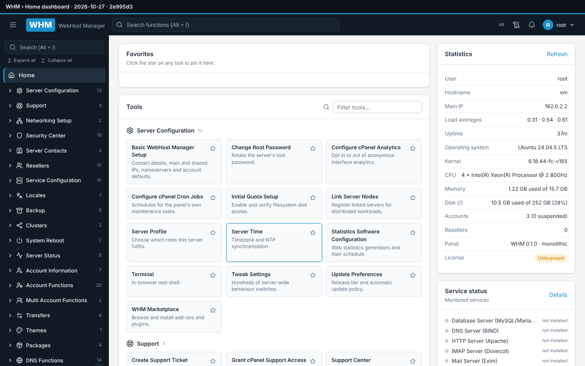

# WHM — WebHost Manager control panel

A production-grade, self-hostable **WHM-compatible hosting control panel**: the complete
WHM administrative interface (31 categories, 216 functions: the 212 WHM functions plus the Application Manager category and Support › Account Conversations) that manages a **real Linux
server** — Linux users and quotas, Apache/NGINX and PHP-FPM, BIND DNS, Exim/Dovecot mail,
MySQL/MariaDB, FTP, SSL/ACME, systemd services, IPs, security, backups, transfers and
resellers — built on Node.js 22, Express, React and SQLite. The product is **HST Panel** by
Hostingsignal: the hosted-account side carries that name, while the administrative side keeps the
WHM name (the sidebar category cPanel calls "cPanel" is *HST Panel* here; `client/src/brand.js` is
the source of the names). The project started as a WHM/cPanel clone, so routes, keys, slugs and
settings still use the original `cpanel` identifiers.

- Design of record: [`BLUEPRINT.md`](BLUEPRINT.md) · Progress: [`CHECKLIST.md`](CHECKLIST.md) · Conventions: [`CLAUDE.md`](CLAUDE.md) · Screenshots: [`docs/screenshots/`](docs/screenshots/README.md)



## Documentation

| Document | What it covers |
|---|---|
| [docs/INSTALL.md](docs/INSTALL.md) | Installation guide: components and deployment modes, requirements and ports, development quick start, production install with `scripts/install.sh` (every flag), the hub (keys, first admin, first license, connecting a panel, `hub.conf` reference), upgrades, backups, uninstall, full `WHM_*` / `WHM_HUB_*` reference, troubleshooting |
| [docs/MANUAL.md](docs/MANUAL.md) | User manual part A: signing in, layout, roles, how a change reaches the server, and every function of categories 1–15 |
| [docs/MANUAL-partB.md](docs/MANUAL-partB.md) | User manual part B: every function of categories 16–30, then licensing, plugins and the Marketplace, plugin developers, hub portals, troubleshooting |
| [plugins/SDK.md](plugins/SDK.md) | Plugin developer reference (manifest, `ctx` API, lifecycle, packaging, signing, submission) |
| [BLUEPRINT.md](BLUEPRINT.md) | Design of record (architecture, security model, every function, license server §16, plugin system §17, marketplace §18) |
| [HANDOFF.md](HANDOFF.md) | Brief for anyone taking the project over; [CHECKLIST.md](CHECKLIST.md) is the live tracker |

## Architecture in one paragraph

A React single-page app talks to an Express API (`server/`) that runs **unprivileged** as
the `whmpanel` user. Every privileged operation (create a Linux user, write a vhost, reload
BIND, …) is sent as a named, schema-validated request over a Unix socket to `whm-agentd`
(`agent/`), a small root daemon that exposes an **allowlisted catalog of operations** and
only ever runs programs with `execFile(bin, argv[])` — never a shell string. The panel keeps
its own state (accounts, packages, zones, jobs, audit log, sessions) in SQLite so it keeps
working while the managed MySQL is being restarted or repaired. Features whose daemon is
not installed degrade to a clear "service not installed" prompt instead of failing.

## Requirements

- Linux with systemd: Ubuntu 22.04/24.04, Debian 12, RHEL/AlmaLinux/Rocky 8/9
- Node.js ≥ 22 (the installer adds it from NodeSource if missing)
- Root access on the server you want to manage

## Production install

```bash
git clone https://github.com/sxi9/whm.git
cd whm
sudo bash scripts/install.sh                    # asks on a terminal: hosting stack, license hub, super admin setup password
sudo bash scripts/install.sh --stack full       # panel + the full hosting stack (Apache, PHP-FPM, MariaDB, BIND, Exim, Dovecot, FTP, ModSecurity, certbot, quotas, firewall, stats, Fail2ban)
sudo bash scripts/install.sh --stack web        # panel + Apache, PHP, MariaDB, certbot, quotas, firewall
sudo bash scripts/install.sh --components apache,php,mysql,bind   # manual selection from the stack catalog
sudo bash scripts/install.sh --stack none       # panel only; the first-login setup wizard or Service Manager › Server stack installs software later
# WHM_ADMIN_PASSWORD='…' chooses the first password; WHM_STACK / WHM_SUPERADMIN_SETUP_PASSWORD / WHM_LICENSE_HUB_URL answer the prompts non-interactively
```

The installer deploys to `/opt/whm`, creates the `whmpanel` service user, writes
`/etc/whm/{whm.conf,agent.conf,panel.env}`, generates a self-signed certificate in `/etc/whm/tls/`
(replaced in place by the hostname's Let's Encrypt certificate once *Networking Setup › Change
Hostname* runs), optionally installs a hosting stack from the same catalog the panel's setup wizard
and *Service Manager › Server stack* use, stores the super admin setup password hash in
`/etc/whm/superadmin.key`, and starts two units:

| Unit | Runs as | Purpose |
|---|---|---|
| `whm-agentd.service` | root | privileged operation catalog on `/run/whm-agent.sock` |
| `whm-panel.service` | whmpanel | API + web interface on **https://server:2087** (http: 2086) |

Log in as `root` with the generated password printed by the installer (also in
`/var/lib/whm/initial-admin-password.txt` — delete it after first login). You will be asked
to change it immediately, then the **setup wizard** (`/setup`) asks for the server basics and which
services to install. Open TCP 2086/2087 in your firewall: HTTPS is the default — port 2086 only
redirects to 2087 (`WHM_FORCE_HTTPS=false` in `/etc/whm/panel.env` serves plain HTTP), and every
site with a certificate redirects HTTP to HTTPS (setting `web.force_https`, toggle under *Service
Configuration › Apache Configuration*). Make the owning root user the **super admin**
(`sudo node /opt/whm/scripts/whm-cli.js superadmin root`, asks for the setup password): only that
user sees the license hub (`https://licserver.hostingsignal.in` by default) and the license key.

Useful commands:

```bash
journalctl -u whm-panel -u whm-agentd -f          # logs
sudo node /opt/whm/scripts/whm-cli.js status      # counts, mode, ports
sudo node /opt/whm/scripts/whm-cli.js reset-password root
sudo bash scripts/install.sh --upgrade            # redeploy a newer checkout, keep data
sudo bash scripts/install.sh --with-hub           # also install the license server + marketplace (below)
```

## Development

```bash
npm install
cp .env.example .env         # monolithic mode, ./data, port 2086
npm run dev                  # API with --watch on :2086 + Vite dev server on :5173 (proxies /api)
npm test                     # vitest: server + agent + client; node:test: SDK, sample + bundled plugins (hub: cd hub && npm test)
npm run build && WHM_SERVE_CLIENT=true npm start    # production-style single process
BASE=http://127.0.0.1:2086 PASSWORD='<root password>' node e2e/ui-check.cjs   # browser end-to-end check (needs playwright)
```

In development the API runs in **monolithic mode** (the op catalog executes in-process, so
run it as root if you want account creation to really create Linux users) and the first
boot writes `data/initial-admin-password.txt`.

## Configuration

Precedence: environment variables → `/etc/whm/whm.conf` (or `WHM_CONFIG`) → defaults.
See [`.env.example`](.env.example) and [`deploy/whm.conf.example`](deploy/whm.conf.example).
Key settings: `WHM_MODE` (`split` in production, `monolithic` for dev), `WHM_DATA_DIR`,
`WHM_PORT`/`WHM_TLS_PORT`, `WHM_TLS_CERT`/`WHM_TLS_KEY` (`/etc/whm/tls/cert.pem` + `key.pem` on an
installed host), `WHM_FORCE_HTTPS`, `WHM_SERVE_CLIENT`, `WHM_LICENSE_HUB_URL`.
The agent's writable path roots can be widened in `/etc/whm/agent.conf`.

## Security model (summary)

- Privilege separation: web tier is non-root; only `whm-agentd` touches the system, through
  a fixed op catalog with zod-validated arguments; unknown ops and bad arguments are refused.
- No shell strings anywhere; identifiers that reach `argv` are validated (no leading `-`).
- Sessions: `httpOnly`/`sameSite=strict` cookies, CSRF token on every mutation, rate limits,
  brute-force blocking (cPHulk), optional TOTP two-factor authentication.
- RBAC: `root` and `reseller` roles; resellers only see accounts they own.
- Secrets at rest encrypted (AES-256-GCM, key in the data dir); API tokens stored hashed.
- Every mutating request and every privileged action is written to the audit log with
  secrets redacted.

Full detail: [`BLUEPRINT.md`](BLUEPRINT.md) §4, §8, §10.

## Repository layout

```
server/   Express API, services, SQLite migrations, tests      agent/    whm-agentd op catalog + executor
client/   React SPA (nav.js = all 216 functions)               hub/      whm-hub: license server + marketplace + portal UI
plugins/  SDK.md, sdk/ (validator, mock host, packer), sample-plugin/, bundled/ (4 plugins)
deploy/   systemd units + config templates (panel, agent, hub)  scripts/  install.sh, whm-cli.js, build-plugin.js
docs/     saved design sections + build plan                    BLUEPRINT.md · CHECKLIST.md · CLAUDE.md
```

## License server & marketplace (hub)

The panel is resold through **whm-hub** (`hub/`, workspace `@whm/hub`): one Node process that is
both the **license server** (`BLUEPRINT.md` §16: keys, activations, check-ins, resellers, trials,
billing webhooks) and the **plugin marketplace** (§18: developer verification, signed distribution,
revocations, entitlements), with a vendor-admin / reseller / developer portal (`hub/ui`). Panels
only ever *pull* from it: a hub outage never affects a running panel.

### Install

```bash
sudo bash scripts/install.sh --with-hub                      # panel + hub on this host
sudo HUB_PUBLIC_URL=https://hub.example.com:7443 HUB_ADMIN_EMAIL=you@example.com \
     bash scripts/install.sh --with-hub                      # public URL + first portal admin
sudo WHM_LICENSE_HUB_URL=https://hub.example.com:7443 bash scripts/install.sh   # panel only, pinned to a remote hub
```

`--with-hub` creates the `whmhub` user, `/etc/whm-hub` (0750: `hub.conf`, `hub.env`, `master.key`,
`ssl/hub.{crt,key}`, `keys/`), `/var/lib/whm-hub` (`license.db`, `marketplace.db`, `packages/`),
`/var/log/whm-hub`, `/var/backups/whm-hub`, installs `hub/` dependencies, builds `hub/ui` (its own
npm package, not a root workspace: `npm ci` when `hub/ui/package-lock.json` exists, `npm install`
otherwise; `HUB_SKIP_UI=1` skips it, and `serve_ui` then wants `false`), and installs
`whm-hub.service`. Overrides at first install: `HUB_PUBLIC_URL`, `HUB_DATA_DIR`,
`HUB_ADMIN_EMAIL`/`HUB_ADMIN_PASSWORD`, `HUB_SKIP_UI=1`.

`--upgrade` redeploys a hub that is already installed (no `--with-hub` needed): code,
dependencies, the portal build and the unit. It never rewrites `hub.conf`, `hub.env`, the keys
or the certificate, so a `public_url` or a CA-issued `tls.*` pair you edited stays; the one
exception is an explicit `HUB_PUBLIC_URL`, which updates `public_url` alone. The data and backup
directories are read back from the installed `hub.env`/`hub.conf` (the unit's `ReadWritePaths`
follow them), so a customised `HUB_DATA_DIR` need not be repeated; passing a *different* one
aborts before anything is touched, because moving the data directory is a manual step (stop the
unit, move it, edit `WHM_HUB_DB_DIR` in `hub.env` and `db_dir`/`marketplace.*` in `hub.conf`).

| Unit | Runs as | Ports |
|---|---|---|
| `whm-hub.service` | whmhub | **:7443** HTTPS — `/v1/*` license API, `/v1/market/*` catalog, `/v1/dev/*`, `/v1/admin/*`, `/v1/reseller/*`, portal SPA; **127.0.0.1:7440** `/healthz`, `/metrics` (never expose) |

The panel learns its hub from `WHM_LICENSE_HUB_URL` in `/etc/whm/panel.env` (the installer asks on a
terminal with the vendor hub `https://licserver.hostingsignal.in` as the default — the panel's own
fallback when the variable is unset —, takes the variable non-interactively, and defaults to the local
hub with `--with-hub`). The address, the key and every hub answer are shown to the panel's **super
admin** only (`whm-cli superadmin <user>`, gated by the setup password in `/etc/whm/superadmin.key`);
other root users see a *managed by the panel owner* card. Hub portal admins (vendor and reseller) must
enrol an authenticator app at their first login (`hub.require_totp_for_admins`, on by default; *Admin ›
Security › Portal policy* switches it).
That URL is only the **bootstrap** address for activation and trials; once a token exists the panel
talks to the hub named in the token (`iss`). Panels speak https only; for a hub with a self-signed
certificate set `WHM_LICENSE_HUB_CA=/etc/whm/hub-ca.pem` (a copy of `hub.crt` readable by
`whmpanel`) — the installer does this for a same-host hub whose certificate it generated.

```bash
journalctl -u whm-hub -f
curl -s http://127.0.0.1:7440/healthz                      # {"data":{"ok":true,"keys":{...}}}
cd /opt/whm/hub && sudo WHM_HUB_CONFIG=/etc/whm-hub/hub.conf node scripts/hub-cli.js status
sudo WHM_HUB_CONFIG=/etc/whm-hub/hub.conf node hub/src/index.js --check-config   # validate the installed config
```

`--check-config` boots against temporary databases and ephemeral keys and answers `/healthz`, but
it is not entirely side-effect free: the marketplace module creates `marketplace.packages_dir`
from the file being checked. Run it against the installed `hub.conf` (whose directories exist),
not against `deploy/hub.conf.example` or any file whose `packages_dir` you do not want created.

### Keys: what the installer generates and what to pin

`hub/scripts/gen-key.js` (run by the installer, or by hand with `--config /etc/whm-hub/hub.conf`):

| Command | Writes | Purpose |
|---|---|---|
| `--master` | `/etc/whm-hub/master.key` (0600) | AES-256-GCM key for every secret the hub stores |
| `--hmac` | `/etc/whm-hub/keys/download.hmac` | signs single-use package download URLs |
| `--license [--activate]` | `/etc/whm-hub/keys/<kid>.ed25519` + `signing_keys` row, `purpose = license` | signs license tokens **and every hub response a panel acts on** |
| `--plugin [--activate]` | same, `purpose = plugin` | signs `SIGNATURE.json` of approved marketplace packages |

The first key of each purpose becomes `active`; later keys stay `pending` until
`hub-cli.js activate-key <kid>` (or `POST /v1/admin/signing-keys/:kid/activate`), which moves the
previous key to `retiring` and, for plugin keys, re-signs every published package. The installer
prints each generated key as `{ kid, pub }`:

- the **license** key must be **pinned in the panel release**: add the entry to
  `server/src/services/license-keys.json` (`{ "keys": [ { "kid", "pub", "not_after" } ] }`) before
  building, or point a staging panel at a file of the same shape with `WHM_LICENSE_KEYS_FILE`.
  Hub responses are verified only against that set — an online key list can add nothing a release
  does not trust;
- the **plugin** key needs no manual step: panels receive it inside their license-signed activation
  and check-in responses and write it to `$WHM_DATA_DIR/plugin-keys/<kid>.pub`.

Rotation rule: ship a new license key in a panel release first, activate it on the hub ≥ 90 days
later, keep the old one `retiring` for ≥ 2× the token TTL, then retire it. Private keys never leave
`/etc/whm-hub/keys/`.

### First license

```bash
cd /opt/whm/hub
sudo WHM_HUB_CONFIG=/etc/whm-hub/hub.conf node scripts/hub-cli.js create-admin you@example.com   # portal login (enrol TOTP on first login)
sudo WHM_HUB_CONFIG=/etc/whm-hub/hub.conf node scripts/hub-cli.js issue whm-pro-annual customer@example.com --months 12
# → { "license_id": "lic_…", "key": "WHM-XXXX-XXXX-XXXX-XXXX", "edition": "pro", … }   (the key is shown once)
```

Editions (`products` rows: `whm-trial`, `whm-solo-*`, `whm-pro-*`, `whm-reseller-annual-N`,
`whm-enterprise`) carry limits (`max_accounts`, `max_resellers`, `max_activations`) and feature
flags (`api`, `transfers`, `clusters`, `marketplace_paid`, `white_label`, …).

- **Trial** — on the panel, *Server Configuration › Basic WebHost Manager Setup › License › Start free
  trial* (e-mail only: `POST /v1/trial`, 14 days, one per server fingerprint and per e-mail). Converting
  it (`POST /v1/admin/trials/:id/convert { sku }`, or the portal) keeps the activation, so the panel
  simply receives a Solo/Pro token at its next check-in.
- **Reseller** — create the reseller in the admin portal (quota per edition + wholesale prices) and an
  API key with `license:issue`; the reseller issues within quota through the reseller portal or
  `POST /v1/reseller/licenses { sku, customer, term_months }` (bulk: `…/bulk` → job + CSV).
- **Where the panel enters the key** — only under *Basic WebHost Manager Setup › License* (enter/replace
  key, *Check in now*, edition/limits/features, activations with *Deactivate*/*Transfer*, vendor portal
  link). The Market Provider Manager's `whm-hub` row holds no key: it is the marketplace enable switch.
  Activation binds the key to a server fingerprint (hashes of machine-id, default-route MAC, root
  filesystem UUID); check-ins run every 12 h; a lapsed license puts the panel into **read-only
  degraded mode** (`423 license_degraded` on mutations, GETs/backups/restarts/unsuspend still allowed)
  and never touches a customer site.

### Marketplace: developer flow

1. **Register** — `POST /v1/dev/register` (or the developer portal), verify the e-mail, complete the
   profile and **enrol TOTP** (required for namespace claims, keys, API keys, e-mail/payout changes,
   publishing; those portal actions ask for a fresh TOTP step-up).
2. **Claim a namespace** — a reverse-DNS prefix you own (`net.acme` ↔ `acme.net`; public suffixes such
   as `io.github` or `com` are refused, `net.whm`/`com.cpanel`/bundled prefixes are reserved). Plugin
   ids must start with it (`net.acme.cache-boost`).
3. **Prove it** — DNS `TXT _whm-dev.acme.net` = `whm-dev-verify=<token>` or
   `https://acme.net/.well-known/whm-developer.txt`; optionally a GitHub organisation (OAuth) or an ID
   document. Checks run through the hub's SSRF-safe fetcher and are inputs, not the decision.
4. **Verify** — a vendor reviewer approves the account in *Admin › Developer verification queue*
   (`status = verified`, re-verification after 12 months) or rejects with a reason. Nothing is
   published before this human decision.
5. **Register a signing key** — `POST /v1/dev/keys` returns a 32-byte challenge; answer with your
   Ed25519 public key (PEM) and `sig = ed25519(challenge)`. Generate the pair with
   `openssl genpkey -algorithm ed25519` or `require('plugins/sdk').pack.generateKeyPair()`.
6. **Submit** — `node scripts/build-plugin.js <dir> --sign dev.pem --dev --out plugin.whmplugin`
   (writes `DEV-SIGNATURE.json`), then `POST /v1/dev/plugins/:id/versions` (raw upload, ≤ 20 MiB) with
   a justification per permission. Automated checks follow: manifest, `engines.whm`, developer
   signature, file-type allow-list, static scan (`child_process`, `eval`, `constructor.constructor`,
   `Reflect`, undeclared `fetch`/`agent:op`), secrets, optional AV, typosquat skeleton check.
7. **Review** — a reviewer sees the scan report, the diff since the last published version and the
   permission list (two reviewers for high-risk scopes). On **approve** the hub writes
   `SIGNATURE.json` with its active plugin key and repacks deterministically.
8. **Publish** — to `stable` or `beta` (`POST …/versions/:v/publish`). Yank hides a version; admins
   can revoke (panels disable it through the signed revocation feed) or take a plugin down.
9. **Install from WHM** — enable the `whm-hub` row in *Market › Market Provider Manager*, then
   *HST Panel › Manage Plugins › Marketplace* (or *Server Configuration › WHM Marketplace*): install
   opens a **consent screen** listing every scope with its description and the developer's
   justification; the package is downloaded through a signed single-use URL, its sha256 and
   `SIGNATURE.json` verified against the hub-pinned keys, then enabled. Updates that add scopes are
   held `pending_consent` (plugin disabled) until root consents. Paid plugins need the
   `marketplace_paid` feature and an entitlement (checkout on the hub portal).

### Bundled plugins

`plugins/bundled/` ships with the release and is installed at boot through the real plugin host
(`source: 'bundled'`, exempt from the signature and developer-mode gates, never updated from the hub):
**ImunifyAV** (`net.whm.imunifyav`), **Server Monitoring** (`net.whm.server-monitoring`),
**WP Toolkit** (`net.whm.wp-toolkit`) and **Automated Backup** (`net.whm.automated-backup`: scope,
components, cron schedule, per-account locks, verification, upload to backup destinations, day/week/
month retention of the local archives, run history, token-confirmed restores, notifications; it
appears under its own sidebar entries). `plugins/sample-plugin` (`net.whm.sample-notes`) is the
reference plugin that uses every extension point and the marketplace fixture.

### Building and signing a plugin

```bash
node scripts/build-plugin.js plugins/sample-plugin --out notes.whmplugin                 # unsigned
node scripts/build-plugin.js plugins/sample-plugin --sign dev.pem --dev --out notes.whmplugin   # for upload (DEV-SIGNATURE.json)
node scripts/build-plugin.js my-plugin --sign ops.pem --out my.whmplugin                 # local trust (SIGNATURE.json)
node --test plugins/sample-plugin/test                                                   # tests against the SDK mock host
```

A `.whmplugin` is a deterministic gzip tar (`plugin.json` + `main.js` at the root, ≤ 20 MiB / 50 MiB
extracted). Signatures are Ed25519 over the package digest, `sig` in standard base64 with padding,
`kid` = first 8 hex of `sha256(public key)`. For a plugin you distribute yourself, sign with
`--sign key.pem` (no `--dev`) and drop `key.pub` as `$WHM_DATA_DIR/plugin-keys/<kid>.pub` on each panel;
turn on `plugins.require_signature` in Manage Plugins. Once the marketplace is enabled, sideloading
additionally requires `plugins.developer_mode`. Full reference: [`plugins/SDK.md`](plugins/SDK.md).

### `hub.conf` reference

`/etc/whm-hub/hub.conf` is JSON (no comments; template `deploy/hub.conf.example`); every key can be
overridden by a `WHM_HUB_*` variable in `/etc/whm-hub/hub.env` (`hub/src/config.js` `ENV_MAP`), which is
where the billing webhook secrets belong (`WHM_HUB_STRIPE_SECRET`, `WHM_HUB_WHMCS_SECRET`,
`WHM_HUB_PADDLE_SECRET`). The GitHub OAuth client secret has no environment variable: it goes in
`hub.conf` (0640 `root:whmhub`) as `marketplace.github_oauth.client_secret`, or pre-encrypted with the
master key as `client_secret_enc`. The installer writes `hub.conf` once; `--upgrade` leaves it alone.

| Key | Default | Meaning |
|---|---|---|
| `public_url` | `https://localhost:7443` | the URL panels and portals use; `iss` of every token |
| `serve_ui` | `false` (`true` in the template) | serve `hub/ui/dist` at `/` (SPA fallback); a warning is logged when the build is missing |
| `host` / `port` / `loopback_port` | `0.0.0.0` / `7443` / `7440` | listeners; `loopback_port: 0` disables `/healthz` + `/metrics` |
| `trust_proxy` | `loopback` | Express `trust proxy` setting |
| `log_level` | `info` | pino level (`fatal` … `trace`, `silent`); logs go to the journal |
| `db_dir` | `/var/lib/whm-hub` | `license.db`, `marketplace.db`, `packages/`, generated session secret |
| `master_key_file` | `/etc/whm-hub/master.key` | hex AES key from `gen-key.js --master` (`master_key` inline is for tests only) |
| `session_secret`, `cookie_secure` | generated / auto | portal cookie settings |
| `tls.cert` / `tls.key` | — (required) | PEM pair for :7443; `insecure_http: true` only behind a TLS-terminating proxy |
| `keys.dir` | `/etc/whm-hub/keys` | `<kid>.ed25519` private keys + `download.hmac` |
| `keys.active_kid.license` / `.plugin` | `null` | promotes a `pending` key only when the database has no active key of that purpose; the `signing_keys` table is authoritative |
| `license.token_ttl_hours` | `168` | token lifetime; `exp = min(iat + ttl, license expiry + grace)` |
| `license.checkin_interval_hours` | `12` | told to panels at activation |
| `license.default_grace_days` | `7` | grace after expiry before `expired` tokens |
| `license.trial_days` | `14` | trial length |
| `license.reclaim_days` | `30` | an activation silent this long may be reclaimed by a new one |
| `license.reactivation_limit` | `{ count: 3, days: 30 }` | re-activations per license per window without vendor approval |
| `license.nonce_ttl_s` / `max_skew_s` | `600` / `300` | replay cache TTL (must be ≥ 2 × skew) and accepted clock skew |
| `license.session_ttl_hours` / `stepup_max_age_s` | `12` / `300` | portal session and TOTP step-up freshness |
| `license.checkin_retention_days` | `90` | `checkins` rows pruned after this |
| `license.lookup_block` | `{ failures: 20, windowMs, blockMs }` | failed key lookups per IP before a 24 h block |
| `license.backup_dir` / `backup_keep` | `/var/backups/whm-hub` / `48` | hourly `sqlite .backup` target and how many to keep (`null` disables) |
| `license.mail` | `{ from, enabled: true, transport: "sendmail" }` | outbound mail (`sendmail -t -i`; `none` records only) |
| `license.billing.{stripe,whmcs,paddle}.secret` | — | inbound webhook signing secrets (prefer `hub.env`) |
| `license.rate_limits.*` | §16.10 values | `{ max, windowMs }` per route group: `activate`, `checkin`, `trial`, `recover`, `reseller`, `admin`, `portal_login`, `public` |
| `license.vendor` | `{ name, support_email?, portal_url? }` | shown in mails and panel messages |
| `marketplace.packages_dir` | `<db_dir>/packages` | signed `.whmplugin` store (`<plugin_id>/<version>-<kid>.whmplugin`) |
| `marketplace.max_package_bytes` | `20971520` | upload limit (20 MiB) |
| `marketplace.download_url_ttl_s` | `900` | lifetime of a signed single-use download URL |
| `marketplace.download_hmac_file` | `<keys.dir>/download.hmac` | from `gen-key.js --hmac` |
| `marketplace.scan.av_command` | `null` | optional AV argv, e.g. `["clamscan", "--no-summary"]` (run with `execFile`) |
| `marketplace.review.require_two_reviewers_for_high_risk` | `true` | second reviewer for high-risk scopes |
| `marketplace.revenue_share_pct` / `payout_min_cents` / `currencies` | `70` / `5000` / `["USD","EUR"]` | monetisation defaults |
| `marketplace.github_oauth` | `null` | `{ client_id, client_secret, redirect_url }` for the GitHub-organisation verification method (secret may be `client_secret_enc`; no `WHM_HUB_*` variable); `null` or an empty `client_id` makes that method answer `501 github_not_configured` |
| `marketplace.public_suffix_list` | `<db_dir>/public_suffix_list.dat` | refreshed weekly; the bundled `hub/shared/psl.dat` is the fallback |
| `marketplace.reserved_namespaces` / `reserved_brands` | `[]` | your own brand prefixes/names, added to the built-in reserved list |
| `marketplace.host_api_versions` | `["1.0.0"]` | host API versions a submission's `engines.whm` must intersect |
| `marketplace.evidence_purge_days` | `30` | ID documents deleted this long after a decision |
| `marketplace.session_ttl_hours` / `stepup_max_age_s` | `12` / `300` | developer portal sessions |
| `marketplace.rate_limits.*` | §18.9 values | `register`, `upload`, `recheck`, `verification`, `download`, `feed`, `catalog`, `dev_login` |

## Status

See [`CHECKLIST.md`](CHECKLIST.md) for the live function-by-function status and the build
phases. All 212 WHM functions plus the Application Manager category, the plugin host and the four bundled plugins are built; the hub
(license server + marketplace) and its panel clients are the Phase-5 work tracked there.
