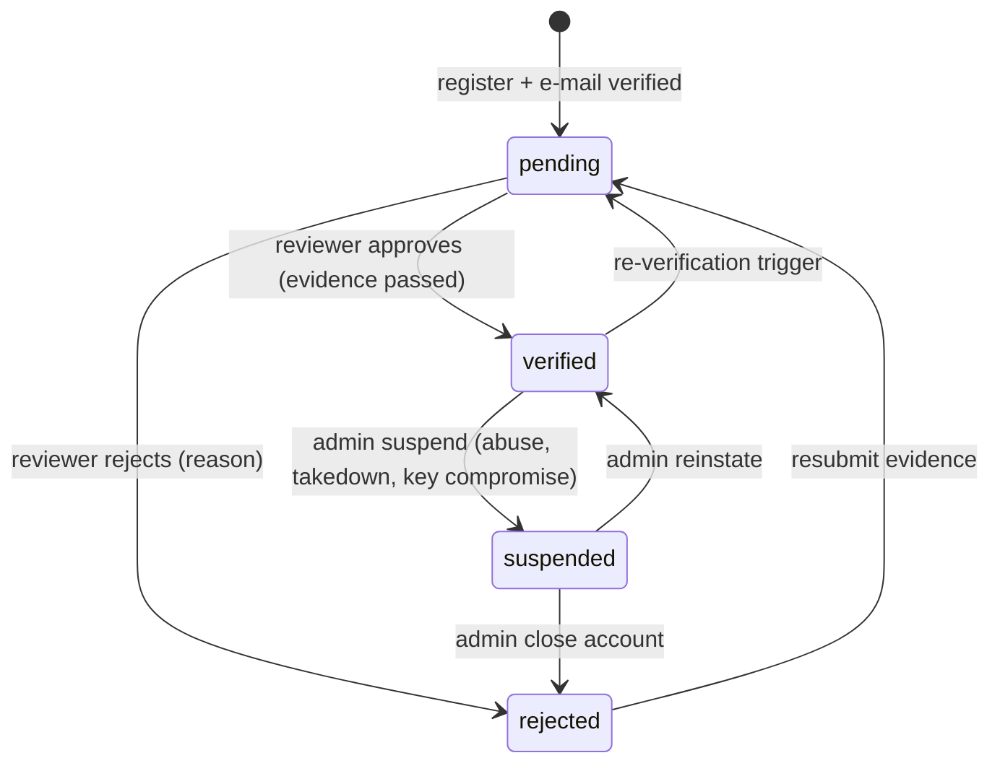
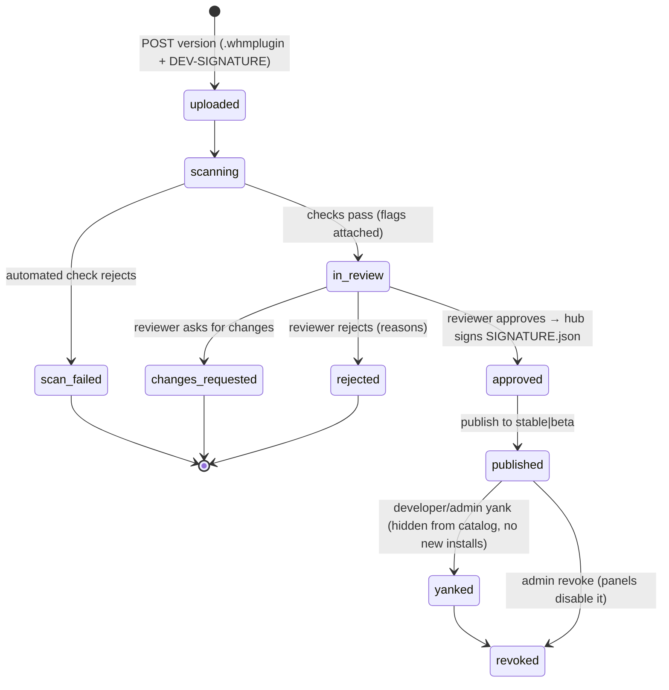

## 18. Plugin Marketplace

The marketplace is how plugins reach panel installs and how third-party developers reach
customers. Four rules from the owner are binding:

1. **Anyone can register as a developer** — self-service sign-up, no invitation.
2. **No developer publishes anything before the vendor verifies them** in the admin backend:
   a human decision recorded with evidence, never automatic.
3. **Plugins reach panels through the marketplace** — WHM Marketplace, Manage Plugins and
   Market Provider Manager are the client; sideloading is a developer-mode escape hatch with a warning.
4. **The panel is resold with the license server** (§16): paid plugins are entitlements on a
   panel license and the package-signing key reaches a panel through license activation.

There is no second packaging or signing scheme: a marketplace package **is** a `.whmplugin` as
`server/src/services/plugins.js` installs it, and the marketplace signature **is** its `SIGNATURE.json`.

**Trust chain in one paragraph.** Two key purposes, never mixed: *license* keys (`signing_keys.purpose =
'license'`) are compiled into the panel (`server/src/services/license-keys.json`) and sign license tokens
**and every hub response the panel acts on** (activation, check-in, download descriptors, update and
revocation feeds, entitlement answers). *Plugin* keys (`purpose = 'plugin'`) sign `SIGNATURE.json` only; the
panel learns them from a license-signed activation/check-in response and writes them to
`$WHM_DATA_DIR/plugin-keys/<kid>.pub`, where the host's `verifySignature()` reads them. Hub responses are
**never** verified with plugin keys (that would make the chain circular) and packages are never signed with
license keys (`hub/shared/keys.js` `sign()` refuses a kid whose purpose does not match the caller's).

### 18.1 Positioning & deployment

> **Supersedes the §16.1 layout (erratum, 2026-10-27).** §16.1 describes `hub/license/src/{index,app,config}.js`,
> `hub/license/src/lib/*`, `hub/license/portal/`, unit `whm-license.service` and `/etc/whm-hub/license.conf`.
> The hub is built as **one** process and one npm workspace, so the tree below is the layout of record and
> every §16.1 path maps as follows: `hub/license/src/index.js` → `hub/src/index.js`; `hub/license/src/app.js` →
> `hub/src/app.js`; `hub/license/src/config.js` → `hub/src/config.js`; `hub/license/src/db/*` →
> `hub/shared/db.js` + `hub/license/migrations/`; `hub/license/src/lib/{keys,canonical,keyfmt,fingerprint,
> webhooks,nonce,scheduler}.js` → `hub/shared/<same name>.js`; `hub/license/src/{services,routes}/` →
> `hub/license/{services,routes}/`; `hub/license/portal/` → `hub/ui/` (one SPA with admin, reseller and
> developer areas); `whm-license.service` → `whm-hub.service`; `/etc/whm-hub/license.conf` (yaml) →
> `/etc/whm-hub/hub.conf` (**JSON**) with the §16.1 keys under a `license:` section; logs
> `/var/log/whm-hub/{app,audit,access}.log`. "§17" in §16.1, §16.8 and §16.12 means this section (§18);
> §17 is *Plugin SDK & host*. The build plan's "§16 errata" table carries the same mapping for the integrator.

`hub/marketplace/` is co-deployed with `hub/license/` as **one** Node 22 + Express 4 + SQLite (WAL)
process, `whm-hub`, in the npm workspace `@whm/hub`:

```
hub/
├── package.json                 @whm/hub  (deps: express, express-session, better-sqlite3, zod, helmet, express-rate-limit, bcryptjs, otplib, pino, pino-http)
├── src/index.js                 bootstrap: config → open both DBs → migrate → services → one Express app → HTTPS :7443, loopback :7440 /healthz /metrics
├── src/app.js                   helmet, rate limits, api-key / portal-session auth, zod validate(), {data,meta}/{error} envelopes
├── src/config.js                /etc/whm-hub/hub.conf (JSON) + env WHM_HUB_*
├── shared/                      used by both halves: db.js (open/migrate), crypto.js (AES-256-GCM, bcrypt, token hashes),
│                                canonical.js (JCS, §16.4), keys.js (Ed25519 sign/verify, kid, purpose), auth.js (api keys, portal sessions, scopes, csrf),
│                                mailer.js, webhooks.js, scheduler.js, audit.js, nonce.js, fingerprint.js, keyfmt.js, safe-fetch.js (SSRF-safe HTTP + DNS, §18.2)
├── license/                     §16 (migrations/001_license.sql, routes/public.js reseller.js admin.js portal.js, services/*)
├── marketplace/
│   ├── migrations/001_marketplace.sql …
│   ├── services/ developers.js verification.js keys.js submissions.js scanner.js review.js catalog.js
│   │             distribution.js entitlements.js billing.js revocations.js signing.js payouts.js stats.js plugin-reviews.js
│   └── routes/ public.js developer.js admin.js
└── ui/                          React (Vite) admin + reseller + developer portal (§18.7)
```

| Item | Value |
|---|---|
| Service / user / DBs | `whm-hub.service`, `User=whmhub`; one unit serves `/v1/*` (license) and `/v1/market/*`, `/v1/dev/*`, `/v1/admin/market/*`; `/var/lib/whm-hub/license.db` (§16.3, owned by `hub/license`) + `/var/lib/whm-hub/marketplace.db` (§18.2–18.5, owned by `hub/marketplace`). Cross-domain access only through in-process services: the marketplace reads licenses via `ctx.licenses.verifyToken/get/featureOf`, `ctx.activations.get`, and keys via `ctx.keys` — it never opens `license.db` |
| Packages | `/var/lib/whm-hub/packages/<plugin_id>/<version>-<mkt_kid>.whmplugin` (`0640 whmhub`), served only through signed, single-use download URLs |
| Config | `/etc/whm-hub/hub.conf` (JSON): `{ public_url, serve_ui, license: { …§16.1 keys… }, keys: { dir: "/etc/whm-hub/keys", active_kid: { license, plugin } }, marketplace: { packages_dir, max_package_bytes (20 MiB), download_url_ttl_s (900), scan: { av_command }, review: { require_two_reviewers_for_high_risk }, revenue_share_pct (70), payout_min_cents, github_oauth: { client_id, client_secret_enc, redirect_url }, public_suffix_list: "/var/lib/whm-hub/public_suffix_list.dat" } }` |
| Signing keys | `/etc/whm-hub/keys/<kid>.ed25519` (`0600 whmhub`); the row `signing_keys(kid, purpose, …)` lives in **license.db** (§16.3 + `purpose`); `keys.active_kid.plugin` names the online key that signs `SIGNATURE.json`, `keys.active_kid.license` the key that signs tokens and responses. `/etc/whm-hub/keys/download.hmac` (32 random bytes, `0600`, `gen-key.js --hmac`) signs download URLs. `/etc/whm-hub/master.key` (`0600`, `gen-key.js --master`) is the AES master key for `shared/crypto.js` |
| Panel client | `server/src/services/marketplace-client.js` + `routes/marketplace.js` (§18.6); **enabled** through the existing `whm-hub` row of `market_providers` (`ctx.market.hub()` → `{ enabled, url }`), **addressed and authenticated** through `ctx.license` (§18.6 "Hub identity") |

Panel ↔ hub transport is §16.6's: `POST` JSON with `X-WHM-Nonce`/`X-WHM-Timestamp`, every hub
response signed (`X-WHM-Signature: kid=…,sig=…` over the canonical body echoing the nonce) with the
**license** key, verified by the panel against the compiled-in `license-keys.json` set. `GET` catalog
reads (`catalog`, `categories`, `plugins/:id`, `plugins/:id/versions`, `keys`) are public, unsigned and
informational; everything the panel *acts on* — download descriptors, the update feed, the revocation
feed, entitlement answers — is a nonce'd `POST` with a signed response (§18.4), sent through
`ctx.license.hub.request()`.

### 18.2 Developers: registration & verification

Registration is open; publishing is gated by `developers.status = 'verified'`.

```sql
developers(id, email UNIQUE, email_verified_at, password_hash, totp_secret_enc, totp_enabled,
           display_name, slug UNIQUE,                       -- public vendor name, e.g. "acme-hosting"
           company, website, country, support_email, support_url,
           status,                                          -- pending|verified|rejected|suspended
           status_reason, verified_at, verified_by, reverify_due_at,
           namespaces_json,                                 -- ["net.acme", "com.acme-hosting"] reverse-DNS prefixes this developer owns
           payout_json_enc,                                 -- Stripe Connect / IBAN details, encrypted
           failed_logins, locked_until, password_changed_at, credentials_changed_at,
           created_at, updated_at)
developer_namespaces(ns PRIMARY KEY, developer_id, domain,  -- ns "net.acme" ↔ domain "acme.net" (rule below); UNIQUE across developers
           status,                                          -- claimed|verified|revoked
           verified_at, last_check_at, last_check_result)
developer_verifications(id, developer_id, ns NULL, method,  -- dns_txt|well_known|github_org|id_document
           evidence_json,                                   -- {"domain":"acme.net","token":"whm-dev-…"} | {"org":"acme","login":"…"} | {"file_id":…}
           result,                                          -- pending|passed|failed|expired
           checked_at, reviewer_id, reviewer_note, created_at)
developer_keys(id, developer_id, kid UNIQUE, public_key_pem, label,
           status, created_at, revoked_at, revoked_reason)  -- active|revoked; kid also refused when present in signing_keys (via ctx.keys.byKid)
developer_sessions(sid PRIMARY KEY, developer_id, data, totp_verified_at, expires_at)
developer_api_keys(id, developer_id, name, key_hash, scopes_json, last_used_at, expires_at, revoked_at)
developer_password_resets(token_hash PRIMARY KEY, developer_id, expires_at, used_at)
developer_webhooks(id, developer_id, url, secret_enc, events_json, enabled)
developer_webhook_deliveries(id, webhook_id, event, payload_json, attempt, status, next_at, last_code)
```

**Namespaces — the ownership rule** (`services/developers.js`, `lib/namespace.js`):

- A namespace is a reverse-DNS prefix of ≥ 2 segments, lower-cased, IDNA-normalised (Unicode labels
  become `xn--…` with `url.domainToASCII`; a label that fails conversion is refused). Namespace
  `a.b.c` ↔ domain `c.b.a`.
- The **registrable domain** of that domain is computed with the Public Suffix List (bundled copy in
  `hub/shared/psl.dat`, refreshed weekly by `jobs.js` into `marketplace.public_suffix_list`): it must
  have ≥ 2 labels and must not itself be a public suffix (ICANN **and** private sections). So `io.github`,
  `com`, `uk.co` cannot be claimed and neither can `io.github.acme` (its domain `acme.github.io` sits on a
  private-section suffix the developer cannot prove by DNS/well-known); developers hosted on such platforms
  claim `com.github.<org>` through the GitHub-organisation method, the only method that proves that form.
- Evidence must be on **exactly** the namespace's domain or on its registrable parent (claiming
  `net.acme.plugins` is proven by `plugins.acme.net` or `acme.net`); evidence on any other host is `failed`.
- Id coverage is `id.startsWith(ns + '.')` — `net.acme` covers `net.acme.cache-boost`, never `net.acme-evil.x`.
- A namespace already held by another developer (`developer_namespaces.ns` PRIMARY KEY, or a prefix/extension
  of one: `net.acme` vs `net.acme.sub`) is refused at claim time with `409 namespace_conflict`; the conflict
  is logged for the reviewer, who may reassign after a dispute.
- **Reserved** (never claimable, `422 namespace_reserved`): `net.whm`, `net.trywhm`, `net.example`,
  `com.cpanel`, `net.cpanel`, `com.whm`, the vendor's own brand list from config (`marketplace.reserved_namespaces`)
  and every bundled-plugin id prefix (`plugins/bundled/*`). `net.example.*` is the SDK fixture namespace.

**Sign-up → verification → publishing**

1. `POST /v1/dev/register { email, password, display_name }` → `202`; mail with a 24 h
   verification link; the account exists but `status = 'pending'`.
2. Developer completes the profile, **enrols TOTP** (required before any of: namespace claim, signing-key
   add/revoke, API-key creation, e-mail/payout change, publish — §18.9), then claims one or more
   **namespaces** (`net.acme`) under the rule above — plugin ids must start with a claimed namespace
   (SDK `ID_PATTERN`, ≥ 3 segments).
3. Developer **registers an Ed25519 signing key** (PEM SPKI) with proof of possession: `POST /v1/dev/keys`
   returns a 32-byte challenge; `POST /v1/dev/keys/:challenge { public_key_pem, label, sig }` must carry
   `sig = ed25519(challenge)` (base64). `kid` = first 8 hex of `sha256(raw 32-byte public key)` (§16.4
   rule); the kid must be unique across `developer_keys` **and** absent from `signing_keys` (`ctx.keys.byKid`),
   else `409 kid_conflict` (a developer cannot register the hub's own public key or grind a collision).
   Every upload carries a `DEV-SIGNATURE.json` from an active key (§18.3); every verify is scoped by
   `(developer_id, kid, status = 'active')`, never by kid alone.
4. Developer attaches **evidence** per claimed namespace: DNS `TXT _whm-dev.<domain>` =
   `whm-dev-verify=<token>` **or** `https://<domain>/.well-known/whm-developer.txt` containing the token;
   optionally a GitHub organisation link (OAuth with `marketplace.github_oauth`; proves membership with
   `admin` role in the org, and covers namespaces `com.github.<org>` only) and an ID document (encrypted,
   deleted 30 days after the decision). Automated checks set `result = passed|failed` — inputs, not the decision.
   **All outbound checks go through `shared/safe-fetch.js`** (SSRF policy): the host name is resolved
   first; loopback, private (RFC 1918), link-local, ULA, multicast, unspecified and the hub's own
   addresses are refused (`evidence_target_refused`); the connection is made to the resolved IP with the
   original `Host`/SNI (DNS-rebinding guard); port 443 only; `redirect: 'error'`; 5 s timeout; 4 KiB body
   cap; no cookies or credentials; TLS verification on; DNS TXT lookups use the system resolver with a 5 s
   timeout and ≤ 10 records. Re-checks (`POST /v1/dev/verification/:id/recheck`) are queued through
   `jobs.js` and limited to 5/h per developer and 1/min per target domain.
5. The request lands in the **admin verification queue**; a vendor reviewer approves
   (`verified`, `reverify_due_at = +12 months`) or rejects with a structured reason
   (`duplicate_identity`, `evidence_failed`, `namespace_conflict`, `policy`, text); every
   transition is an `audit_log` row and a mail.
6. **Re-verification triggers**: `reverify_due_at`; e-mail or payout details changed; a key
   revoked for compromise; a takedown or 2 rejections in 90 days; monthly namespace re-check
   fails. While a previously verified developer is back in `pending`, uploads are still accepted
   (**upload rule**: `status IN ('verified','pending') AND verified_at IS NOT NULL`); never-verified
   accounts cannot upload; **publish always requires `status = 'verified'`**.
7. **Suspension** (admin, with reason) freezes publishing and hides unpublished versions;
   published versions stay installable unless separately revoked (§18.4).



Notification mails (`shared/mailer.js`, templated, no secrets): `dev.email_verify`, `dev.verification_received`,
`dev.verified`, `dev.rejected`, `dev.reverify_due`, `dev.suspended`, `dev.key_added`, `dev.key_revoked`,
`dev.security_event` (login from a new IP, lockout, password/e-mail/TOTP/API-key change — §18.9),
`dev.password_reset`, `dev.submission_*` (§18.3), `dev.payout_*` (§18.5).

### 18.3 Submission pipeline

```sql
plugins(id PRIMARY KEY,                                     -- the manifest id (reverse-DNS, SDK ID_PATTERN)
        developer_id, name, name_skeleton, slug UNIQUE, summary, description_md, category_id, keywords_json,
        homepage, support_url, license_spdx, icon_file_id,
        pricing_json,                                       -- {"model":"free"} | {"model":"one_time","cents":2900,"currency":"USD"} | {"model":"subscription","cents":500,"interval":"month","trial_days":14}
        status,                                             -- draft|listed|unlisted|removed
        latest_stable_version, latest_beta_version, install_count, rating_avg, rating_count,
        created_at, updated_at)
plugin_versions(id, plugin_id, version,                     -- semver; UNIQUE(plugin_id, version)
        channel,                                            -- stable|beta
        status,                                             -- uploaded|scanning|scan_failed|in_review|changes_requested|approved|published|rejected|yanked|revoked
        manifest_json, permissions_json, engines_whm,       -- copied from plugin.json at upload
        permission_justifications_json,                     -- {"agent:op:web.wp.update":"runs wp-cli for updates", …}
        changelog_md, upload_sha256, package_sha256, package_bytes, extracted_bytes,
        package_digest,                                     -- hex of packageDigest(root) — what SIGNATURE.json signs
        dev_kid, dev_signature,                             -- from DEV-SIGNATURE.json, verified at upload
        mkt_kid, mkt_signature, signed_at,                  -- SIGNATURE.json written by the hub on approval / re-sign (current)
        risk,                                               -- normal|high
        scan_report_json, review_id, published_at, yanked_at, yanked_reason, created_at)
plugin_version_signatures(version_id, mkt_kid, mkt_signature, package_sha256, file, signed_at, PRIMARY KEY(version_id, mkt_kid))  -- every signed file ever served (rotation history)
plugin_files(id, version_id, path, sha256, bytes)           -- canonical file list over the wrapper-stripped root (the lines packageDigest hashes)
plugin_assets(id, plugin_id, kind, file_id, position)       -- screenshot|icon|banner
reviews(id, version_id, reviewer_id, state,                 -- open|approved|changes_requested|rejected
        checklist_json, reasons_json, notes_md, diff_base_version_id, decided_at)
```

**Upload** — `POST /v1/dev/plugins/:id/versions` (raw `.whmplugin`, max 20 MiB) from a developer
allowed to upload (`status IN ('verified','pending') AND verified_at IS NOT NULL`, §18.2 step 6)
whose namespace covers `:id`; others get `403 developer_not_verified` / `403 namespace_not_owned`.
The package must be exactly what the host accepts: gzip tar with `plugin.json` and `main.js` at the
root (one wrapper directory tolerated — **the hub strips it**: digest, `plugin_files`, scan and repack
are all defined over the wrapper-stripped root, and the repacked file has no wrapper), entry names
free of whitespace/control characters, no links or devices, ≤ 50 MiB extracted. A root
`SIGNATURE.json` in an upload is refused (`422 reserved_file`): only the hub writes that file. It must
contain `DEV-SIGNATURE.json`:

```json
{ "kid": "3f9a1c77", "alg": "ed25519", "sig": "<standard base64, padded>" }
```

`sig` is an Ed25519 signature over `packageDigest(root)` computed **with both**
`SIGNATURE.json` and `DEV-SIGNATURE.json` excluded (the host's function with one more
exclusion; `scripts/build-plugin.js --sign --dev` produces it). The hub later writes
`SIGNATURE.json` over the digest the host computes (everything except `SIGNATURE.json`, so the
developer's signature file is itself covered), which is why a published package verifies on a
panel byte-for-byte with the committed host code and no host change. **Encoding rule**: both
signature files carry standard base64 **with** padding (what `Buffer.from(sig, 'base64')` in the
host decodes; license tokens stay base64url per §16.4); `keys.sign(bytes, { kid, encoding: 'base64' })`
and `pack.js sign()` emit exactly that, and the parity test asserts the exact string.

**Automated checks** (`services/scanner.js`, run as a hub job; any failure → `scan_failed`
with the report attached):

| Check | Rule |
|---|---|
| Manifest | `validateManifest()` from `plugins/sdk/validate-manifest.js` must return `ok`; `id` equals `:id`; `version` is new and greater than every published version on the channel |
| Engines | `engines.whm` must intersect the hub's supported host range (`HOST_API_VERSION` list in config; today `1.0.0`) |
| Developer signature | `DEV-SIGNATURE.json` verifies against an *active* key of **this** developer (`developer_id, kid, status`) |
| File types | every entry must have an extension from the allow-list (`.js .cjs .json .md .html .css .svg .png .jpg .txt .map`, `LICENSE`, `README`); anything else (`.node`, `.sh`, `.so`, `.wasm`, `.mjs`, extension-less executables) → **reject** |
| Static scan | tokenised walk (acorn-free, the SDK tokeniser in `lib/scanner-rules.js`) of every file the host `require` resolver can load (`.js`, `.cjs`, `.json`): `require(` of anything outside the host allow-list (`child_process`, `fs`, `net`, `http`, `vm`, `worker_threads`, `module`, `process`…) → **reject**; `eval`, `new Function`, `Function(`, `.constructor.constructor`, **computed `constructor` access** (`['constructor']`, `[\`constructor\`]`, a string literal `"constructor"` used as a property key), `Reflect.`, `process.`, `globalThis`, `import(`, `WebAssembly`, and any `\u`/`\x` escape inside an identifier or property name → **reject** (the host already disables them; a package that contains them is either broken or hostile); `fetch(` or URL literals without a matching `net:outbound:` scope → **flag**; `ctx.agent.op('x.y')` literal not covered by a declared `agent:op:x.y` → **flag** |
| Permissions | every declared scope must have a justification (≥ 20 chars); `accounts:write`, `backups:restore`, any `agent:op:*` and `net:outbound:*` mark the version **high-risk** (`risk = 'high'`; two reviewers when `review.require_two_reviewers_for_high_risk`) |
| Size & deps | ≤ 20 MiB packed / 50 MiB extracted / 2 000 entries; no `node_modules/` with native binaries, no minified bundles over 1 MiB without a source map |
| Secrets | regexes for private keys, AWS/GCP/Stripe tokens, `password=` literals → **reject** |
| AV | optional `clamscan --no-summary <dir>` hook (`scan.av_command`, run with `execFile`) → **reject** on hit |
| Identity | typosquat check on the **NFKC + Unicode-confusables skeleton** (`name_skeleton`, UTS #39 skeleton over `name`, `slug`, `id` with `-`/`_`/`.` removed): Damerau-Levenshtein ≤ 2 against every plugin of another developer (listed, unlisted **and** draft), every bundled-plugin name/id, and the reserved brand list (`whm`, `cpanel`, `trywhm`, `imunify`, `wordpress`, `official`, vendor names from config) → **flag**; an exact skeleton match with a listed plugin or a reserved brand → **reject** |

**Human review** (`services/review.js`, admin portal): the queue shows the scan report, the
manifest, the **diff since the last published version** (file list + unified diff of text
files from `plugin_files`), the permission list with justifications and *new* scopes
highlighted, screenshots, changelog and the developer's history. Outcomes:

- **approve** → `services/signing.js` writes `SIGNATURE.json` `{ kid: ctx.keys.active('plugin').kid,
  alg: "ed25519", sig }` over the host digest, repacks the tarball from the wrapper-stripped root
  (file order sorted, mtime 0, mode 0644), records `package_sha256`, `mkt_kid`, `mkt_signature` and a
  `plugin_version_signatures` row → `approved`.
- **publish** (developer or reviewer, after approval; developer must be `verified`) → `published` on
  `channel` (`stable`/`beta`); `plugins.latest_*_version` updated; the update feed (§18.4) carries it.
- **changes_requested / rejected** → structured `reasons_json`
  (`[{ code: "undeclared_permission", path: "main.js:88", text: "…" }]`); the developer
  resubmits as a **new** version — uploaded bytes are immutable.



**Versioning & lifecycle.** Semver, one `channel` per version; a panel on `beta` sees both.
Yank = hide + stop new installs (developers may yank their own; licenses that already hold an
`installs` row for that version may still re-download it); **revoke** = admin only, with
reason + severity, propagated through the revocation feed; **takedown** = whole plugin removed,
every version revoked, developer suspended pending review. **Emergency kill-switch**:
`POST /v1/admin/market/revocations/kill-switch { plugin_id, version: null, severity: "critical",
action: "disable" }` also puts `{ code: "plugin_revocations_pending" }` into the `messages` of
every activation's next license check-in (§16.6), so panels pull the feed within one check-in.

### 18.4 Catalog & distribution

```sql
categories(id, slug UNIQUE, name, position)                 -- Security, Backups, WordPress, Monitoring, Mail, DNS, Developer tools, Billing, Other
plugin_reviews(id, plugin_id, customer_id, license_id, rating 1..5, title, body,
        status,                                             -- pending|published|hidden
        moderated_by, ip_hash, created_at)                  -- UNIQUE(plugin_id, customer_id): one review per customer per plugin
downloads(id PRIMARY KEY,                                   -- "dl_…" — the single-use id in the download URL
        version_id, license_id, activation_id, ip_hash, panel_version, ts, expires_at, fetched_at NULL, result)
installs(id, plugin_id, license_id, activation_id, version, state,   -- installed|enabled|disabled|uninstalled|revoked
        first_seen, last_seen)                              -- reported by check-in usage (counts only); upserted only for active activations
revocations(id, plugin_id, version NULL, severity,          -- info|warning|critical
        action,                                             -- disable|uninstall
        reason, revoked_by, ts)
-- signing_keys(kid, purpose, public_key, created_at, retired_at, status) lives in license.db (§16.3 + purpose); read here through ctx.keys only
audit_log(id, ts, principal, role, ip, action, target, args_redacted, result)      -- same shape as the panel's
```

**Public catalog API** (`routes/public.js`, no auth, per-IP rate limits, ETag/`Cache-Control`):

| Method & path | Returns |
|---|---|
| `GET /v1/market/catalog?q=&category=&channel=stable&page=&pageSize=&sort=installs|rating|updated` | `{ data: [ { id, name, slug, summary, developer: { slug, display_name, verified: true }, category, pricing, latest: { version, published_at, engines_whm }, install_count, rating_avg, rating_count, icon_url } ], meta }` |
| `GET /v1/market/categories` | categories with counts |
| `GET /v1/market/plugins/:id` | detail: description, screenshots, permissions **with SDK descriptions and justifications**, compatibility (`engines_whm` vs `?host=1.0.0`), versions (stable/beta), changelog, moderated reviews, developer card |
| `GET /v1/market/plugins/:id/versions` | `[ { version, channel, published_at, engines_whm, package_sha256, package_bytes, permissions, kid } ]` |
| `GET /v1/market/keys` | `{ keys: [ { kid, pub, purpose: "plugin", status } ] }` — informational; panels pin keys from activation (§18.6) |

**Signed panel API** (`routes/public.js`; §16.6 rules: `POST`, `X-WHM-Nonce`/`X-WHM-Timestamp`, body
carries `token`, `nonce`, `ts`; response signed with the **license** key and echoing `nonce`):

| Method & path | Returns |
|---|---|
| `POST /v1/market/download` | signed download descriptor (below) |
| `POST /v1/market/updates { token, installed: [ { id, version } ], host, channel, nonce, ts }` | `{ data: [ { id, current, latest, channel, security: bool, changelog_url } ], meta: { nonce, now } }` — `installed` ids are matched against `installs` for this license; unknown ids are answered too (they are what the panel reports from `marketplace_installs`); `latest` is never lower than `current` |
| `POST /v1/market/revocations { token, since, nonce, ts }` | `{ data: [ { id, plugin_id, version, severity, action, reason, ts } ], meta: { nonce, now, head_ts } }` — `head_ts` = ts of the newest revocation row (0 if none) |
| `POST /v1/market/plugins/:id/reviews { token, rating, title, body, nonce, ts }` | `{ data: { id, status: "pending" } }` |

**Download descriptor** — the only path to package bytes:

```http
POST /v1/market/download
{ "plugin_id":"net.acme.cache-boost", "version":"2.1.0", "token":"WHMT1.…", "fingerprint":"sha256:…",
  "panel_version":"1.4.2", "host_api":"1.0.0", "nonce":"n_…", "ts":1761350400 }
→ 200 { "data": { "url":"https://hub.vendor.example/v1/market/packages/dl_01JB…?exp=1761351300&sig=…",
         "sha256":"9c3e…", "bytes":1048576, "kid":"7b2d4e10", "expires_at":"2026-10-25T00:15:00Z",
         "entitlement": { "kind":"one_time", "status":"active" } }, "meta": { "nonce":"n_…" } }
→ 402 { "error": { "code":"entitlement_required", "message":"cache-boost is a paid plugin", "pricing":{…}, "buy_url":"…" } }
→ 403 { "error": { "code":"feature_required", "message":"Your Solo license does not include paid plugins", "feature":"marketplace_paid" } }
→ 403 { "error": { "code":"license_inactive" | "activation_inactive" | "fingerprint_mismatch" } }
→ 410 { "error": { "code":"version_yanked" | "version_revoked", "reason":"…" } }
```

The hub, in order: verifies `token` offline with its own **license** keys (`ctx.licenses.verifyToken`,
§16.4; `payload.status ∈ active|grace`); resolves `lid`/`aid` from the token and **requires the live rows**
`licenses.status ∈ active|grace` and `activations.status = 'active'` (`403 license_inactive` /
`activation_inactive` otherwise — a revoked, transferred or deactivated license stops downloading
immediately, not when its token expires); requires `fingerprint` to match the stored activation within
the §16.5 drift rule (`403 fingerprint_mismatch` — a copied `license_state` does not download from another
machine); applies `feat.marketplace_free` / `feat.marketplace_paid` from the live license row; checks the
entitlement (§18.5) for paid plugins; **yanked** → `410 version_yanked` unless an `installs` row for this
license and version exists; **revoked** → `410 version_revoked` always; writes a `downloads` row with
`license_id`/`activation_id` from the DB lookup and `expires_at = now + download_url_ttl_s`; returns the
descriptor. The URL carries `sig = HMAC-SHA256(download.hmac, "dl_id|activation_id|exp")` — the hub
recomputes it from the `downloads` row, so the URL is bound to that activation; the `dl_` id is
**single-use** (`fetched_at` set atomically on the first `200`; later requests `410 download_consumed`),
and expired or consumed ids are purged by `jobs.js`. The file served is the current signed package
(`plugin_versions.mkt_kid`) and `sha256`/`kid` in the descriptor describe exactly that file. Trials
(§16.2) may download free plugins only.

**Usage & reviews.** A panel's §16.6 check-in `usage` grows a `plugins` entry
(`[ { "id", "version", "state" } ]`, ids and versions only — the panel reports `marketplace_installs`
rows); the `checkin` hook upserts `installs` **only when the activation is `active`**. `install_count`
counts `installs` rows with `state ∈ enabled|installed|disabled`, `last_seen` within 30 days and a license
whose edition is not `trial`. Reviews come from the panel (`POST /v1/market/plugins/:id/reviews` with
the token) and are accepted only when: the license edition is not `trial`; an `installs` row for that
plugin exists, is ≥ 7 days old and has `last_seen` within 30 days; no review by the same `customer_id`
exists for the plugin (one per customer per plugin — the check-in's `cid`); ≤ 5 review posts per customer
per day and ≤ 20 per `ip_hash` per day; bursts (≥ 3 reviews of one plugin from one `ip_hash` or customer
in 24 h) are flagged for moderation. Reviews stay `pending` until moderated; developers reply once.

### 18.5 Monetisation

```sql
entitlements(id, license_id, customer_id, plugin_id, kind,  -- free|one_time|subscription|trial
        status,                                             -- active|expired|cancelled|refunded
        starts_at, expires_at NULL, purchase_id, source,    -- checkout|admin|reseller|trial
        created_at, updated_at)
purchases(id, customer_id, license_id, plugin_id, kind, amount_cents, currency, tax_cents,
        provider, external_id UNIQUE,                       -- stripe|paddle|whmcs + their id (idempotent, like billing_events)
        status,                                             -- paid|refunded|chargeback|cancelled
        revenue_share_pct, developer_cents, vendor_cents, paid_at, refunded_at)
payouts(id, developer_id, period_start, period_end, gross_cents, refunds_cents, share_pct,
        net_cents, currency, status,                        -- pending|approved|paid|failed|held
        provider_ref, statement_json, created_at, paid_at)
customer_magic_links(token_hash PRIMARY KEY, customer_id, email, expires_at, used_at, ip_hash)
```

- **Models**: `free`; `one_time` per license (follows the license through transfers,
  §16.6); `subscription` (monthly/annual) with an optional `trial_days` trial entitlement,
  one per license per plugin. Prices are set by the developer in the vendor's currency
  list; the vendor may mark a plugin *featured* or *bundled with an edition*
  (`entitlements.source = admin`, e.g. Enterprise includes everything).
- **Checkout**: the panel opens `buy_url` (hub portal, logged in as the customer via the §16
  portal or a **magic link** mailed to `customers.email`: single-use, 15-minute TTL, bound to the
  customer e-mail it was sent to, `token_hash` stored only, consumption audited with `ip_hash`); payment
  through the same inbound billing connectors as §16.7 (`POST /v1/admin/billing/webhooks/:source`,
  idempotent on `external_id`). **Discriminator**: every checkout the hub creates sets
  `metadata.whm_kind = 'plugin_purchase'` (Stripe metadata / Paddle passthrough / WHMCS custom field) and
  `metadata.whm_plugin_id`; the §16.7 license handler ignores events whose `whm_kind` is not `license` (or
  absent) and the marketplace `billing` hook ignores everything but `plugin_purchase`, so an `invoice.paid`
  for a plugin that also carries a license `external_ref` is never processed as a renewal. A paid event
  creates `purchases` + `entitlements` and the panel's next download request succeeds. Resellers can grant
  entitlements to their own customers' licenses within a plugin-level wholesale price
  (`resellers.pricing_json.plugins`).
- **Revenue share**: `developers`-level default 70/30 (`config.marketplace.revenue_share_pct`),
  overridable per developer by the vendor; computed per purchase and frozen on the row.
- **Payouts**: monthly job `payouts-close` aggregates paid minus refunded purchases per
  developer, holds amounts under the minimum (`payout_min_cents`) or when the developer is
  not `verified`, and marks `pending`; a vendor admin approves and pays through Stripe
  Connect/manual transfer, recording `provider_ref`; the developer portal shows statements.
- **Refunds / chargebacks**: provider event → `purchases.status`, entitlement `refunded`,
  the version stays installed but further downloads/updates return `402`; chargebacks also
  count towards the customer's abuse score. Developer share of a refunded purchase is clawed
  back from the next payout.
- **Panel enforcement** (`requireFeature('marketplace_paid')`, §16.8) gates only the *install*
  of paid plugins; a downgrade never disables what is installed (§16: license state never touches the host).

### 18.6 Panel integration (`server/src/services/marketplace-client.js`)

```sql
-- migration 032_marketplace.sql (panel)
marketplace_installs(plugin_id PRIMARY KEY, version, channel, package_sha256, hub_kid,
        consented_permissions_json, consented_by, consented_at,
        consent_state,                                      -- consented|pending  (pending = new version installed but held disabled)
        was_enabled,                                        -- state before the held update, restored after consent
        installed_at, updated_at)
marketplace_revocations(id PRIMARY KEY, plugin_id, version, severity, action, reason, ts,
        applied_at, applied_to_json,                        -- ids actually disabled/uninstalled (marketplace and same-id sideloads)
        acknowledged_by, acknowledged_at)
marketplace_state(id PRIMARY KEY CHECK(id=1), last_catalog_sync_at, last_revocation_ts, last_revocation_now,
        revocations_head_ts, last_update_check_at, pending_updates_json)
```

- **Hub identity — `ctx.license` is the single owner.** The marketplace client takes its base URL
  from `ctx.license.hubUrl()` (`token.iss` once a token exists, else `config.licenseHubUrl` from
  `WHM_LICENSE_HUB_URL`, the activation bootstrap URL) and its credential from `ctx.license.token()`;
  it sends every signed call through `ctx.license.hub.request()` and verifies feeds with
  `ctx.license.verifySigned()` (U4 contract in the build plan). The `whm-hub` row of `market_providers`
  is only the **enable switch and the URL the operator sees**: `status()` reports `hub_mismatch` and every
  marketplace action answers `409 hub_mismatch` when `new URL(ctx.market.hub().url).origin ≠ new
  URL(ctx.license.hubUrl()).origin`. The License tab (§16.8) is the **only** place a license key is entered;
  the hub adapter's `licenseKey` field is removed from `market-adapters.js` (stored values are ignored and
  `hub()` returns `{ enabled, url }`), and the row's *Test* button probes `/v1/status/<prefix>` with
  `ctx.license.get().keyPrefix`. Row disabled → the WHM Marketplace page shows the static catalog
  (`services/server-configuration.marketplace.json`) as today; enabled → the hub catalog
  (`GET /api/marketplace/catalog`) with the static entries under "Distribution packages".
- **Key pinning** (lives in `license.js`; the marketplace client only reads `pluginSigningKids()`): §16.6
  `/v1/activate` and `/v1/checkin` responses carry `data.plugin_signing_keys: [ { kid, pub, status } ]`
  with `status ∈ active|retiring` (retired keys are not listed) and `data.revocations_head_ts`; the
  response is signed with a license key pinned at build time, so `license.js` may write each listed key
  to `$WHM_DATA_DIR/plugin-keys/<kid>.pub` (PEM SPKI, `0640`) and record them as `pinnedKids` in
  `license_state.payload_json`. A kid that disappears from the list is removed **only if** it is in
  `pinnedKids`. Before writing, an existing `<kid>.pub` that is not in `pinnedKids`, or whose content
  differs from the pinned PEM, is **never overwritten**: the panel keeps the operator file, writes
  `audit_log` `license.plugin_key_conflict` and `ctx.contacts.notify('license.plugin_key_conflict')`,
  and `pluginSigningKids()` excludes that kid. `pluginSigningKids()` returns active **and** retiring kids.
- **Install flow** (`POST /api/marketplace/install { pluginId, version?, channel?, consent? }` → `202 { job }`,
  type `marketplace.install`): `ctx.license.hub.request('/v1/market/download', …)` (signature verified
  there) → fetch the descriptor URL into `$WHM_DATA_DIR/marketplace/cache/<id>-<version>.whmplugin`
  (20 MiB, 60 s, https only) → `sha256` equals the descriptor → **downgrade guard**: a `version` lower than
  the installed `marketplace_installs.version` is refused (`422 downgrade_refused`) unless the request
  carried `allowDowngrade: true` → `ctx.plugins.install({ buffer, source: 'marketplace' }, { user, req,
  policy: { requireSigned: true, signers: hubKids, activate: false } })` — additive host options: a valid
  `SIGNATURE.json` from a listed kid is required **regardless of** `plugins.require_signature`
  (`422 unsigned_package` / `untrusted_signer`), and `activate: false` makes the host leave an upgraded
  plugin **disabled** instead of re-enabling it, returning `{ plugin, wasEnabled }` → engine check (host:
  `incompatible_host`) → **consent check against the installed package**: `required =
  ctx.plugins.get(id).manifest.permissions` of the just-installed, signature-verified package (never the
  catalog JSON; the descriptor's `sha256` + signature are the only trusted inputs); if the request's
  `consent.permissions` (or, for updates, the stored `consented_permissions_json`) covers `required`, the
  job enables the plugin (new installs, and updates where `wasEnabled`), writes/updates the
  `marketplace_installs` row with `consent_state = 'consented'`, `consented_by`, `consented_at`, removes the
  cache file and finishes `done` with `result: { status: 'installed', pluginId, version }`; otherwise the
  plugin stays installed-but-disabled, the row gets `consent_state = 'pending'`, `was_enabled`, and the job
  finishes **`done`** with `result: { status: 'pending_consent', pluginId, version, required: [scope…],
  added: [scope…], justifications }`. The **consent screen** (scopes with SDK descriptions, developer
  justifications, the in-process trust notice) posts `POST /api/marketplace/consent/:id { permissions }`:
  the service compares again with the installed manifest, enables the plugin (if new, or `was_enabled`),
  records consent and audits `plugin.consent`. Updates that add scopes therefore re-prompt **before** the
  new code ever runs. `POST /api/marketplace/update/:id` is the same job with `version = latest`.
- **Browse / search / update / uninstall**: Manage Plugins gains a **Marketplace** tab
  (catalog grid, search, category filter, detail drawer with permissions, versions, reviews,
  Install/Update/Uninstall buttons wired to the manage API); the WHM Marketplace page is the
  same component without the management actions for resellers. `GET /api/marketplace/updates`
  (daily scheduler `marketplace-update-check`, which `POST`s only the ids in `marketplace_installs`)
  feeds a dashboard notice and the `plugin.update_available` Contact Manager event. Bundled and
  sideloaded ids are never updated from the hub.
- **Install sources & the developer-mode gate** (policy, implemented in the host's `verifySignature()`
  and `install()` as additive edits — build plan U5): `source: 'bundled'` is honoured only when the `dir`
  realpath is under the repository's `plugins/bundled/` (otherwise the install is recorded as `path`);
  bundled installs are **exempt** from both `plugins.require_signature` and the developer-mode gate
  (bundled directories ship in the release and are covered by the release manifest, §16.10). `upload`,
  `path` and non-bundled `dir` installs follow `plugins.require_signature` as today **and**, once
  `ctx.marketplace?.status().enabled` is true, additionally require the setting `plugins.developer_mode =
  true` (default `false`) — otherwise `422 unsigned_package` with the message "enable plugins.developer_mode
  to sideload while the marketplace is enabled" (a signed package from a hub kid is accepted through the
  sideload route too, recorded as `source = 'path'|'upload'`). Sideloaded plugins are labelled *Sideloaded*
  in Manage Plugins. `POST /api/plugins/manage/install` keeps its `warnings: ['unsigned', 'in-process']` and
  the trust notice.
- **Revocation enforcement**: scheduler job `marketplace-revocations` every 6 h (and on the
  check-in message `plugin_revocations_pending`, and whenever a signed check-in's `revocations_head_ts`
  is greater than `marketplace_state.revocations_head_ts`) `POST`s `/v1/market/revocations { since:
  last_revocation_ts }` through `ctx.license.hub.request()` (nonce echoed in the signed body, signature
  verified against the compiled-in license keys). **Freshness**: `meta.now` must be within 300 s of the panel
  clock and ≥ `last_revocation_now`, and `meta.head_ts` ≥ the stored `revocations_head_ts`; anything else is
  refused (`hub_feed_stale`, audited, `fail_count++`) — a replayed old feed cannot hide a revocation, and a
  stripped feed is detected at the next check-in. Each row is matched against **every `plugins` row whose
  id matches and whose `signer ∈ hubKids`** (marketplace installs and same-id installs from a cached file);
  for `severity = 'critical'` a same-id plugin with any signer or none is disabled too (the banner says
  why). Per match: `ctx.plugins.disable(id)` (`action = disable`) or `ctx.plugins.uninstall(id, { purge:
  false })`; writes `marketplace_revocations` (`applied_to_json`), `audit_log` (`plugin.revoked`),
  `ctx.contacts.notify('plugin.revoked')` and a persistent red banner until root acknowledges it
  (`POST /api/marketplace/revocations/:id/ack`). **Re-enabling a revoked plugin** is refused by an enable
  guard the client registers on the host (`ctx.plugins.guards.enable.push(fn)`, additive host edit):
  `409 plugin_revoked` while an applied, unacknowledged `marketplace_revocations` row exists for the id and
  `plugins.developer_mode` is off — this covers both `POST /api/plugins/manage/:id/enable` and
  `ctx.plugins.enable()`.
- **Degraded license** (§16.8): browsing works; install/update answer `423 license_degraded`.

### 18.7 Admin backend & developer portal screens (`hub/ui`)

| Portal | Screens |
|---|---|
| **Vendor admin** | Dashboard (verification queue size, review queue by risk, downloads/day, revenue, revocations); **Developer verification queue** (evidence results, documents, approve/reject with reasons, re-verify, suspend); Developers (search, keys, namespaces, payouts, history, security events); **Plugin review queue** (scan report, diff, permissions, approve/request changes/reject, two-reviewer gate for high-risk); Catalog (listed/unlisted/featured, categories, bundles per edition); **Revocations & takedowns** (create, severity, kill-switch, propagation status from `installs.last_seen`); Entitlements & purchases (search by license prefix, grant, refund); Payouts (close period, approve, mark paid); Reviews moderation (burst flags); Signing keys (`purpose` filter; plugin-key rotation with the re-sign progress, §18.9); Audit |
| **Developer** | Register / verify e-mail / profile / 2FA (enrol, step-up prompts); Verification (claim namespaces, evidence instructions, status); Signing keys (add with challenge, revoke); Plugins (create listing, assets, pricing); Versions (upload, scan report, review status + reasons, publish to stable/beta, yank); Stats (installs, downloads, ratings, revenue); Payouts & statements; API keys & webhooks; Security (sessions, events, password reset) |

### 18.8 REST endpoint tables

**Developer API** (`/v1/dev/*`; portal session, or `developer_api_keys` with scopes
`plugin:read plugin:write version:upload version:publish stats:read webhook:write`; rows filtered by
`developer_id`; the **step-up** routes marked † require a session whose `totp_verified_at` is ≤ 5 min old
— API keys cannot call them):

| Method & path | Function |
|---|---|
| `POST /v1/dev/register` · `POST /v1/dev/verify-email` · `POST /v1/dev/login` · `/logout` · `/2fa/*` · `POST /v1/dev/password/reset` · `POST /v1/dev/password/reset/:token` | account (lockout, reset — §18.9) |
| `GET/PATCH /v1/dev/profile` (e-mail/payout changes †) · `POST /v1/dev/namespaces` † · `DELETE …/:ns` † | profile, namespace claims |
| `GET/POST /v1/dev/verification` · `POST /v1/dev/verification/:id/recheck` (5/h) | evidence submission, automated re-check |
| `GET /v1/dev/keys` · `POST /v1/dev/keys` † (challenge) · `POST /v1/dev/keys/:challenge` † (PEM + signed challenge) · `POST /v1/dev/keys/:kid/revoke` † | signing keys |
| `GET/POST /v1/dev/plugins` · `GET/PATCH /v1/dev/plugins/:id` · `POST …/assets` · `DELETE …/assets/:aid` | listings |
| `POST /v1/dev/plugins/:id/versions` (raw) · `GET …/versions` · `GET …/versions/:v` (scan report, review) · `POST …/versions/:v/publish { channel }` † (or API key `version:publish`) · `POST …/versions/:v/yank { reason }` | submission pipeline |
| `GET /v1/dev/plugins/:id/stats?from=&to=` · `GET /v1/dev/payouts` · `GET /v1/dev/payouts/:id/statement.csv` | stats, money |
| `GET/POST † /DELETE /v1/dev/api-keys` · `GET/POST/DELETE /v1/dev/webhooks` · `GET /v1/dev/sessions` · `DELETE /v1/dev/sessions` | integration, security |

**Admin API** (`/v1/admin/market/*`; vendor portal session + TOTP, or `api_keys` with
`owner_type = vendor` and scopes `market:review market:verify market:revoke market:billing
market:read`):

| Method & path | Function |
|---|---|
| `GET /v1/admin/market/verifications?status=` · `POST …/:id/approve` · `/reject { code, text }` · `/request-evidence` | developer verification queue |
| `GET /v1/admin/market/developers` · `PATCH …/:id` · `POST …/:id/suspend` · `/reinstate` · `/reverify` · `PUT …/:id/revenue-share` · `POST …/:id/namespaces/:ns/reassign` | developers |
| `GET /v1/admin/market/reviews?risk=` · `GET …/:id` (scan, diff, manifest) · `POST …/:id/approve` · `/request-changes` · `/reject` | plugin review queue |
| `GET/PATCH /v1/admin/market/plugins/:id` (`status`, `featured`, `category`) · `POST …/takedown` | catalog control |
| `GET/POST /v1/admin/market/revocations` · `POST …/kill-switch` | revocations, emergency |
| `GET/POST /v1/admin/market/entitlements` · `POST …/:id/cancel` · `GET /v1/admin/market/purchases` · `POST …/:id/refund` | money in |
| `GET /v1/admin/market/payouts` · `POST …/close` · `POST …/:id/approve` · `/mark-paid` · `/hold` | money out |
| `GET /v1/admin/market/plugin-reviews?status=pending` · `POST …/:id/publish` · `/hide` | review moderation |
| `GET/POST /v1/admin/market/categories` · `GET /v1/admin/market/stats` · `GET /v1/admin/market/audit` | misc |
| `GET /v1/admin/market/resign-status` | progress of the re-sign job after a plugin-key activation (§18.9) |
| `GET /v1/admin/signing-keys?purpose=` · `POST /v1/admin/signing-keys { purpose }` · `POST …/:kid/activate` · `POST …/:kid/retire` | **owned by §16.7 / `hub/license`**; the marketplace registers the `activate`/`retire` hooks (`ctx.hooks.keyActivated`, `ctx.hooks.beforeKeyRetire`) |

**Reseller API** (`/v1/reseller/market/*`; reseller portal session or reseller `api_keys` — the §16.7
scopes apply; rows scoped to the reseller's own licenses):

| Method & path | Function |
|---|---|
| `POST /v1/reseller/market/entitlements { license_id, plugin_id, expires_at? }` (scope `license:issue`) | grants a plugin entitlement to one of the reseller's own licenses at the wholesale price in `resellers.pricing_json.plugins[plugin_id]` (`no_wholesale_price` 403 when none, `not_owned` 403 for a foreign license); audited `entitlement.reseller_grant` |
| `GET /v1/reseller/products` (scope `license:read`, **owned by §16 / `hub/license`**) | the editions this reseller may issue with its wholesale prices — what the reseller portal's issue forms offer |

**Developer webhooks** (`developer_webhooks` / `developer_webhook_deliveries` in marketplace.db, delivered by
`shared/webhooks.js` with `ownerType = 'developer'` and the marketplace `db` handle — same HMAC header and
retry schedule as §16.7): `version.scan_completed`, `version.review_decided`, `version.published`,
`version.revoked`, `version.resigned`, `developer.status_changed`, `purchase.completed`, `purchase.refunded`,
`payout.paid`.

### 18.9 Security

- **Key custody & purpose**: private keys live only in `/etc/whm-hub/keys/` (`0600 whmhub`) and never
  leave through any route. `hub/shared/keys.js` `sign(bytes, { kid, purpose, encoding })` refuses a kid whose
  `signing_keys.purpose` ≠ `purpose` (`key_purpose_mismatch`): hub responses and tokens are signed only with
  `purpose = 'license'` keys, `SIGNATURE.json` only with `purpose = 'plugin'` keys. The hub `/healthz`
  fails when either active key is unloadable.
- **Plugin-key rotation** (vendor admin, §18.8): add → the new key appears as `retiring`-free `active`
  candidate in `plugin_signing_keys` of every activation/check-in (status `active` only after activation;
  until then it is listed with status `pending` and panels pin it too) ≥ 90 days → **activate**
  (`POST /v1/admin/signing-keys/:kid/activate`): the old key becomes `retiring`; the hub job `resign-packages`
  re-signs **every `approved`/`published`/`yanked` version** with the new kid (new `SIGNATURE.json`, new
  package file `<version>-<kid>.whmplugin`, new `package_sha256`, `plugin_versions.mkt_kid` updated, previous
  file kept and recorded in `plugin_version_signatures` for the `installs` history; descriptor and feeds serve
  the new file; webhook `version.resigned`) → **retire** (`POST …/:kid/retire`) is refused with
  `409 key_in_use` while any `plugin_versions.mkt_kid` references it and while it was activated < 2× check-in
  interval ago; retired keys drop out of `plugin_signing_keys` and panels remove them. Retiring never
  invalidates installed plugins (verification happens at install time) **and** never breaks new installs
  (every served package carries a signature from a key panels still pin).
- **Supply chain**: uploaded bytes are immutable and hashed on arrival (`upload_sha256`); the hub signs only
  what a reviewer approved; the repacked tarball is deterministic and its digest is re-verified with the
  committed host `packageDigest` rule before publishing; a version's `package_sha256` is published in the
  descriptor and the feed, so a tampered mirror fails at the panel before the signature is even checked.
- **Developer identity & account security**: e-mail + password + **TOTP**. TOTP enrolment is required
  before API-key creation, signing-key add/revoke, namespace claim, e-mail/payout change and publish; those
  actions in the portal also need a fresh TOTP step-up (≤ 5 min, `developer_sessions.totp_verified_at`).
  API keys cannot exist without TOTP and are revoked when TOTP is disabled. Login is limited to 10 attempts
  per 15 min per IP+account, then `locked_until = +15 min` (doubling, audited, mail `dev.security_event`).
  Password reset: `POST /v1/dev/password/reset { email }` → `202` always; single-use token (hash stored),
  15-min TTL; reset requires TOTP when enabled. Any password or e-mail change invalidates **all**
  `developer_sessions` and `developer_api_keys` (`credentials_changed_at`) and mails the old and new
  address. Signing-key proof of possession at registration and on every upload; namespace evidence
  re-checked monthly; ID document optional and purged after 30 days; every status change audited with the
  reviewer id.
- **Abuse controls & rate limits**: registration 5/day per IP + disposable-domain block list; login
  10/15 min per IP+account; uploads 10/day per developer; `recheck` 5/h per developer; `POST /v1/market/download`
  60/h per activation and `/updates`, `/revocations` 30/h per activation under the §16.10 nonce/timestamp
  rules; catalog reads 600/h per IP; review posts per §18.4; two rejected submissions in 90 days →
  re-verification; chargeback ratio > 2 % suspends paid listings.
- **SSRF**: every hub-initiated connection to a developer-supplied host (evidence checks, webhook
  deliveries, GitHub OAuth callbacks) goes through `shared/safe-fetch.js` (§18.2 step 4 policy).
- **Data minimisation & hardening**: panels send plugin ids/versions only; `downloads` stores
  `ip_hash`; payout details encrypted; helmet, CSRF, `zod` everywhere, bcrypt + TOTP, TLS only,
  audit of every mutation; §16.11 monitoring plus `scan_queue_age`, `review_queue_age`,
  `revocations_pending`, `signed_downloads_total`, `resign_backlog`.

### 18.10 Tests

The `@whm/hub` suite (node:test, temp SQLite, fixed test key pairs with `purpose` license **and** plugin) must cover:

- Developers: register → e-mail verify → profile → TOTP → namespace claim; **upload rule**: never-verified
  `pending` → `403 developer_not_verified`, re-verification `pending` (with `verified_at`) uploads but
  `publish` → `403 developer_not_verified`, `verified` publishes; approve/reject/suspend/re-verify transitions
  with mails + audit rows; keys: PEM/Ed25519 only, `kid` per §16.4, challenge proof of possession, kid present
  in `signing_keys` or another developer's row → `409 kid_conflict`, revoked key refused.
- Namespaces (fixtures per rule): `net.acme` + TXT on `acme.net` → passed; TXT on `other.net` → failed;
  `com.google` with evidence on `acme.net` → failed; `io.github`, `com`, `uk.co` → `namespace_reserved`/PSL
  refusal; `net.whm`, `com.cpanel`, bundled prefixes → `namespace_reserved`; IDNA (`net.bücher` → `net.xn--bcher-kva`)
  and a homoglyph claim normalise and conflict; `net.acme` does not cover `net.acme-evil.x`; second developer
  claiming `net.acme` or `net.acme.sub` → `namespace_conflict`.
- SSRF: evidence domains resolving to `127.0.0.1`, `10.0.0.1`, `169.254.169.254`, `fc00::1`, `::1`, the hub's
  own address, a redirect to an internal host, port ≠ 443, body > 4 KiB, a rebinding resolver (first public,
  then private) → refused with `evidence_target_refused`; `recheck` 6th call in an hour → 429.
- Developer security: 11th failed login → lockout + audit + mail; step-up required for key add, namespace
  claim, API-key creation, publish (`403 totp_stepup_required`); API-key creation without TOTP → 403;
  disabling TOTP revokes API keys; password change invalidates every session and API key; reset token
  single-use and expired.
- Upload: the golden `.whmplugin` from `scripts/build-plugin.js --sign --dev` (fixture
  `plugins/sample-plugin`) passes; missing/invalid `DEV-SIGNATURE.json`, tampered file, wrong
  key, another developer's key, size overflow, duplicate/lower version, `engines.whm` mismatch, tar with
  links or absolute paths, a root `SIGNATURE.json` (`reserved_file`), a `.sh`/`.node` entry → the right
  `422`/`403`; wrapper directory stripped (digest, `plugin_files` and repack identical to the unwrapped upload).
- Scanner: a fixture per reject rule (`child_process`, `eval`, `new Function`,
  `constructor.constructor`, `x['constructor']['constructor']`, `Reflect.get`, `constructor`, a
  `.cjs`/`.json` entry point, secret literal) and per flag rule (undeclared `fetch` host,
  undeclared `agent:op`); typosquat on skeleton forms (`ImunifyΑV` with Greek Alpha, `WP-Toolkit`, a draft
  of another developer); AV hook stub.
- Review: diff against the previous version; two-reviewer gate (`require_two_reviewers_for_high_risk`);
  approve → `SIGNATURE.json` with the active plugin kid, standard base64 with padding, byte-equal to what
  `pack.js verify()` and the host decode → **the repacked package installs and verifies on the real panel
  host** (`services/plugins.js` with the hub public key in `plugin-keys/`); reasons shape; cross-purpose
  refusal (`sign()` with the license kid for a package, the plugin kid for a response → `key_purpose_mismatch`).
- Catalog/download: search/filter/pagination, compatibility, free download, paid `402`,
  `marketplace_paid` `403`, revoked `410`, yanked `410` for a new license but `200` for a license with an
  `installs` row; live `licenses.status = revoked` and `activations.status = transferred` with a still-valid
  token → `403`; fingerprint mismatch → `403`; URL `sig` bound to the activation (altered `dl_` id or `exp`
  → 403), expiry, single-use (`410 download_consumed`); `downloads` row with `license_id`/`activation_id`
  from the DB; signed body echoing the nonce.
- Rotation: activate a new plugin kid → every published version re-signed, descriptor serves the new file,
  old file recorded in `plugin_version_signatures`; retire refused while referenced (`409 key_in_use`);
  `plugin_signing_keys` lists active + retiring, never retired.
- Revocations, feeds & money: `POST /v1/market/revocations` `since` filter, signed body, nonce echo,
  `head_ts`; `revocations_head_ts` present in the signed check-in; kill-switch → check-in message; yank ≠
  revoke; `/updates` never offers a lower version; billing idempotency (`external_id`), `whm_kind` routing
  (a plugin `invoice.paid` carrying a license `external_ref` is **not** a renewal), one trial per license,
  refund → `402`, share frozen per purchase, payout close/approve/hold; magic link single-use + TTL + e-mail
  binding; reviews: trial license refused, install < 7 days refused, second review by the same customer
  refused, burst flagged; `install_count` excludes trials and inactive activations.
- Panel client (`server/test/marketplace-client.test.js`, mock hub via `ctx.license.transport`):
  key pinning from a signed activation (active + retiring written, retired removed, operator file of the same
  kid never overwritten → audit + notify); `hub_mismatch` when the provider row's origin differs from
  `hubUrl()`; install job (download via `hub.request` → sha256 → signature → consent against the installed
  manifest → enable); catalog permissions that differ from the installed manifest → `pending_consent`;
  unsigned/other-kid package refused with `require_signature` off; update that adds scopes leaves the
  plugin disabled, job `done` with `status: 'pending_consent'`, consent re-enables; downgrade refused unless
  `allowDowngrade`; revocation poll (signed, nonce, freshness: stale `now`, lower `head_ts` and replayed body
  refused) disables + banner + audit + notify, also disables a same-id `path` install signed by a hub kid,
  critical disables a same-id unsigned sideload; `plugin_revoked` on enable until ack / developer mode;
  bundled install exempt from both gates, `source: 'bundled'` from a non-repo dir recorded as `path`,
  sideload gated by `plugins.developer_mode` once the hub row is enabled; degraded `423`; hub off → static catalog.
