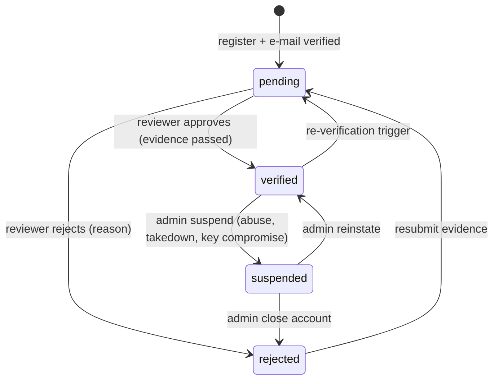

## 18. Plugin Marketplace

The marketplace is how plugins reach panel installs and how third-party developers reach
customers. Four rules from the owner are binding:

1. **Anyone can register as a developer** — self-service sign-up, no invitation.
2. **No developer publishes anything before the vendor verifies them** in the admin backend:
   a human decision recorded with evidence, never automatic.
3. **Plugins reach panels through the marketplace** — WHM Marketplace, Manage Plugins and
   Market Provider Manager are the client; sideloading is a developer-mode escape hatch with a warning.
4. **The panel is resold with the license server** (§16): paid plugins are entitlements on a
   panel license and the package-signing key reaches a panel through license activation.

There is no second packaging or signing scheme: a marketplace package **is** a `.whmplugin` as
`server/src/services/plugins.js` installs it, and the marketplace signature **is** its `SIGNATURE.json`.

### 18.1 Positioning & deployment

`hub/marketplace/` is co-deployed with `hub/license/` (§16.1) as **one** Node 22 + Express 4 +
SQLite (WAL) process, `whm-hub`, in the npm workspace `@whm/hub`:

```
hub/
├── package.json                 @whm/hub  (deps: express, better-sqlite3, zod, helmet, express-rate-limit, bcryptjs, otplib, pino)
├── src/index.js                 bootstrap: config → open both DBs → migrate → services → one Express app → HTTPS :7443
├── src/app.js                   helmet, rate limits, api-key / portal-session auth, zod validate(), {data,meta}/{error} envelopes
├── shared/                      used by both halves: db.js (open/migrate), crypto.js (AES-256-GCM, bcrypt, token hashes),
│                                canonical.js (JCS, §16.4), keys.js (Ed25519 sign/verify, kid), auth.js (api keys, portal sessions, scopes),
│                                mailer.js, webhooks.js, scheduler.js, audit.js
├── license/                     §16 (routes/public.js reseller.js admin.js, services/*)
├── marketplace/
│   ├── migrations/001_marketplace.sql …
│   ├── services/ developers.js verification.js keys.js submissions.js scanner.js review.js catalog.js
│   │             distribution.js entitlements.js billing.js revocations.js signing.js stats.js
│   └── routes/ public.js developer.js admin.js
└── ui/                          React (Vite) admin portal + developer portal (§18.7)
```

| Item | Value |
|---|---|
| Service / user / DBs | `whm-hub.service`, `User=whmhub`; one unit serves `/v1/*` (license) and `/v1/market/*`, `/v1/dev/*`, `/v1/admin/market/*`; `/var/lib/whm-hub/license.db` (§16.3) + `marketplace.db`, cross-domain reads only through in-process services (`ctx.licenses.verifyToken`, `ctx.licenses.get`) |
| Packages | `/var/lib/whm-hub/packages/<plugin_id>/<version>.whmplugin` (`0640 whmhub`), served only through signed download URLs |
| Config | `/etc/whm-hub/hub.conf` adds `marketplace: { public_url, packages_dir, max_package_bytes (20 MiB), download_url_ttl_s (900), scan: { av_command }, review: { require_two_reviewers_for_critical } }` |
| Signing keys | `/etc/whm-hub/keys/<kid>.ed25519`, `signing_keys.purpose ∈ { license, plugin }`; the **plugin** key is the online key that signs `SIGNATURE.json` |
| Panel client | `server/src/services/marketplace-client.js` + `routes/marketplace.js` (§18.6); configured through the existing `whm-hub` row of `market_providers` (`ctx.market.hub()` → `{ enabled, url, licenseKey }`) |

Panel ↔ hub transport is §16.6's: `POST` JSON with `X-WHM-Nonce`/`X-WHM-Timestamp`, every hub
response signed (`X-WHM-Signature: kid=…,sig=…` over the canonical body echoing the nonce). `GET`
catalog reads are public and unsigned; everything the panel *acts on* (download descriptors,
revocation feed, entitlement answers) is signed.

### 18.2 Developers: registration & verification

Registration is open; publishing is gated by `developers.status = 'verified'`.

```sql
developers(id, email UNIQUE, email_verified_at, password_hash, totp_secret_enc, totp_enabled,
           display_name, slug UNIQUE,                       -- public vendor name, e.g. "acme-hosting"
           company, website, country, support_email, support_url,
           status,                                          -- pending|verified|rejected|suspended
           status_reason, verified_at, verified_by, reverify_due_at,
           namespaces_json,                                 -- ["net.acme", "com.acme-hosting"] reverse-DNS prefixes this developer owns
           payout_json_enc,                                 -- Stripe Connect / IBAN details, encrypted
           created_at, updated_at)
developer_verifications(id, developer_id, method,           -- dns_txt|well_known|github_org|id_document
           evidence_json,                                   -- {"domain":"acme.example","token":"whm-dev-…"} | {"org":"acme"} | {"file_id":…}
           result,                                          -- pending|passed|failed|expired
           checked_at, reviewer_id, reviewer_note, created_at)
developer_keys(id, developer_id, kid UNIQUE, public_key_pem, label,
           status, created_at, revoked_at, revoked_reason)  -- active|revoked
developer_sessions(sid PRIMARY KEY, developer_id, data, expires_at)
developer_api_keys(id, developer_id, name, key_hash, scopes_json, last_used_at, expires_at)
```

**Sign-up → verification → publishing**

1. `POST /v1/dev/register { email, password, display_name }` → `202`; mail with a 24 h
   verification link; the account exists but `status = 'pending'`.
2. Developer completes the profile, claims one or more **namespaces** (`net.acme`) — plugin ids
   must start with a claimed namespace (SDK `ID_PATTERN`, ≥ 3 segments), so `net.whm.*` and
   `net.example.*` are reserved for the vendor and the SDK fixtures.
3. Developer **registers an Ed25519 signing key** (PEM SPKI); `kid` = first 8 hex of
   `sha256(raw 32-byte public key)` (§16.4 rule). Every upload carries a `DEV-SIGNATURE.json`
   from an active key (§18.3): proof of possession and the trail from a version to a person.
4. Developer attaches **evidence** per claimed namespace: DNS `TXT _whm-dev.<domain>` =
   `whm-dev-verify=<token>` **or** `https://<domain>/.well-known/whm-developer.txt`; optionally
   a GitHub organisation link (OAuth, org membership) and an ID document (encrypted, deleted
   30 days after the decision). Automated checks set `result = passed|failed` — inputs, not the decision.
5. The request lands in the **admin verification queue**; a vendor reviewer approves
   (`verified`, `reverify_due_at = +12 months`) or rejects with a structured reason
   (`duplicate_identity`, `evidence_failed`, `namespace_conflict`, `policy`, text); every
   transition is an `audit_log` row and a mail.
6. **Re-verification triggers**: `reverify_due_at`; e-mail or payout details changed; a key
   revoked for compromise; a takedown or 2 rejections in 90 days; monthly namespace re-check
   fails. While pending, the developer may *upload* but not *publish*.
7. **Suspension** (admin, with reason) freezes publishing and hides unpublished versions;
   published versions stay installable unless separately revoked (§18.4).



Notification mails (`shared/mailer.js`, templated, no secrets): `dev.email_verify`, `dev.verification_received`,
`dev.verified`, `dev.rejected`, `dev.reverify_due`, `dev.suspended`, `dev.key_added`, `dev.submission_*` (§18.3), `dev.payout_*` (§18.5).

### 18.3 Submission pipeline

```sql
plugins(id PRIMARY KEY,                                     -- the manifest id (reverse-DNS, SDK ID_PATTERN)
        developer_id, name, slug UNIQUE, summary, description_md, category_id, keywords_json,
        homepage, support_url, license_spdx, icon_file_id,
        pricing_json,                                       -- {"model":"free"} | {"model":"one_time","cents":2900,"currency":"USD"} | {"model":"subscription","cents":500,"interval":"month","trial_days":14}
        status,                                             -- draft|listed|unlisted|removed
        latest_stable_version, latest_beta_version, install_count, rating_avg, rating_count,
        created_at, updated_at)
plugin_versions(id, plugin_id, version,                     -- semver; UNIQUE(plugin_id, version)
        channel,                                            -- stable|beta
        status,                                             -- uploaded|scanning|scan_failed|in_review|changes_requested|approved|published|rejected|yanked|revoked
        manifest_json, permissions_json, engines_whm,       -- copied from plugin.json at upload
        permission_justifications_json,                     -- {"agent:op:web.wp.update":"runs wp-cli for updates", …}
        changelog_md, package_sha256, package_bytes, extracted_bytes,
        package_digest,                                     -- hex of packageDigest(dir) — what SIGNATURE.json signs
        dev_kid, dev_signature,                             -- from DEV-SIGNATURE.json, verified at upload
        mkt_kid, mkt_signature, signed_at,                  -- SIGNATURE.json written by the hub on approval
        scan_report_json, review_id, published_at, yanked_at, yanked_reason, created_at)
plugin_files(id, version_id, path, sha256, bytes)           -- canonical file list (the lines packageDigest hashes)
plugin_assets(id, plugin_id, kind, file_id, position)       -- screenshot|icon|banner
reviews(id, version_id, reviewer_id, state,                 -- open|approved|changes_requested|rejected
        checklist_json, reasons_json, notes_md, diff_base_version_id, decided_at)
```

**Upload** — `POST /v1/dev/plugins/:id/versions` (raw `.whmplugin`, max 20 MiB) from a
*verified* developer whose namespace covers `:id`; others get `403 developer_not_verified` /
`403 namespace_not_owned`. The package must be exactly what the host accepts: gzip tar with
`plugin.json` and `main.js` at the root (one wrapper directory tolerated), entry names free of
whitespace/control characters, no links or devices, ≤ 50 MiB extracted. It must contain
`DEV-SIGNATURE.json`:

```json
{ "kid": "3f9a1c77", "alg": "ed25519", "sig": "<base64>" }
```

`sig` is an Ed25519 signature over `packageDigest(dir)` computed **with both**
`SIGNATURE.json` and `DEV-SIGNATURE.json` excluded (the host's function with one more
exclusion; `scripts/build-plugin.js --sign` produces it). The hub later writes
`SIGNATURE.json` over the digest the host computes (everything except `SIGNATURE.json`, so the
developer's signature file is itself covered), which is why a published package verifies on a
panel byte-for-byte with the committed host code and no host change.

**Automated checks** (`services/scanner.js`, run as a hub job; any failure → `scan_failed`
with the report attached):

| Check | Rule |
|---|---|
| Manifest | `validateManifest()` from `plugins/sdk/validate-manifest.js` must return `ok`; `id` equals `:id`; `version` is new and greater than every published version on the channel |
| Engines | `engines.whm` must intersect the hub's supported host range (`HOST_API_VERSION` list in config; today `1.0.0`) |
| Developer signature | `DEV-SIGNATURE.json` verifies against an *active* key of this developer |
| Static scan | tokenised walk of every `.js` file: `require(` of anything outside the host allow-list (`child_process`, `fs`, `net`, `http`, `vm`, `worker_threads`, `module`…) → **reject**; `eval`, `new Function`, `Function(`, `constructor.constructor`, `process.`, `globalThis`, `import(`, `WebAssembly` → **reject** (the host already disables them; a package that contains them is either broken or hostile); `fetch(` or URL literals without a matching `net:outbound:` scope → **flag**; `ctx.agent.op('x.y')` literal not covered by a declared `agent:op:x.y` → **flag** |
| Permissions | every declared scope must have a justification (≥ 20 chars); `accounts:write`, `backups:restore`, any `agent:op:*` and `net:outbound:*` mark the version **high-risk** (two reviewers) |
| Size & deps | ≤ 20 MiB packed / 50 MiB extracted / 2 000 entries; no `node_modules/` with native binaries (`.node`), no minified bundles over 1 MiB without a source map |
| Secrets | regexes for private keys, AWS/GCP/Stripe tokens, `password=` literals → **reject** |
| AV | optional `clamscan --no-summary <dir>` hook (`scan.av_command`) → **reject** on hit |
| Identity | typosquat check: Damerau-Levenshtein ≤ 2 against every listed plugin `name`/`slug`/`id` owned by another developer → **flag**; a name containing `whm`, `cpanel`, `official` → **flag** |

**Human review** (`services/review.js`, admin portal): the queue shows the scan report, the
manifest, the **diff since the last published version** (file list + unified diff of text
files from `plugin_files`), the permission list with justifications and *new* scopes
highlighted, screenshots, changelog and the developer's history. Outcomes:

- **approve** → `services/signing.js` writes `SIGNATURE.json` `{ kid: <plugin signing kid>,
  alg: "ed25519", sig }` over the host digest, repacks the tarball (file order sorted, mtime 0,
  mode 0644), records `package_sha256`, `mkt_kid`, `mkt_signature` → `approved`.
- **publish** (developer or reviewer, after approval) → `published` on `channel`
  (`stable`/`beta`); `plugins.latest_*_version` updated; the update feed (§18.4) carries it.
- **changes_requested / rejected** → structured `reasons_json`
  (`[{ code: "undeclared_permission", path: "main.js:88", text: "…" }]`); the developer
  resubmits as a **new** version — uploaded bytes are immutable.


**Versioning & lifecycle.** Semver, one `channel` per version; a panel on `beta` sees both.
Yank = hide + stop new installs (developers may yank their own); **revoke** = admin only, with
reason + severity, propagated through the revocation feed; **takedown** = whole plugin removed,
every version revoked, developer suspended pending review. **Emergency kill-switch**:
`POST /v1/admin/market/revocations/kill-switch { plugin_id, version: null, severity: "critical",
action: "disable" }` also puts `{ code: "plugin_revocations_pending" }` into the `messages` of
every activation's next license check-in (§16.6), so panels pull the feed within one check-in.

### 18.4 Catalog & distribution

```sql
categories(id, slug UNIQUE, name, position)                 -- Security, Backups, WordPress, Monitoring, Mail, DNS, Developer tools, Billing, Other
plugin_reviews(id, plugin_id, license_id, customer_id, rating 1..5, title, body,
        status,                                             -- pending|published|hidden
        moderated_by, created_at)                           -- one per license per plugin; only licenses with an install may review
downloads(id, version_id, license_id NULL, activation_id NULL, ip_hash, panel_version, ts, result)
installs(id, plugin_id, license_id, activation_id, version, state,   -- installed|enabled|disabled|uninstalled|revoked
        first_seen, last_seen)                              -- reported by check-in usage (counts only)
revocations(id, plugin_id, version NULL, severity,          -- info|warning|critical
        action,                                             -- disable|uninstall
        reason, revoked_by, ts)
signing_keys(kid PRIMARY KEY, purpose, public_key, created_at, retired_at, status)   -- shared with §16.3; purpose license|plugin
audit_log(id, ts, principal, role, ip, action, target, args_redacted, result)      -- same shape as the panel's
```

**Public catalog API** (`routes/public.js`, no auth, per-IP rate limits, ETag/`Cache-Control`):

| Method & path | Returns |
|---|---|
| `GET /v1/market/catalog?q=&category=&channel=stable&page=&pageSize=&sort=installs|rating|updated` | `{ data: [ { id, name, slug, summary, developer: { slug, display_name, verified: true }, category, pricing, latest: { version, published_at, engines_whm }, install_count, rating_avg, rating_count, icon_url } ], meta }` |
| `GET /v1/market/categories` | categories with counts |
| `GET /v1/market/plugins/:id` | detail: description, screenshots, permissions **with SDK descriptions and justifications**, compatibility (`engines_whm` vs `?host=1.0.0`), versions (stable/beta), changelog, moderated reviews, developer card |
| `GET /v1/market/plugins/:id/versions` | `[ { version, channel, published_at, engines_whm, package_sha256, package_bytes, permissions } ]` |
| `POST /v1/market/download` | signed download descriptor (below) |
| `GET /v1/market/updates?installed=<id>@<ver>,…&host=1.0.0&channel=` | `[ { id, current, latest, channel, security: bool, changelog_url } ]` |
| `GET /v1/market/revocations?since=<unix>` | signed `{ data: [ { id, plugin_id, version, severity, action, reason, ts } ], meta: { now } }` |
| `GET /v1/market/keys` | `{ keys: [ { kid, pub, purpose: "plugin", status } ] }` — informational; panels pin keys from activation (§18.6) |

**Download descriptor** — the only path to package bytes:

```http
POST /v1/market/download
{ "plugin_id":"net.acme.cache-boost", "version":"2.1.0", "token":"WHMT1.…", "fingerprint":"sha256:…",
  "panel_version":"1.4.2", "host_api":"1.0.0", "nonce":"n_…", "ts":1761350400 }
→ 200 { "data": { "url":"https://hub.vendor.example/v1/market/packages/dl_01JB…?sig=…&exp=1761351300",
         "sha256":"9c3e…", "bytes":1048576, "kid":"7b2d4e10", "expires_at":"2026-10-25T00:15:00Z",
         "entitlement": { "kind":"one_time", "status":"active" } }, "meta": { "nonce":"n_…" } }
→ 402 { "error": { "code":"entitlement_required", "message":"cache-boost is a paid plugin", "pricing":{…}, "buy_url":"…" } }
→ 403 { "error": { "code":"feature_required", "message":"Your Solo license does not include paid plugins", "feature":"marketplace_paid" } }
→ 410 { "error": { "code":"version_revoked", "reason":"…" } }
```

The hub verifies `token` with its own license keys (§16.4; `status ∈ active|grace`), applies
`feat.marketplace_free` / `feat.marketplace_paid`, checks the entitlement (§18.5) for paid
plugins, logs a `downloads` row and returns a 15-minute HMAC-signed URL for the
**already-signed** package file. Trials (§16.2) may download free plugins only.

**Usage & reviews.** A panel's §16.6 check-in `usage` grows a `plugins` entry
(`[ { "id", "version", "state" } ]`, ids and versions only); the hub upserts `installs`, the source
of install counts. Reviews come from the panel (`POST /v1/market/plugins/:id/reviews` with the
token) by a license holding an `installs` row, stay `pending` until moderated; developers reply once.

### 18.5 Monetisation

```sql
entitlements(id, license_id, customer_id, plugin_id, kind,  -- free|one_time|subscription|trial
        status,                                             -- active|expired|cancelled|refunded
        starts_at, expires_at NULL, purchase_id, source,    -- checkout|admin|reseller|trial
        created_at, updated_at)
purchases(id, customer_id, license_id, plugin_id, kind, amount_cents, currency, tax_cents,
        provider, external_id UNIQUE,                       -- stripe|paddle|whmcs + their id (idempotent, like billing_events)
        status,                                             -- paid|refunded|chargeback|cancelled
        revenue_share_pct, developer_cents, vendor_cents, paid_at, refunded_at)
payouts(id, developer_id, period_start, period_end, gross_cents, refunds_cents, share_pct,
        net_cents, currency, status,                        -- pending|approved|paid|failed|held
        provider_ref, statement_json, created_at, paid_at)
```

- **Models**: `free`; `one_time` per license (follows the license through transfers,
  §16.6); `subscription` (monthly/annual) with an optional `trial_days` trial entitlement,
  one per license per plugin. Prices are set by the developer in the vendor's currency
  list; the vendor may mark a plugin *featured* or *bundled with an edition*
  (`entitlements.source = admin`, e.g. Enterprise includes everything).
- **Checkout**: the panel opens `buy_url` (hub portal, logged in as the customer via the §16
  portal or a magic link mailed to `customers.email`); payment through the same inbound billing
  connectors as §16.7 (`POST /v1/admin/billing/webhooks/:source`, idempotent on
  `external_id`); a paid event creates `purchases` + `entitlements` and the panel's next
  download request succeeds. Resellers can grant entitlements to their own customers'
  licenses within a plugin-level wholesale price (`resellers.pricing_json.plugins`).
- **Revenue share**: `developers`-level default 70/30 (`config.marketplace.revenue_share_pct`),
  overridable per developer by the vendor; computed per purchase and frozen on the row.
- **Payouts**: monthly job `payouts-close` aggregates paid minus refunded purchases per
  developer, holds amounts under the minimum (`payout_min_cents`) or when the developer is
  not `verified`, and marks `pending`; a vendor admin approves and pays through Stripe
  Connect/manual transfer, recording `provider_ref`; the developer portal shows statements.
- **Refunds / chargebacks**: provider event → `purchases.status`, entitlement `refunded`,
  the version stays installed but further downloads/updates return `402`; chargebacks also
  count towards the customer's abuse score. Developer share of a refunded purchase is clawed
  back from the next payout.
- **Panel enforcement** (`requireFeature('marketplace_paid')`, §16.8) gates only the *install*
  of paid plugins; a downgrade never disables what is installed (§16: license state never touches the host).

### 18.6 Panel integration (`server/src/services/marketplace-client.js`)

```sql
-- migration 032_marketplace.sql (panel)
marketplace_installs(plugin_id PRIMARY KEY, version, channel, package_sha256, hub_kid,
        consented_permissions_json, consented_by, consented_at, installed_at, updated_at)
marketplace_revocations(id PRIMARY KEY, plugin_id, version, severity, action, reason, ts,
        applied_at, acknowledged_by)
marketplace_state(id PRIMARY KEY CHECK(id=1), last_catalog_sync_at, last_revocation_ts, last_update_check_at, pending_updates_json)
```

- **Configuration** is the existing `whm-hub` row of `market_providers` (adapter `hub`; URL and
  optional license key validated by `market-adapters.js`); the client reads `ctx.market.hub()`
  and the token from `ctx.license.get()` (§16.8). Row disabled → the WHM Marketplace page shows
  the static catalog (`services/server-configuration.marketplace.json`) as today; enabled → the
  hub catalog (`GET /api/marketplace/catalog`) with the static entries under "Distribution packages".
- **Key pinning**: §16.6 `/v1/activate` and `/v1/checkin` responses carry
  `data.plugin_signing_keys: [ { kid, pub, status } ]`; the response is signed with a license key
  pinned at build time, so `license.js` may write each active key to
  `$WHM_DATA_DIR/plugin-keys/<kid>.pub` (PEM SPKI, `0640`), remove retired ones, and record
  them as `source = hub` in `license_state.payload_json`. Operator-added keys are never touched.
- **Install flow** (`POST /api/marketplace/install` → `202 { job }`, type `marketplace.install`):
  `POST /v1/market/download` → fetch the signed URL into `$WHM_DATA_DIR/marketplace/cache/
  <id>-<version>.whmplugin` (20 MiB, 60 s, https only) → `sha256` equals the descriptor →
  `ctx.plugins.install({ buffer, source: 'marketplace' }, { user, req, policy: { requireSigned:
  true, signers: hubKids } })` — an additive host option: a valid `SIGNATURE.json` from a listed
  kid is required **regardless of** `plugins.require_signature` → engine check (host:
  `incompatible_host`) → the job stops at `pending_consent` unless the request carried
  `consent.permissions` equal to the version's declared list; the **consent screen** (scopes
  with SDK descriptions, developer justifications, the in-process trust notice) re-posts with
  consent → `enable` → `marketplace_installs` row. Updates that add scopes re-prompt.
- **Browse / search / update / uninstall**: Manage Plugins gains a **Marketplace** tab
  (catalog grid, search, category filter, detail drawer with permissions, versions, reviews,
  Install/Update/Uninstall buttons wired to the manage API); the WHM Marketplace page is the
  same component without the management actions for resellers. `GET /api/marketplace/updates`
  (daily scheduler `marketplace-update-check`) feeds a dashboard notice and the
  `plugin.update_available` Contact Manager event.
- **Developer-mode sideload** stays `POST /api/plugins/manage/install` (raw body / `{ path }`),
  with its `warnings: ['unsigned', 'in-process']` and the trust notice; once the hub row is
  enabled, unsigned uploads also need `plugins.developer_mode = true` (default `false`); such
  plugins are labelled *Sideloaded* and excluded from marketplace updates.
- **Revocation enforcement**: scheduler job `marketplace-revocations` every 6 h (and on the
  check-in message `plugin_revocations_pending`) pulls `GET /v1/market/revocations?since=
  last_revocation_ts`, verifies the signature with the pinned hub kid, and per matching
  `marketplace_installs` row runs `ctx.plugins.disable(id)` (`action = disable`) or
  `ctx.plugins.uninstall(id, { purge: false })`; writes `marketplace_revocations`, `audit_log`
  (`plugin.revoked`), `ctx.contacts.notify('plugin.revoked')` and a persistent red banner until
  root acknowledges it. Re-enabling a revoked plugin requires `plugins.developer_mode`.
- **Degraded license** (§16.8): browsing works; install/update answer `423 license_degraded`.

### 18.7 Admin backend & developer portal screens (`hub/ui`)

| Portal | Screens |
|---|---|
| **Vendor admin** | Dashboard (verification queue size, review queue by risk, downloads/day, revenue, revocations); **Developer verification queue** (evidence results, documents, approve/reject with reasons, re-verify, suspend); Developers (search, keys, namespaces, payouts, history); **Plugin review queue** (scan report, diff, permissions, approve/request changes/reject, two-reviewer gate for high-risk); Catalog (listed/unlisted/featured, categories, bundles per edition); **Revocations & takedowns** (create, severity, kill-switch, propagation status from `installs.last_seen`); Entitlements & purchases (search by license prefix, grant, refund); Payouts (close period, approve, mark paid); Reviews moderation; Signing keys (`purpose = plugin` rotation); Audit |
| **Developer** | Register / verify e-mail / profile / 2FA; Verification (claim namespaces, evidence instructions, status); Signing keys (add PEM, revoke); Plugins (create listing, assets, pricing); Versions (upload, scan report, review status + reasons, publish to stable/beta, yank); Stats (installs, downloads, ratings, revenue); Payouts & statements; API keys & webhooks |

### 18.8 REST endpoint tables

**Developer API** (`/v1/dev/*`; session + TOTP from the portal, or `developer_api_keys` with scopes
`plugin:read plugin:write version:upload version:publish stats:read webhook:write`; rows filtered by
`developer_id`):

| Method & path | Function |
|---|---|
| `POST /v1/dev/register` · `POST /v1/dev/verify-email` · `POST /v1/dev/login` · `/logout` · `/2fa/*` | account |
| `GET/PATCH /v1/dev/profile` · `POST /v1/dev/namespaces` · `DELETE …/:ns` | profile, namespace claims |
| `GET/POST /v1/dev/verification` · `POST /v1/dev/verification/:id/recheck` | evidence submission, automated re-check |
| `GET/POST /v1/dev/keys` · `POST /v1/dev/keys/:kid/revoke` | signing keys |
| `GET/POST /v1/dev/plugins` · `GET/PATCH /v1/dev/plugins/:id` · `POST …/assets` · `DELETE …/assets/:aid` | listings |
| `POST /v1/dev/plugins/:id/versions` (raw) · `GET …/versions` · `GET …/versions/:v` (scan report, review) · `POST …/versions/:v/publish { channel }` · `POST …/versions/:v/yank { reason }` | submission pipeline |
| `GET /v1/dev/plugins/:id/stats?from=&to=` · `GET /v1/dev/payouts` · `GET /v1/dev/payouts/:id/statement.csv` | stats, money |
| `GET/POST/DELETE /v1/dev/api-keys` · `GET/POST/DELETE /v1/dev/webhooks` | integration |

**Admin API** (`/v1/admin/market/*`; vendor portal session + TOTP, or `api_keys` with
`owner_type = vendor` and scopes `market:review market:verify market:revoke market:billing
market:read`):

| Method & path | Function |
|---|---|
| `GET /v1/admin/market/verifications?status=` · `POST …/:id/approve` · `/reject { code, text }` · `/request-evidence` | developer verification queue |
| `GET /v1/admin/market/developers` · `PATCH …/:id` · `POST …/:id/suspend` · `/reinstate` · `/reverify` · `PUT …/:id/revenue-share` | developers |
| `GET /v1/admin/market/reviews?risk=` · `GET …/:id` (scan, diff, manifest) · `POST …/:id/approve` · `/request-changes` · `/reject` | plugin review queue |
| `GET/PATCH /v1/admin/market/plugins/:id` (`status`, `featured`, `category`) · `POST …/takedown` | catalog control |
| `GET/POST /v1/admin/market/revocations` · `POST …/kill-switch` | revocations, emergency |
| `GET/POST /v1/admin/market/entitlements` · `POST …/:id/cancel` · `GET /v1/admin/market/purchases` · `POST …/:id/refund` | money in |
| `GET /v1/admin/market/payouts` · `POST …/close` · `POST …/:id/approve` · `/mark-paid` · `/hold` | money out |
| `GET /v1/admin/market/plugin-reviews?status=pending` · `POST …/:id/publish` · `/hide` | review moderation |
| `GET/POST /v1/admin/market/categories` · `GET /v1/admin/market/stats` · `GET /v1/admin/market/audit` | misc |
| `GET/POST /v1/admin/signing-keys` (`purpose`) · `POST …/:kid/retire` | shared with §16.7 |

**Developer webhooks** (same HMAC header and retry schedule as §16.7): `version.scan_completed`,
`version.review_decided`, `version.published`, `version.revoked`, `developer.status_changed`,
`purchase.completed`, `purchase.refunded`, `payout.paid`.

### 18.9 Security

- **Key custody**: the plugin signing private key lives only in `/etc/whm-hub/keys/` (`0600
  whmhub`), never leaves through any route; rotation follows §16.4 (add → distribute via
  activation/check-in ≥ 90 days → activate → retire) so every panel holds a kid before it signs;
  retiring a key never invalidates installed plugins (verification happens at install time).
- **Supply chain**: uploaded bytes are immutable and hashed on arrival; the hub signs only
  what a reviewer approved; the repacked tarball is deterministic and its digest is
  re-verified with the committed host `packageDigest` rule before publishing; a version's
  `package_sha256` is published in the descriptor and the feed, so a tampered mirror fails at
  the panel before the signature is even checked.
- **Developer identity**: e-mail + TOTP (mandatory before publishing), signing key proof of
  possession on every upload, namespace evidence re-checked monthly, ID document optional and
  purged after 30 days, every status change audited with the reviewer id.
- **Abuse controls & rate limits**: registration 5/day per IP + disposable-domain block list;
  uploads 10/day per developer; `POST /v1/market/download` 60/h per activation under the §16.10
  nonce/timestamp rules; catalog reads 600/h per IP; review bursts from one `ip_hash` held;
  two rejected submissions in 90 days → re-verification; chargeback ratio > 2 % suspends paid listings.
- **Data minimisation & hardening**: panels send plugin ids/versions only; `downloads` stores
  `ip_hash`; payout details encrypted; helmet, CSRF, `zod` everywhere, bcrypt + TOTP, TLS only,
  audit of every mutation; §16.11 monitoring plus `scan_queue_age`, `review_queue_age`,
  `revocations_pending`, `signed_downloads_total`.

### 18.10 Tests

The `@whm/hub` suite (node:test, temp SQLite, fixed test key pairs) must cover:

- Developers: register → e-mail verify → profile → namespace claim; publishing refused while
  `pending`; approve/reject/suspend/re-verify transitions with mails + audit rows; `net.acme.x`
  allowed, `net.whm.x` refused; keys: PEM/Ed25519 only, `kid` per §16.4, revoked key refused.
- Upload: the golden `.whmplugin` from `scripts/build-plugin.js --sign` (fixture
  `plugins/sample-plugin`) passes; missing/invalid `DEV-SIGNATURE.json`, tampered file, wrong
  key, size overflow, duplicate/lower version, `engines.whm` mismatch, tar with links or
  absolute paths → the right `422`/`403`.
- Scanner: a fixture per reject rule (`child_process`, `eval`, `new Function`,
  `constructor.constructor`, secret literal) and per flag rule (undeclared `fetch` host,
  undeclared `agent:op`); typosquat distance; AV hook stub.
- Review: diff against the previous version; two-reviewer gate; approve → `SIGNATURE.json`
  with the active plugin kid → **the repacked package installs and verifies on the real panel
  host** (`services/plugins.js` with the hub public key in `plugin-keys/`); reasons shape.
- Catalog/download: search/filter/pagination, compatibility, free download, paid `402`,
  `marketplace_paid` `403`, revoked `410`, signed-URL expiry, `downloads` row, signed body.
- Revocations & money: feed `since` filter + signature, kill-switch → check-in message, yank ≠
  revoke; billing idempotency (`external_id`), one trial per license, refund → `402`, share
  frozen per purchase, payout close/approve/hold.
- Panel client (`server/test/marketplace-client.test.js`, mock hub via `transport.request`):
  key pinning from a signed activation; install job (sha256 → signature → consent → enable);
  unsigned/other-kid package refused with `require_signature` off; consent re-prompt on new
  scopes; revocation poll disables + banner + audit + notify; degraded `423`; hub off → static catalog.
