# Screenshots

Updated 2026-10-26 at commit `83e0595`. All images are captured automatically (Playwright) against the built interface served by the API, and each carries a label bar naming the screen, whether it is live or a placeholder, the date and the commit. They are regenerated at every milestone (`e2e/screenshots.sh`).

- **[Every page →](pages/README.md)** — all 212 function pages grouped by category (196/212 live) plus core pages.

## Flow

Login → dashboard → creating an account through the form → lists, status pages, configuration and search.

<table><tr><td align="center" valign="top" width="33%"><a href="01-login.png">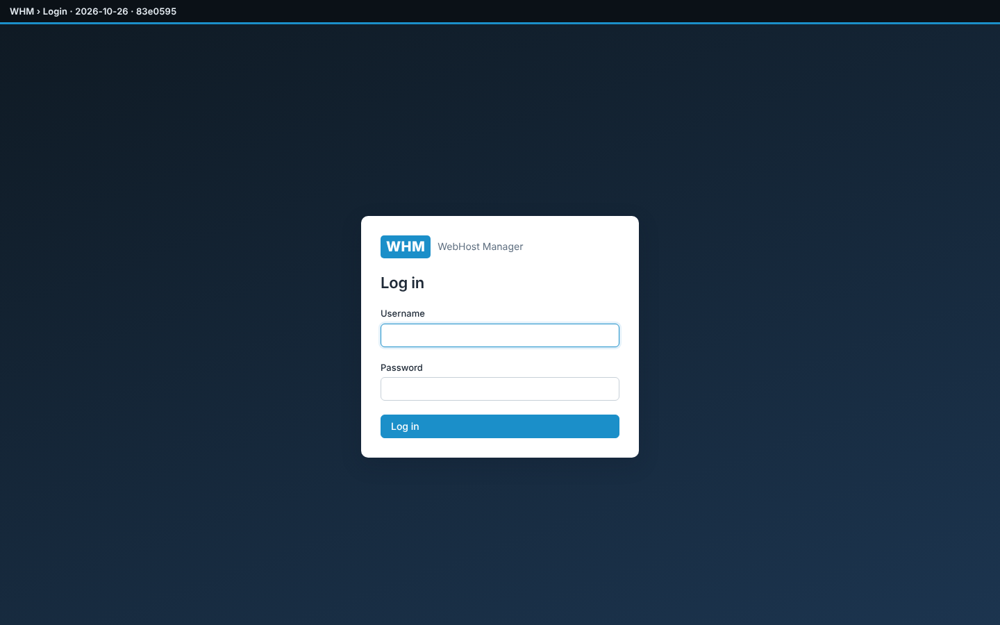</a><br><sub><b>Login</b></sub></td><td align="center" valign="top" width="33%"><a href="02-dashboard.png"></a><br><sub><b>Home dashboard</b></sub></td></tr>
<tr><td align="center" valign="top" width="33%"><a href="02-dashboard-full.png">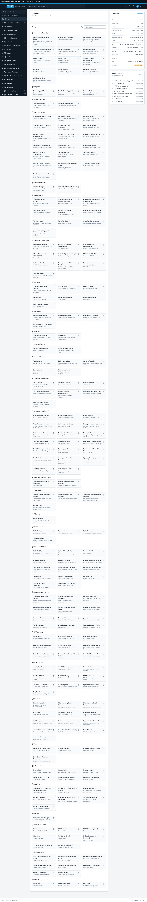</a><br><sub><b>Home dashboard (full page)</b></sub></td><td align="center" valign="top" width="33%"><a href="03-create-account-form.png">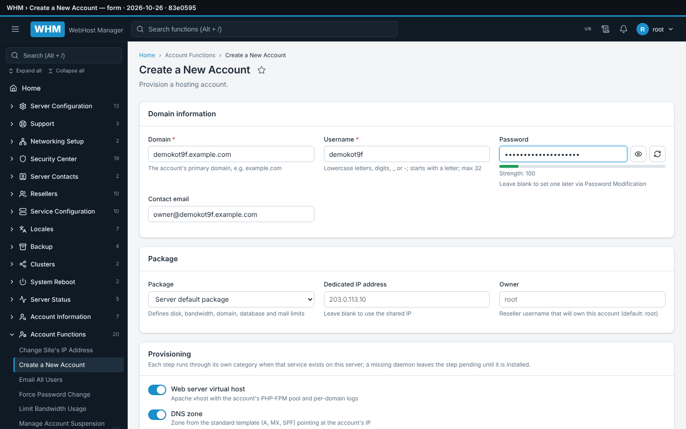</a><br><sub><b>Create a New Account — form</b></sub></td></tr>
<tr><td align="center" valign="top" width="33%"><a href="04-create-account-result.png">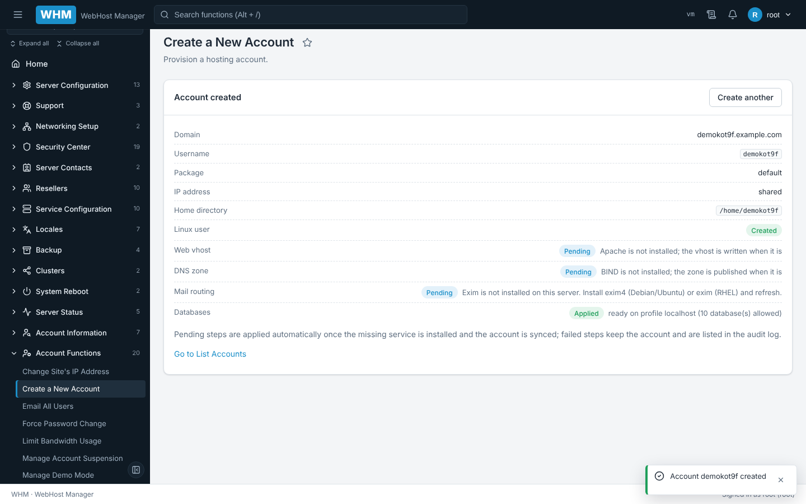</a><br><sub><b>Create a New Account — result</b></sub></td><td align="center" valign="top" width="33%"><a href="05-list-accounts.png">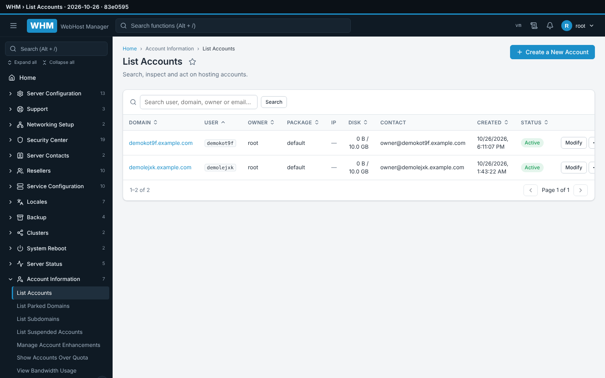</a><br><sub><b>List Accounts</b></sub></td></tr>
<tr><td align="center" valign="top" width="33%"><a href="06-service-status.png">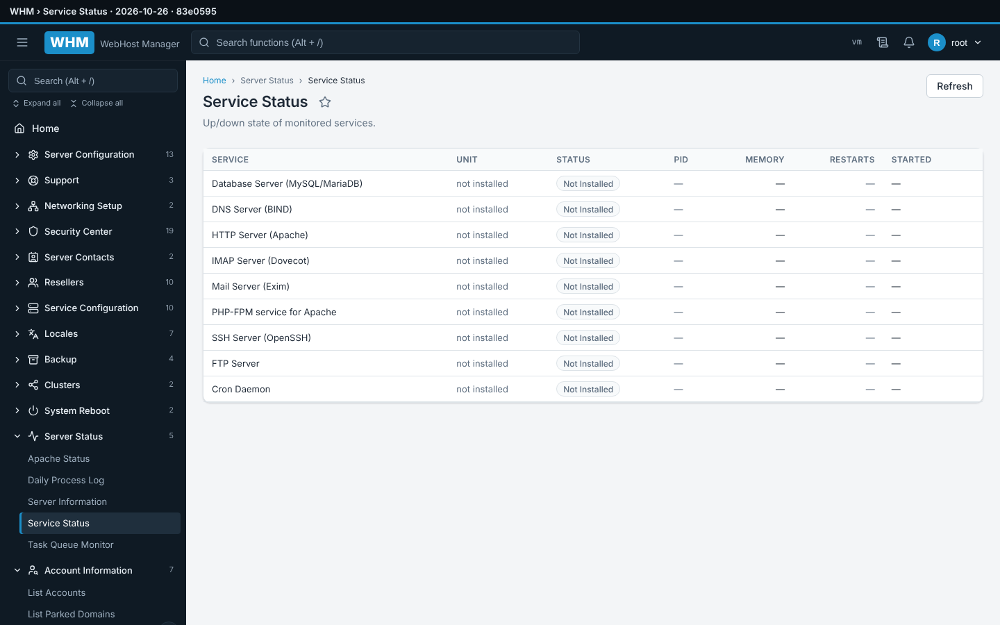</a><br><sub><b>Service Status</b></sub></td><td align="center" valign="top" width="33%"><a href="07-server-information.png">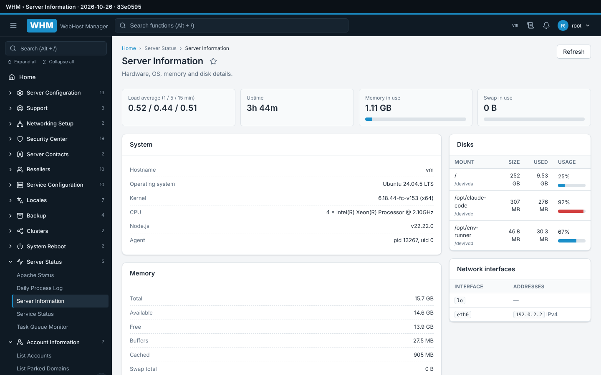</a><br><sub><b>Server Information</b></sub></td></tr>
<tr><td align="center" valign="top" width="33%"><a href="08-feature-manager.png">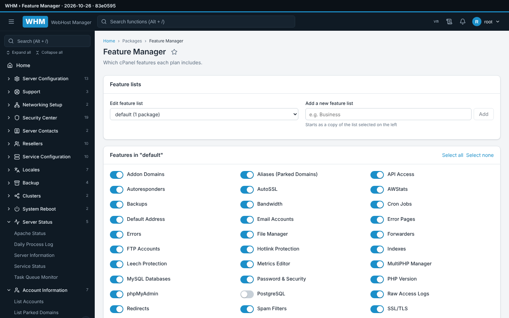</a><br><sub><b>Feature Manager</b></sub></td><td align="center" valign="top" width="33%"><a href="09-tweak-settings.png">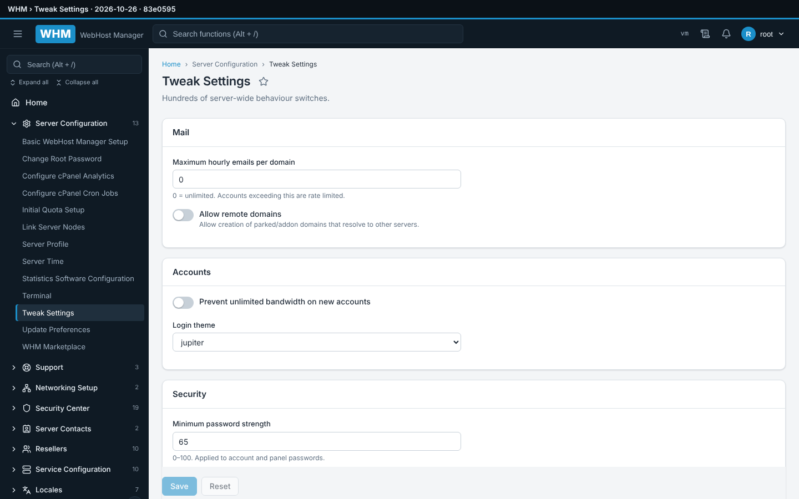</a><br><sub><b>Tweak Settings</b></sub></td></tr>
<tr><td align="center" valign="top" width="33%"><a href="10-generic-function-page.png"></a><br><sub><b>Placeholder for a not-yet-built function</b></sub></td><td align="center" valign="top" width="33%"><a href="11-sidebar-search.png">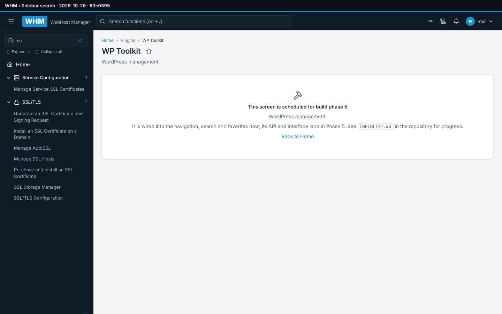</a><br><sub><b>Sidebar search</b></sub></td></tr>
<tr><td align="center" valign="top" width="33%"><a href="12-top-search.png">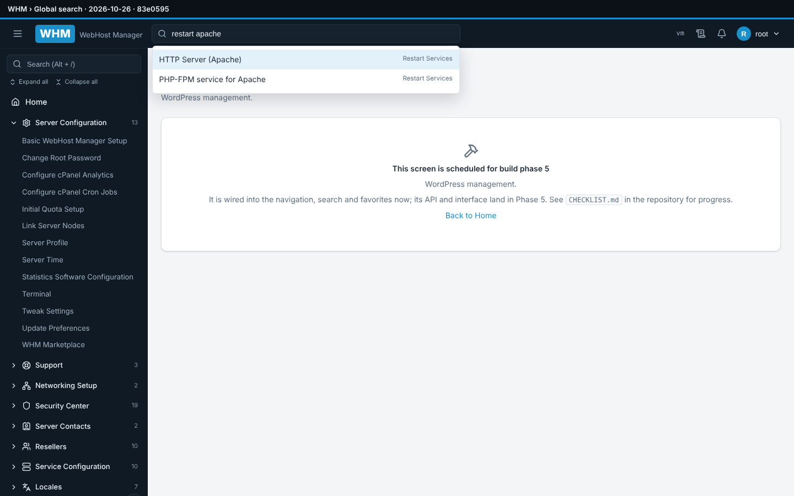</a><br><sub><b>Global search</b></sub></td><td align="center" valign="top" width="33%"><a href="13-restart-service.png">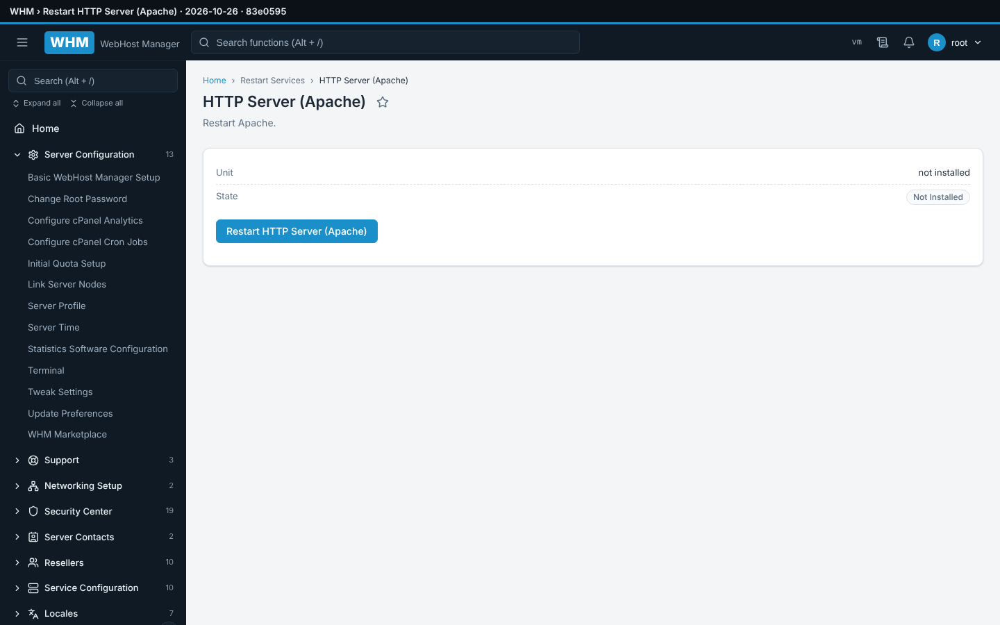</a><br><sub><b>Restart HTTP Server (Apache)</b></sub></td></tr>
<tr><td align="center" valign="top" width="33%"><a href="14-process-manager.png">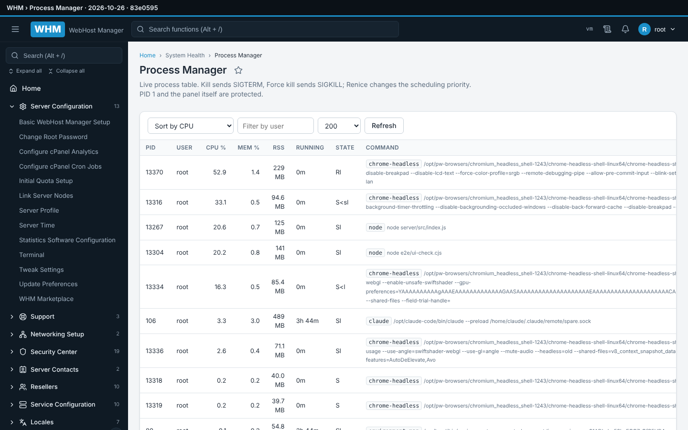</a><br><sub><b>Process Manager</b></sub></td></tr></table>

## Regenerate

```bash
BASE=http://127.0.0.1:2086 PASSWORD='<root password>' bash e2e/screenshots.sh   # flow shots + every page + galleries
```
